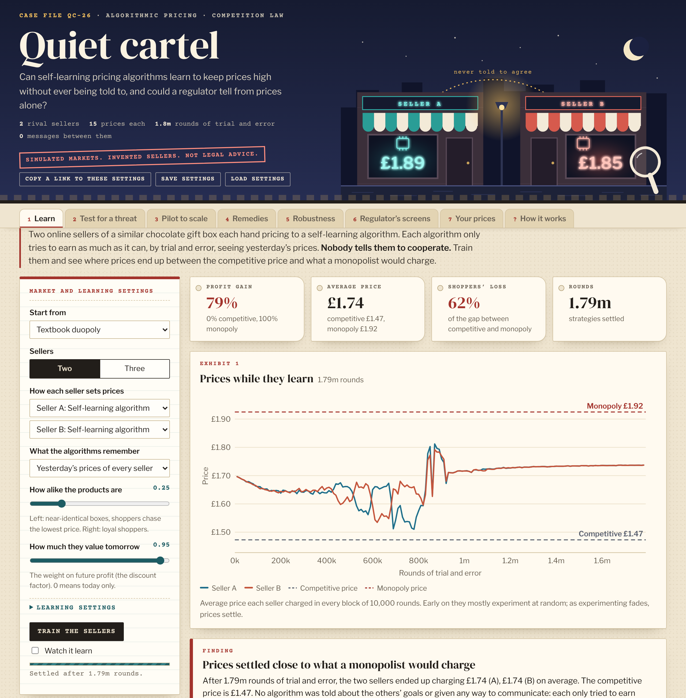
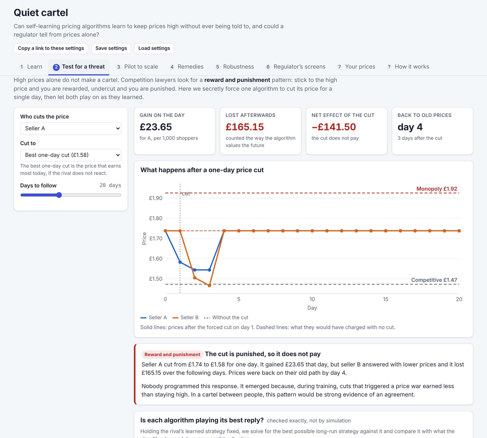
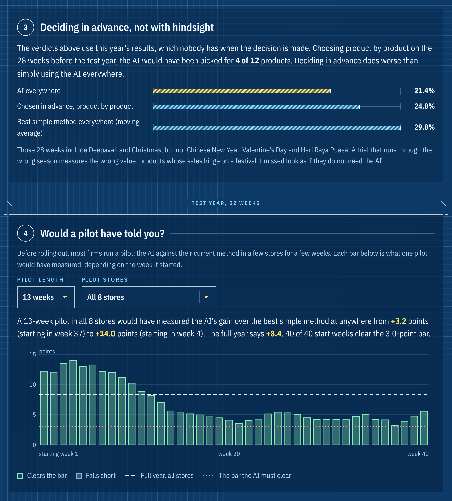
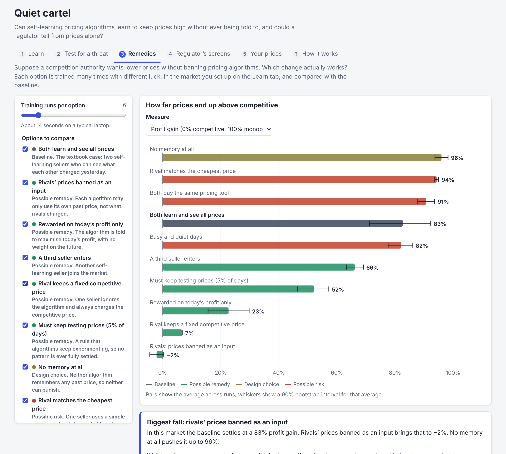
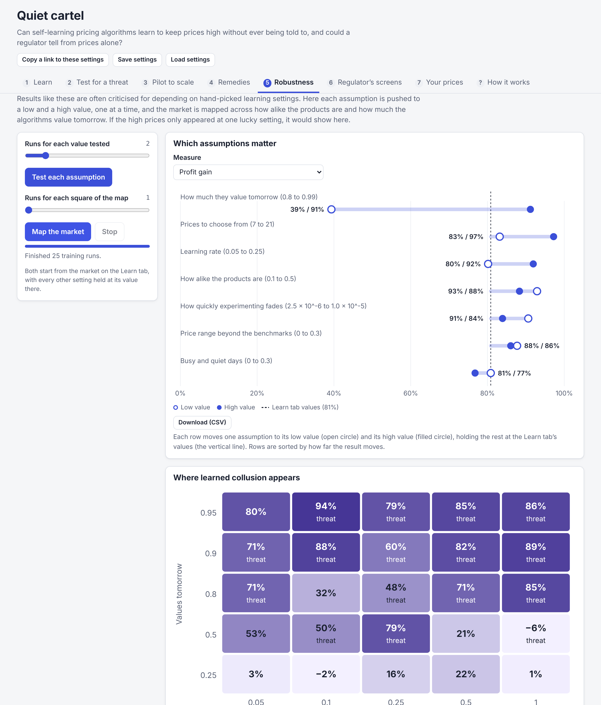
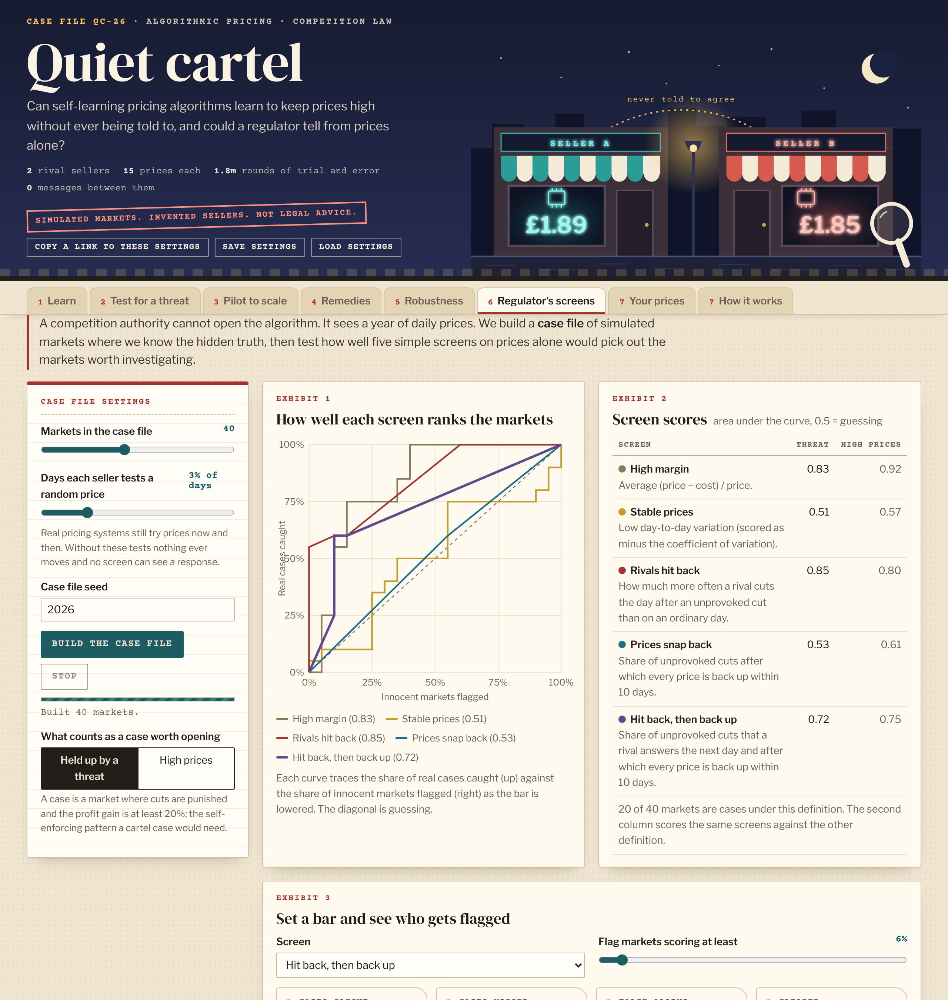
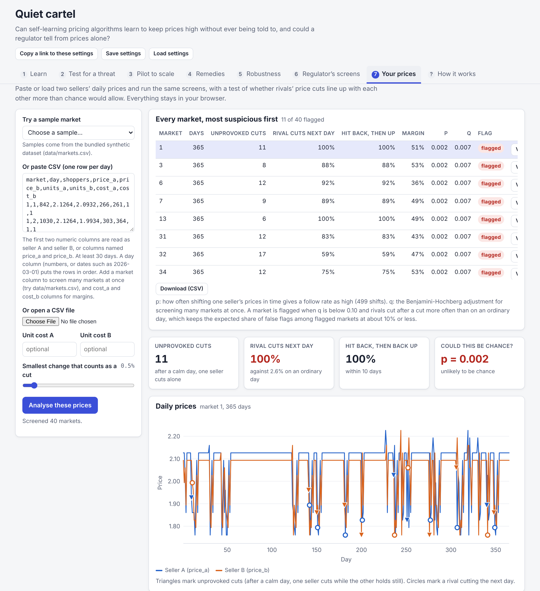
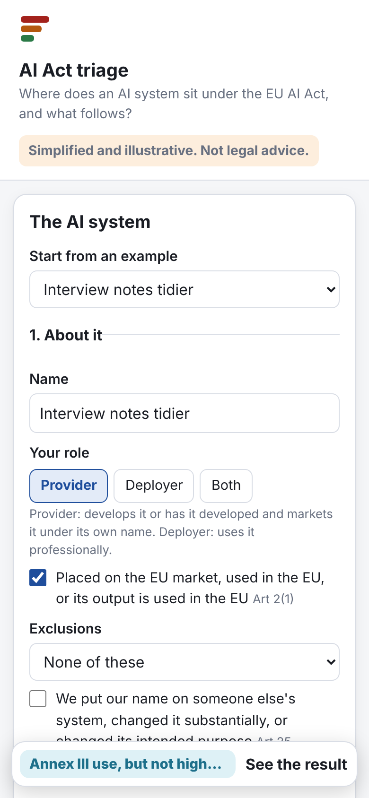

# Quiet cartel

**Can two pricing algorithms learn to keep prices high without ever being told to, and could a regulator tell?**

Quiet cartel is a laboratory for one of the stranger questions in competition policy. Two invented online sellers of a similar chocolate gift box each hand their pricing to a self-learning algorithm. Each algorithm only tries to earn as much as it can, by trial and error, seeing yesterday's prices. Nobody tells them to cooperate and they have no way to talk. Do prices end up competitive, or somewhere near what a monopolist would charge? If they end up high, is anything holding them there? Which rule changes would bring them down? And could a competition authority, which only ever sees prices, pick out the markets worth investigating?

There are two versions, built on the same model:

- **The browser app** (`app/index.html`). Double-click it: no installs, no internet connection, nothing sent anywhere. It trains the sellers live, tests whether a price cut is punished, runs a pilot-to-scale experiment, compares remedies, checks how robust the result is, builds a case file of simulated markets to score a regulator's screens, and screens your own price data, one market or hundreds.
- **The Python companion** (`quiet_cartel/`). The same model, reproducing every run exactly, plus what a browser does less well: batch experiments on several processor cores with paired statistical tests, whether a pilot's result predicts the result at scale (correlations over many runs), a power analysis of how long a regulator must watch, screening a whole CSV of markets with false-discovery control, fitting the demand model to sales data, and a self-contained HTML report ([an example from the runs behind the findings](docs/report.html)). Standard library only.



## Why it matters

The question behind these builds is why AI so often stalls at the pilot stage. Pricing is one of the places where AI pilots look easiest to justify: margins go up, the dashboard turns green. This project shows why that uplift is hard to read and why a legal or compliance team might stop the roll-out:

- **AI governance and regulation.** Competition law is built around agreements between people. Two algorithms that each learn, on their own, to punish any price cut by the other produce the same outcome as a cartel without any agreement at all. Regulators in the UK and EU have written about this risk; this app lets you watch it happen, test for the reward-and-punishment pattern that would make it look like a cartel, and compare what different rules would do.
- **AI adoption beyond the pilot.** A pricing pilot measured on margin cannot tell "better pricing" apart from "learned to stop competing". The difference only shows up when you poke the algorithm (the punishment test) or when rivals adopt similar tools. That makes the business case at scale partly a legal question, which is exactly the kind of unclear benefit and hard-to-measure risk that stalls scaling.
- **Explainable decision tools.** Every verdict comes with the evidence behind it: the price path after a forced cut, an exact best-reply calculation, the learned strategy as a map, and screens scored against a known truth.

## Open the app

Download the branch (on GitHub: **Code**, then **Download ZIP**), unzip it and double-click `app/index.html`. Or from a terminal:

```bash
open app/index.html        # macOS
xdg-open app/index.html    # Linux
start app\index.html       # Windows
```

The app has seven views and a short guide:

1. **Learn.** Pick a market (two or three sellers, how alike the products are, how much each algorithm values tomorrow, what it remembers, whether a seller follows a fixed rule instead, shared vendor, busy and quiet days) and train the sellers. Watch prices move as experimenting fades, see where they settled between the competitive and monopoly prices, and read the learned strategy as a heat map.
2. **Test for a threat.** Force one seller to cut its price for a day and watch the others respond. The app reports the gain on the day, the losses afterwards, and whether the cut is punished. An exact best-reply calculation shows how far each learned strategy is from the best possible reply to its rival.
3. **Pilot to scale.** Both sellers start at the competitive price. Seller A pilots an algorithm while seller B keeps a simple rule (keep the competitive price, match the cheapest, or undercut), then B adopts an algorithm too. See what the pilot reported to the board against what A earns once its rival has one, stage by stage and run by run.
4. **Remedies.** Train ten options many times each (banning rivals' prices as an input, rewarding today's profit only, a third seller, a rival that keeps a fixed competitive price, a rule that algorithms keep testing prices, no memory, a price-matching rival, a shared pricing vendor, busy and quiet days) and compare profit gain, shoppers' loss and how often cuts are punished, with 90% bootstrap intervals.
5. **Robustness.** Push each of seven assumptions (shopper loyalty, patience, learning rate, how fast experimenting fades, number of prices, price range, demand noise) to a low and a high value, one at a time, and see a tornado chart of how far the profit gain moves. A second view maps the profit gain across shopper loyalty and patience.
6. **Regulator's screens.** Build a case file of simulated markets whose hidden truth is known, observe a year of daily prices in each, and score five screens a competition authority could run on prices alone. Toggle what counts as a case (held up by a threat, or just high prices), see ROC curves, and slide a bar to see who gets flagged.
7. **Your prices.** Paste or open a CSV of two sellers' daily prices, or pick a sample market from the bundled dataset. The app runs the same screens and a permutation test of whether rivals' cuts line up more often than chance, and compares the result with your case file. Add a `market` column to screen many markets at once: open `data/markets.csv` to screen all 40 bundled markets, ranked by Benjamini-Hochberg q-value, and click any market to see its prices.

The bar under the title copies a link that restores every setting (useful for sharing a scenario), or saves and loads settings as a small JSON file. Every results table can be downloaded as CSV.

## Run the Python companion

Python 3.10 or later, standard library only. From the project folder:

```bash
python -m quiet_cartel train                                   # one training run, explained
python -m quiet_cartel train --preset three --seed 4           # presets match the app's
python -m quiet_cartel remedies --runs 20 --json results/remedies.json
python -m quiet_cartel pilot --runs 20 --json results/pilot.json        # does the pilot predict the result at scale?
python -m quiet_cartel tornado --runs 5 --json results/tornado.json      # which assumptions matter?
python -m quiet_cartel map --runs 2 --json results/map.json              # loyalty against patience
python -m quiet_cartel sweep --x mu=0.1,0.25,0.5 --y delta=0.5,0.8,0.95 --runs 3
python -m quiet_cartel screen data/markets.csv --truth data/markets_truth.csv --json results/screen.json
python -m quiet_cartel watch --markets 40 --seeds 3 --json results/watch.json   # how long must a regulator watch?
python -m quiet_cartel calibrate data/markets.csv --truth data/markets_truth.csv
python -m quiet_cartel report --remedies results/remedies.json --pilot results/pilot.json --tornado results/tornado.json --map results/map.json --screen results/screen.json --watch results/watch.json --out results/report.html
```

`--set key=value` changes any model setting (for example `--set mu=0.1 --set firmTypes=learn,nash`), and `--jobs N` sets how many processor cores batch commands use. A default training run takes about 2.5 seconds in Python and 0.15 seconds in the browser.

`screen` accepts any CSV with `day`, `price_a` and `price_b` columns, optionally `market` (for many markets in one file), `cost_a`, `cost_b`, and `shoppers`, `units_a`, `units_b` for daily sales. With sales it also fits the demand model and, when the file has costs too, adds a screen that compares prices with the fitted competitive and monopoly prices.

## The data

`data/markets.csv` is a synthetic dataset of 40 invented two-seller markets over 365 days (14,600 rows): daily prices, shoppers and units sold by each seller. `data/markets_truth.csv` holds each market's hidden truth: how its sellers price, how loyal its shoppers are, its profit gain and whether a cut is punished. Both are made by a seeded generator:

```bash
python data/generate_markets.py     # about two minutes; identical output every time
```

The generator uses the same case-file recipe as the app, so building a case file in the app with seed 2026 and 40 markets gives the same markets. It also refreshes the sample markets offered on the app's "Your prices" tab. Everything is invented: no real sellers, prices or customers.

## Screenshots















## Which language does what

| Part | Language | Lines (roughly) | What it does |
|------|----------|-----------------|--------------|
| `app/index.html` | HTML, CSS, JavaScript | 3,500 | The model (about 1,150 lines), all seven views, charts drawn as SVG, sample data |
| `quiet_cartel/model.py` | Python | 1,750 | The same model, bit for bit |
| `quiet_cartel/` (other modules) | Python | 3,800 | Batch experiments and statistics, sweeps, screening, calibration, report, command line |
| `data/generate_markets.py` | Python | 170 | The seeded dataset generator |
| `tests/` | JavaScript, Python | 3,300 | Model tests, exact agreement tests, companion tests, browser tests |

## How it works

**The market.** Each day every shopper picks one product, or nothing, according to quality, price and a random personal taste. This is the standard logit demand model. Its single parameter `mu` sets how alike the products feel: small values mean shoppers chase the lowest price, large values mean loyal shoppers. Two benchmarks come straight from the maths: the **competitive price**, where no seller can gain by changing its own price for one day (the static Nash equilibrium, found by iterating each seller's exact best reply), and the **monopoly price**, which maximises the sellers' joint profit. The set-up follows a well-known academic design (Calvano, Calzolari, Denicolò and Pastorello, American Economic Review, 2020), rebuilt from scratch.

**The algorithms.** Each learning seller runs tabular Q-learning. It keeps a table of how valuable each of 15 prices is in each situation (yesterday's prices), usually charges the best one it knows and sometimes tries a random one. Experimenting starts on every day and fades exponentially. Training stops when no seller's best price has changed in any situation for 100,000 rounds. A seller can instead follow a fixed rule: a constant competitive price, matching the cheapest rival, or undercutting it.

**Pilot to scale.** A seller can start on a rule and switch to learning at a chosen round, with its own exploration rate starting from 100% at that point while the other seller's algorithm keeps learning. The pilot result is measured just before the rival switches, and the scaled result once both strategies have settled again.

**The tests.** After training, the app follows the learned strategies until prices repeat (the settled cycle) and measures the **profit gain**: 0% at competitive profits, 100% at monopoly profits. The **punishment test** forces one seller to cut its price for a day and compares what follows with the path without the cut; a cut counts as punished when it would pay on the day, a rival answers with a lower price and the cut loses money overall. The **best-reply check** holds the rival's learned strategy fixed and solves the seller's best long-run strategy against it exactly, by value iteration over every possible situation, then compares its value with that of the learned strategy.

**Robustness.** The tornado moves one assumption at a time to a low and a high value, with every other setting held, and retrains on several seeds; the map retrains on a grid of shopper loyalty and patience.

**The screens.** In each case-file market the trained sellers play for a year, each testing a random price on about 3% of days. The screens see only these prices (and unit costs): margin, price stability, how often a rival cuts the day after an unprovoked cut (a cut after a calm day, while the other seller holds still), how often prices snap back, and the combination of both. They are scored by ROC area against the hidden truth. A permutation test shifts one seller's prices in time to ask whether rivals' cuts line up more than chance allows, and Benjamini-Hochberg q-values control false flags when many markets are screened at once. The companion's `watch` command repeats this for observation periods from 60 to 730 days and test rates from 1% to 6%, training each market once and watching it many ways.

**Exactness.** All the maths that feeds a decision uses only addition, subtraction, multiplication and division, with the same random number generator (mulberry32) in both languages and custom exponential and logarithm functions. An agreement test runs the JavaScript in Node.js and the Python port on the same inputs and checks that every number matches exactly.

## Tests

```bash
node --test tests/js/model.test.js                       # the browser app's model (Node.js 18 or later)
python -m unittest discover -s tests/python -t .         # Python: exact agreement with the app, and the companion
python -m unittest discover -s tests/ui -t .             # the app in headless Chromium (needs Playwright for Python)
```

The agreement tests need Node.js on the path and skip with a message without it. The browser tests need `pip install playwright` and `playwright install chromium`.

## Limitations

- Everything is synthetic and the sellers are invented. Prices are shown in pounds only to make them readable.
- Real pricing systems learn from richer data, change prices at different times and often use other methods than tabular Q-learning with 15 prices. The results show what is possible in a clean set-up, not how common it is.
- Training takes about two million rounds. Real markets do not give an algorithm that much experimenting time without someone noticing, which is one of the main criticisms of this line of research.
- The legal tests are simplified illustrations. Whether tacit collusion between algorithms is unlawful is an open question in UK and EU competition law. Nothing here is legal advice.
- The case file mixes set-ups in fixed proportions. How well a screen works depends heavily on that mix, which a real regulator would not know.

## What could come next

- A cycle-aware screen. About four in ten markets held up by a threat settle into a price cycle with no calm days, so a screen built on clean cuts never sees them. Measuring cuts against each market's own usual cycle could close that blind spot.
- Let the algorithms keep learning after deployment, so that a regulator's test prices also teach them.
- Add sellers who change prices at different times of day, and buyers who compare prices with a lag.
- Try other learning methods (policy-gradient or bandit pricing) on the same tests.
