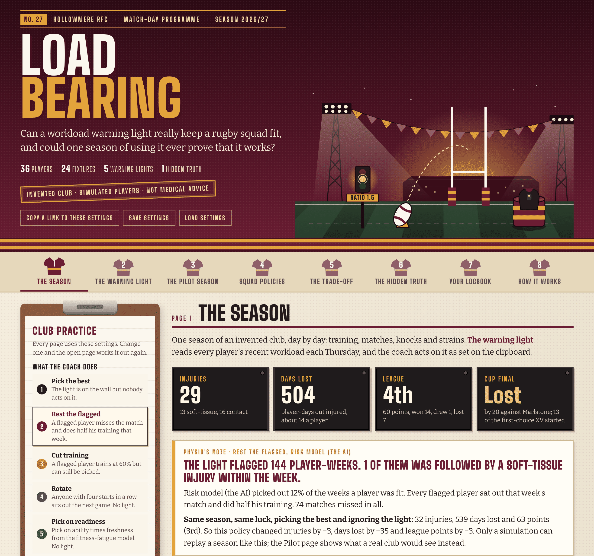
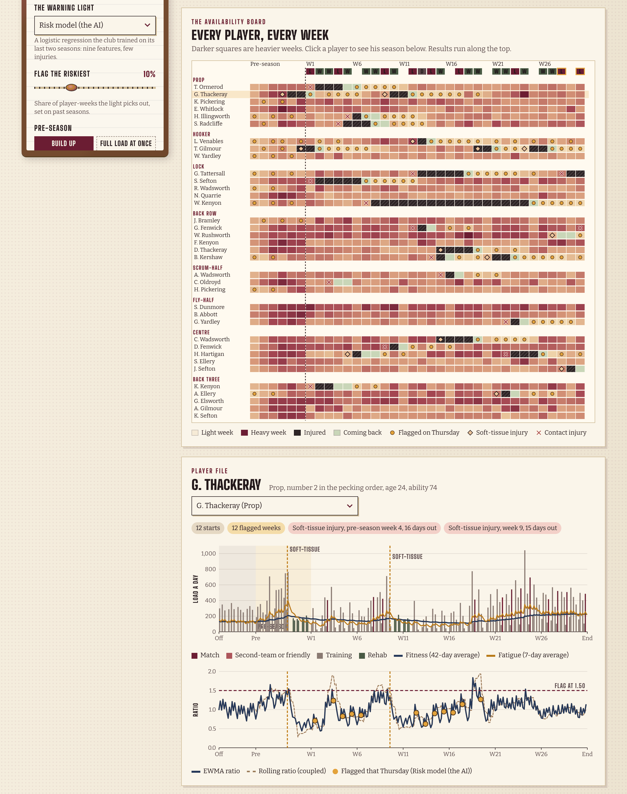
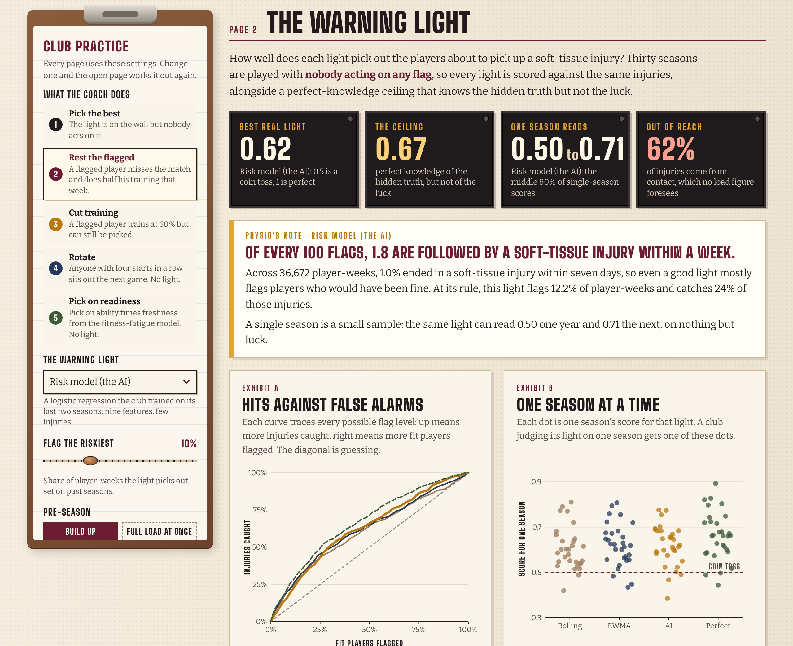
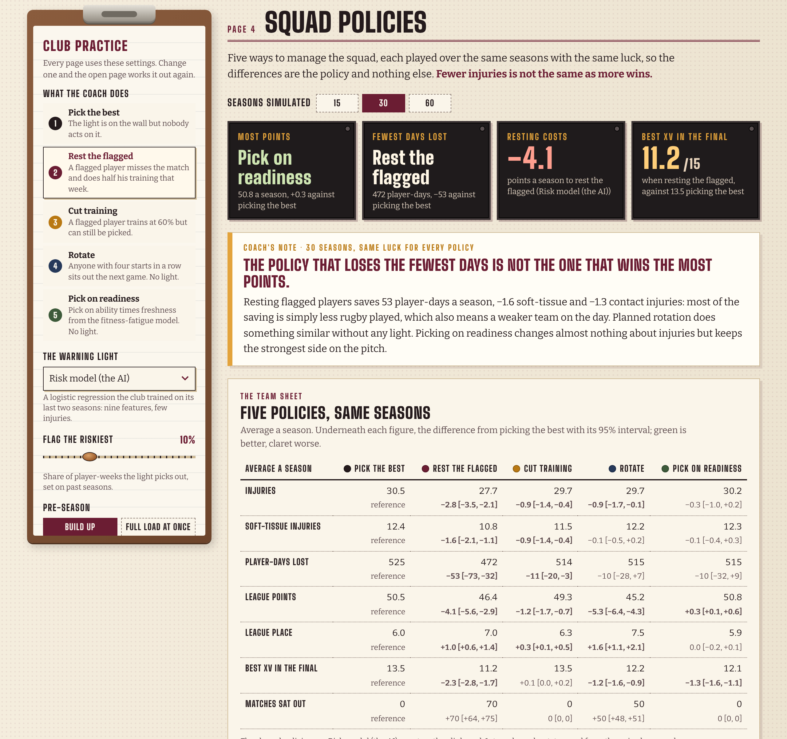
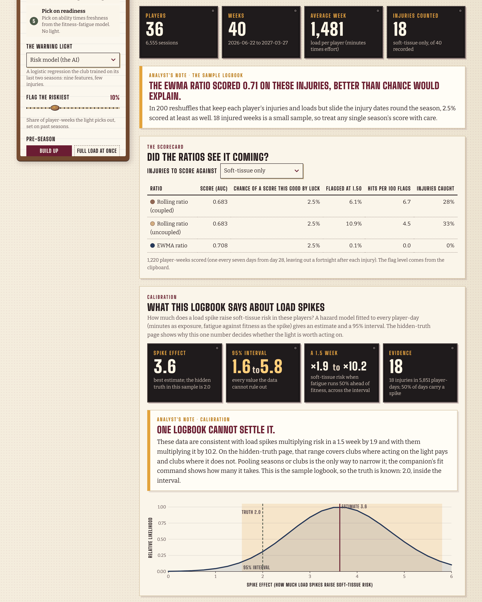

# Load bearing

**Can a workload warning light really keep a rugby squad fit, and could one season of using it ever prove that it works?**

Load bearing is a laboratory for a question every club with a training-load dashboard faces, and every organisation piloting a predictive AI tool faces too. An invented club, Hollowmere RFC, plays a season one day at a time: 36 players train, play, pick up knocks and strains, rehabilitate and come back. Each Thursday a "warning light" reads every player's recent workload and flags the ones it thinks are at risk, and the coach acts on it (or not). Because the simulation knows the hidden truth behind every injury, it can do what no real club can: score the light against the truth, replay a season with and without it on exactly the same luck, and show what a one-season pilot would have told the board.

There are two versions, built on the same model:

- **The browser app** (`app/index.html`). Double-click it: no installs, no internet connection, nothing sent anywhere. It plays a season and shows every player's week on an availability board, explains every injury, scores five warning lights against the same injuries, runs the pilot-season experiment, compares five ways of managing the squad, finds the best way to use the light for what a league point is worth to you, and analyses your own club's session logbook.
- **The Python companion** (`loadbearing/`). The same model, reproducing every number exactly, plus what a browser does less well: batch experiments with paired statistics, the trade-off across all five lights at once, the power of a trial across many clubs, sweeps of any setting, fitting the Banister fitness-fatigue model to performance tests, analysing a logbook with an HTML report, and a self-contained report of the main analyses ([an example](docs/report.html)). Standard library only.



## Why it matters

The question behind these builds is why AI so often stalls at the pilot stage. A workload light is a small, well-documented example of the general problem:

- **AI adoption beyond the pilot.** The benefit of the light is a counterfactual (injuries that did not happen), the events are rare and the season-to-season noise is large. In the default club, acting on the light prevents about 2.4 injuries a season, but a season's count varies by about 5.5 either way, so a one-season pilot shows an improvement only 57% of the time and would need about 84 seasons in each arm to detect the effect reliably. This is the "hard-to-measure benefits and unclear ROI" that executives describe as blocking scale-up, made concrete.
- **Human-AI interaction and over-reliance.** 97% of the times the coach rests a flagged player, nothing happens in the next fortnight. That feels like the light working, whether or not it does.
- **Team and sports leadership.** Resting flagged players cuts days lost but costs about four league points a season and two of the first-choice XV in the cup final. The policy that loses the fewest days is not the one that wins the most matches.

The full argument, with numbers, is in [FINDINGS.md](FINDINGS.md).

## Open the app

Download the branch (on GitHub: **Code**, then **Download ZIP**), unzip it and double-click `app/index.html`. Or from a terminal:

```bash
open app/index.html        # macOS
xdg-open app/index.html    # Linux
start app\index.html       # Windows
```

The app is styled as the club's match-day programme, with numbered shirts for pages and the coach's clipboard for settings. It opens on a season already played. Its seven pages:

1. **The season.** One season, day by day, with the coach acting on the light as the clipboard says. A scoreboard of injuries, days lost, the league and the cup final; the physio's note, which also replays the same season with the light ignored; an availability board of every player and every week (load, injuries, flags, results); a player file with daily load, fitness and fatigue, and his workload ratios; the inquest, which takes every injury in turn and shows the hidden factors behind it, what the light said the Thursday before, and whether resting that player for that one week would have avoided it (the season replayed on the same luck); availability through the season; the league table and every result.
2. **The warning light.** Thirty seasons with nobody acting on any flag, so five lights are scored against the same soft-tissue injuries: hits against false alarms (ROC curves), each light's score season by season, a scorecard, why the coupled and uncoupled ratios rank players identically but read "1.5" differently, and what the club's risk model learned.
3. **The pilot season.** The before-and-after comparison a club would actually run, against the true effect on the same luck: what one pilot reports, how many seasons a fair comparison needs, what the coach sees after each rest, and what the light costs in league points.
4. **Squad policies.** Pick the best, rest the flagged, cut training, planned rotation and pick on readiness, each over the same seasons with paired 95% intervals: injuries, days lost, points, league place and the first-choice XV in the final.
5. **The trade-off.** Every way the club could use its light (rest or cut training at each flag level), rotation at each streak length and picking on readiness, all over the same seasons. A slider sets how many player-days of injury a league point is worth; the page names the best option at that rate, the break-even rate of the clipboard's option, which options are efficient, and an order of merit, with the break-even line drawn on a chart of days saved against points lost.
6. **Your logbook.** Open or paste a session log (date, player, minutes and effort, or load, with injuries if you have them). The app works out every player's coupled, uncoupled and EWMA ratios, monotony and strain, this week's highest ratios, and, if injuries are recorded, whether the ratios anticipated them better than chance (a permutation test that slides each player's injuries round the season). The sample is a simulated season of 6,555 sessions, also in [`data/club_logbook.csv`](data/club_logbook.csv).
7. **How it works.** The machinery, the words used, what it leaves out and background reading.

The clipboard sets what the coach does, which light, its flag level, the pre-season, training effort, graded return after injury and which season to play. Under "The hidden truth" you can change what no real club can see: how strongly load spikes cause injury, how common contact injuries are, and the squad itself. The buttons on the cover copy a link that restores every setting, or save and load settings as a small JSON file. Logbook ratios can be downloaded as CSV.











## Run the Python companion

Python 3.10 or later, standard library only. From the project folder:

```bash
python3 -m loadbearing season --seed 6                  # one season, replayed with the light ignored
python3 -m loadbearing inquest --seed 6                 # why each injury happened, and could a rest have avoided it?
python3 -m loadbearing flags --seasons 30 --json results/flags.json
python3 -m loadbearing compare --seasons 30 --csv results/policies.csv
python3 -m loadbearing optimise --point-value 12 --all-lights   # every light, action and flag level
python3 -m loadbearing pilot --pairs 40                 # could a one-season pilot tell?
python3 -m loadbearing trial --clubs 4,8,16,32          # power of a trial across clubs
python3 -m loadbearing sweep --param spike --values 0,1,2,3,4
python3 -m loadbearing logbook data/club_logbook.csv --report results/logbook.html --ratios-csv results/ratios.csv
python3 -m loadbearing calibrate --logbook data/club_logbook.csv --tests data/jump_tests.csv --truth data/jump_truth.csv
python3 -m loadbearing report --out results/report.html
```

Every simulation command takes the app's settings (`--policy`, `--flag`, `--threshold`, `--budget`, `--preseason`, `--intensity`, `--no-graded-return`, `--spike`, `--contact-scale`, `--squad-seed`) and defaults to the app's: rest anyone the risk model flags. `python3 -m loadbearing COMMAND --help` explains each one. The same command always prints the same numbers. The default runs take from under a second (`season`) to about half a minute (`compare`, `trial`, `report`) on a two-core laptop.

The data in `data/` comes from `python3 data/generate_logbook.py`, a seeded generator that rebuilds the files exactly: `club_logbook.csv` (one simulated season's 6,555 sessions with injuries, identical to the app's sample), `jump_tests.csv` (a countermovement-jump test every Monday for every fit player, made from each player's loads through a fitness-fatigue model with hidden parameters) and `jump_truth.csv` (those hidden parameters, so the calibration can be checked).

## Run the tests

```bash
node --test tests/js/model.test.js                       # the browser app's model, in Node.js
python3 -m unittest discover -s tests/python -t .        # the companion, and that both languages agree exactly
python3 -m unittest discover -s tests/ui -t .            # the app in headless Chromium (needs Playwright for Python)
```

The agreement test runs the JavaScript model in Node.js on dozens of cases (seasons under every policy and light, the trained risk model, every analysis, the logbook, the CSV and date helpers) and checks the Python port returns the same numbers, bit for bit.

## Which language does what

| Part | Language | Lines (roughly) | What it does |
|---|---|---|---|
| `app/index.html` | HTML, CSS, JavaScript | 3,050 (model 1,320, interface 1,090, styles 410, markup 240) | The whole app: model, six pages, hand-drawn SVG charts, embedded fonts |
| `loadbearing/model.py` | Python | 1,870 | The same model, number for number |
| `loadbearing/cli.py`, `experiments.py`, `calibrate.py`, `report.py` | Python | 2,020 | Commands, multi-club trial design, sweeps, Banister calibration, HTML reports |
| `data/generate_logbook.py` | Python | 160 | The seeded dataset |
| `tests/` | JavaScript, Python | 1,890 | Model, agreement, companion and browser tests |

The browser app is the version anyone can open: it does the main job on its own. The companion is for heavier, repeatable work: running hundreds of seasons, designing a trial, fitting a model to a club's own test data and writing reports.

## How it works

**A season.** Day 0 is the Monday of a six-week pre-season, preceded by four weeks of off-season training. Each player's session load is minutes times effort out of ten (session RPE), times a personal effort bias and a little daily noise. Fitness and fatigue are 42-day and 7-day running averages of load. Each Saturday in season the coach picks a matchday 23 by position, from the fit players (and, depending on the policy, leaving out flagged or long-serving players); out-of-position cover is penalised. Team strength is the starters' ability times their match-day readiness, and each match's margin comes from the strength gap, home advantage and luck. The other eleven invented clubs play each other, so there is a real league table.

**The hidden truth.** Every session carries a chance of a soft-tissue injury that rises when fatigue runs more than 10% ahead of fitness (a load spike), when a player is under-trained, older, back from injury within six weeks, or carries a hidden frailty; and a chance of a contact injury that depends mostly on match minutes and position. Injury lengths are drawn from skewed distributions; with graded return on, a player trains at 60% for ten days before he can be picked.

**The lights.** Every Thursday each fit player gets five scores from the logbook alone: the rolling ratio (last 7 days over the average week of the last 28, the coupled version, or of the 21 before them, the uncoupled one), the EWMA ratio (7-day over 28-day exponentially weighted averages), a logistic regression the club trains by Newton's method on its own previous two seasons (nine features, including the EWMA ratio, fitness base, week-on-week change, monotony, a recent return, earlier injuries, age, match minutes and position), and the perfect-knowledge ceiling (the true soft-tissue risk over the coming week if it repeats the last). Ratio lights fire at a threshold; the model and the ceiling flag the riskiest share of player-weeks, with the cut-off set on past seasons.

**Same luck.** Every random draw is fixed in advance by the season number, player and day, so the same season can be played under two policies and the difference is the policy alone. The pilot experiment contrasts this with what a club sees: one season without the light against a different season with it.

**Exact agreement.** Both languages use their own series-based `exp` and `log`, a seeded mulberry32 generator and the same order of every floating-point operation, which is why the Python port can match the browser bit for bit.

## Limitations

- Everything is invented: the club, players, league, injury mechanism and the size of every effect. The defaults are set so a season looks plausible for semi-professional rugby (about 30 time-loss injuries, 40% soft-tissue), not fitted to real data.
- How strongly load spikes cause injury is genuinely contested; the clipboard lets you change it, and the conclusions about evidence hold across the range, but the size of the benefit does not.
- The squad is fixed for a season, second-team injuries count alongside first-team ones, and matches come from a simple strength model.
- The risk model is deliberately the kind of model a single club could build. A vendor pooling many clubs could do better, though the perfect-knowledge ceiling limits how much.
- The logbook analysis is a screening aid for thinking about evidence, not a medical tool. It is not coaching or medical advice.

## What could come next

- A league-wide view: pool many clubs' logbooks (each analysed locally) to show how much evidence a governing body could gather in a season.
- A cost model that puts a value on a player-day lost and a league point, so the rest-or-play decision becomes a decision under uncertainty with an explicit trade-off.
- Smarter actions than resting: modified sessions targeted by position, or graded return lengths tuned by the model.
