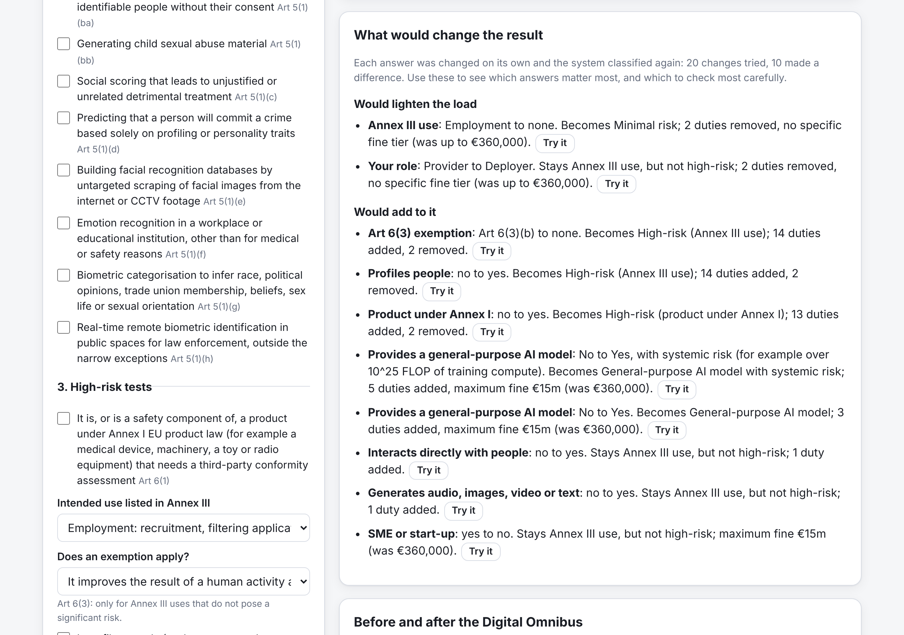
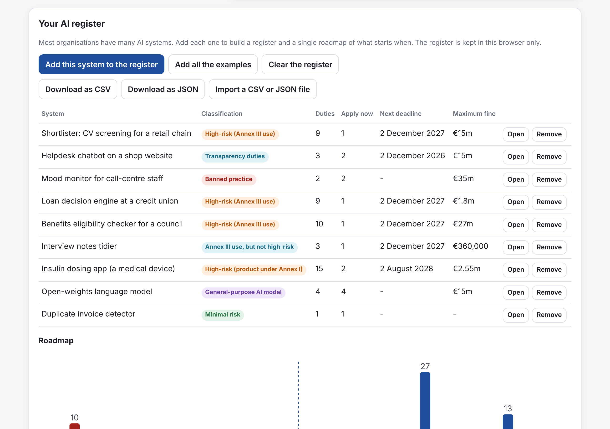
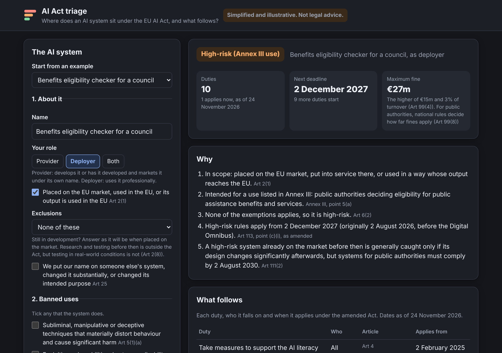

# AI Act triage

**Simplified and illustrative. Not legal advice.** This project turns a reading of the EU AI Act, as amended in July 2026, into rules a program can run. It is a learning and planning aid. It cannot tell you what the law requires of a particular organisation.

Where does an AI system sit under the EU AI Act, and what follows? Answer about twenty questions about a system and the app gives you:

- the **classification** (banned, high-risk, general-purpose model, transparency duties, minimal risk or out of scope), with a numbered **"Why"** chain that cites the article behind every step;
- every **duty** that follows, who it falls on (provider or deployer), the article, and the date it applies under the amended Act, with a countdown from any date you pick;
- a **before-and-after timeline** of what the Digital Omnibus (Regulation (EU) 2026/1744) moved for this system;
- **what would change the result**: each answer is changed on its own and the system classified again, so you can see which answers carry the result (and which to check most carefully), with a "Try it" button for each;
- the **maximum fine** for the company's turnover, and a short **UK view** (the UK has no AI statute, so this points to the regulators and laws already in play).

For many systems at once there is an **AI register**: add systems, get one roadmap of what starts when across all of them, and download or import the register as CSV or JSON. The CSV is the same file the Python `register` command reads, which prints the plan and writes a Markdown report and a CSV of every duty.

Everything runs offline in one HTML file. There are no requests to any server, no accounts, and no real organisations: the nine examples are invented.

## Why

The Digital Omnibus on AI moved the dates that matter most. Rules for high-risk uses listed in Annex III moved from 2 August 2026 to **2 December 2027**; rules for high-risk products under Annex I moved from 2 August 2027 to **2 August 2028**. It also added two new bans from 2 December 2026, and gave providers of existing content generators until 2 December 2026 to mark their output. Many AI inventories and slide decks still carry the 2024 dates.

Governance teams also triage systems in bulk. The hard question is rarely "what does Article 6 say?" but "which of our answers decides this?" A CV screener is high-risk because of one answer (its Annex III use); an "improves a completed human activity" exemption fails the moment the system profiles people. Showing the reasoning, the dates and the pivotal answers together makes those conversations faster and easier to check.

## How to run it

**The app.** Open `app/index.html` in any modern browser. Nothing to install, and it works with no network connection. The register is kept in that browser's local storage only.

**The Python package** (standard library only; developed on Python 3.13):

```
python3 -m ai_act_triage classify examples/shortlister.json
python3 -m ai_act_triage classify examples/shortlister.json --as-of 2027-12-02
python3 -m ai_act_triage register examples/register.csv
python3 -m ai_act_triage register examples/register.csv --markdown plan.md --csv duties.csv
```

`classify` takes a JSON file of answers (the same names the app uses; see `examples/shortlister.json`). `register` takes a CSV with one system per row, or a JSON file the app downloaded. Column names are not case-sensitive, blank cells take the usual answer, and anything it cannot read (an unknown column or answer, "Deployer" instead of "deployer", "maybe" for a yes/no question) is listed under "Notes on the input" rather than silently dropped. Dates are counted from today unless you give `--as-of`. `examples/register-report.md` and `examples/register-duties.csv` show the output for the nine examples.

**Tests:**

```
node --test tests/*.test.js                  # the app's rules engine (Node 18 or later)
python3 -m unittest discover -s tests        # Python, parity with the app, and the browser UI
```

The parity tests need Node.js and the UI tests need Playwright for Python with Chromium; each group skips itself, with a message, if its tool is missing. `python3 tools/screenshots.py` retakes the pictures below.

## Screenshots

| Desktop | Phone |
|---|---|
|  |  |

| What would change the result | The register and roadmap |
|---|---|
|  |  |

Dark mode follows the system setting: 

## Which language does what

| Part | Language | Lines | What it does |
|---|---|---:|---|
| `app/index.html`: rules engine (between `MODEL START` and `MODEL END`) | JavaScript | 681 | Normalises answers, classifies, lists duties and dates, pivots, register roadmap, notes on odd input, CSV reading and writing. Includes the 98-line embedded copy of the rules |
| `app/index.html`: interface | JavaScript, HTML, CSS | 737 | Questions, results, timeline and roadmap charts (inline SVG), register, downloads and imports |
| `ai_act_triage/rules.json` | JSON | 709 | The rules as data: dates, bans, Annex III areas, exemptions, 37 duties, fines, UK notes, labels, examples. Copied into the app by `tools/sync_rules.py` |
| `ai_act_triage/model.py` | Python | 648 | A line-for-line port of the rules engine |
| `ai_act_triage/register.py`, `__main__.py` | Python | 366 | Register files (CSV and JSON), reports, and the command line |
| `tests/` | JavaScript, Python | 879 | 25 Node tests, 11 Python tests, 11 parity tests, 11 browser tests |
| `tools/` | Python | 112 | Rules sync and screenshots |

The rules engine exists twice so that the app works as a single offline file and the Python package can run in scripts. The parity tests run the app's own engine in Node and check that both give identical results: 400 random systems across eight dates, pivots for 90 systems, roadmaps, notes on odd answers read from files, numbers written the way JavaScript writes them (over 400 values), unusual white space, huge numbers and early years, euro formatting, and twelve awkward CSV files (quotes, new lines, a missing closing quote, duplicate and unknown columns, a column called `constructor`, a cell of 200,000 characters). They also check that the two copies of the rules are the same data.

## How it works

**1. Scope** (Art 2). Out of scope if the system is not placed on the EU market, put into service there or used so that its output reaches the EU (Art 2(1)); if it is used only for military, defence or national security (Art 2(3)); or if it is developed and put into service only for scientific research and development (Art 2(6)). A system still in development should be answered as it will be when placed on the market: research and testing before then is outside the Act, but testing in real-world conditions is not (Art 2(8)). Purely personal use by an individual removes only deployer duties (Art 2(10)): a deployer is then out of scope, and someone answering "both" keeps only the provider's duties.

**2. Banned practices** (Art 5) in force on the chosen date stop the analysis: nothing else is assessed until the practice is removed. A ban that has not started yet (the two new ones before 2 December 2026, or any ban before 2 February 2025) is listed as an upcoming duty, and the other tests still run so the duties that apply in the meantime are shown; duties that would only start on or after the ban date are left out, because they can never apply.

**3. High-risk.** A product, or a safety component of a product, under the EU product law in Annex I that needs a third-party conformity assessment is high-risk (Art 6(1)). A use listed in Annex III is high-risk (Art 6(2)) unless one of the four Art 6(3) conditions applies **and** the system does not profile people; profiling always makes an Annex III system high-risk. An exempt system still carries two duties: documenting the assessment (Art 6(4)) and registering in the EU database (Art 49(2)). Where a system is both an Annex I product and a high-risk Annex III use, the app uses the Annex III route and its earlier date; an Art 6(3) exemption removes only the Annex III route, so such a product stays high-risk under Art 6(1). Every high-risk result also notes the transitional rule for systems already on the market (Art 111(2)). A deployer who puts its name on a high-risk system, substantially modifies it or changes its intended purpose takes on the provider's duties too (Art 25(1)).

**4. Transparency** (Art 50) and **general-purpose AI models** (Arts 51 to 55) are assessed alongside, so a high-risk chatbot shows both sets of duties. The result's headline is the most serious tag; the others appear as "Also:" tags.

**5. Duties and dates.** Each of the 37 duties in `rules.json` has a role, a trigger and a date key. The date comes from the amended Art 113 and from Art 111 for systems and models already on the market. Each duty shows whether it already applies on the chosen date or how many days remain, and the "original" 2024 date where the Omnibus moved it.

**6. What would change the result.** The engine changes one answer at a time (each role, each yes/no answer, removing each ticked ban or the Annex III use, claiming or dropping an exemption, each kind of model and deployer), classifies again and keeps the changes that alter the tier, the duties, their dates or the maximum fine. Each is labelled as lightening the load or adding to it: first by how serious the tier is, then by the number of duties, then the fine, then whether dates move later or earlier. Scope answers are only varied when the system is out of scope (or claims personal use), because "if it were not used in the EU" is true of every system. Lifting a ban that is in force always counts as lighter, even though the other duties then appear.

**7. Register and roadmap.** The roadmap groups every duty of every system by the date it starts, with how many systems and duties each date reaches.

### The provisions, dates and thresholds this relies on

Checked on 24 November 2026. Regulation (EU) 2024/1689 (the AI Act), as amended by **Regulation (EU) 2026/1744** of 8 July 2026 (the Digital Omnibus on AI), published in the Official Journal on 24 July 2026 and in force from 27 July 2026. The amending regulation's dates were checked against its text on EUR-Lex. Two points come from published commentary quoting the final text rather than from the regulation itself: that self-assessed exempt systems must still be registered (the Commission proposed removing this; the final text kept it in a simplified form), and the new wording of Art 4 (providers and deployers "shall take measures to support the development of AI literacy").

| What | Provision | Date or threshold used |
|---|---|---|
| Banned practices, points (a) to (h) | Art 5(1), Art 113(a) | From 2 February 2025 |
| New bans: non-consensual intimate images of identifiable people; child sexual abuse material | Art 5(1)(ba) and (bb), added by the Omnibus | From 2 December 2026 |
| AI literacy (softened by the Omnibus to taking measures to support it) | Art 4 | From 2 February 2025 |
| General-purpose AI model duties | Arts 53 and 55, Art 113(b) | From 2 August 2025 |
| Models on the market before 2 August 2025 | Art 111(3) | By 2 August 2027 |
| Systemic-risk presumption | Art 51(2) | Over 10^25 floating-point operations of training compute |
| Open-source models | Art 53(2) | Exempt from Art 53(1)(a) and (b) unless systemic risk |
| Transparency duties | Art 50(1) to (4) | From 2 August 2026 |
| Marking by generators on the market before 2 August 2026 | Art 50(2), Art 111 as amended | By 2 December 2026 |
| High-risk, Annex III uses | Art 6(2), Art 113(c)(i) as amended | From 2 December 2027 (was 2 August 2026) |
| High-risk, Annex I products | Art 6(1), Art 113(c)(ii) as amended | From 2 August 2028 (was 2 August 2027) |
| Exemptions and the profiling rule | Art 6(3), Art 6(4), Art 49(2) | Same date as Annex III |
| Provider duties | Arts 9 to 15, 17 to 20, 43, 47 to 49, 72, 73 | Route date |
| Registration in the EU database | Art 49(1) (providers), Art 49(3) (public-authority deployers) | Annex III systems |
| Critical infrastructure: national registration, no EU database entry, no right to an explanation, no impact assessment | Art 49(5), Art 49(1) and (3), Art 86(1), Art 27(1) | Annex III, point 2 |
| High-risk systems already on the market | Art 111(2) | Caught only after a significant change in design; systems for public authorities must comply by 2 August 2030 (shown as a note) |
| Deployer duties | Art 26(1), (2), (4) to (8), (11); Art 86 | Route date |
| Fundamental rights impact assessment | Art 27 | Public bodies and private bodies providing public services, plus credit scoring and life or health insurance (Annex III, points 5(b) and (c)) |
| Fines: banned practices | Art 99(3) | Up to €35m or 7% of worldwide annual turnover, whichever is higher |
| Fines: most operator duties | Art 99(4) | Up to €15m or 3% |
| Fines: SMEs and start-ups | Art 99(6) | Whichever of the two is lower |
| Fines: public authorities | Art 99(8) | Each Member State decides how far fines apply (shown as a note) |
| Fines: general-purpose model providers | Art 101 | Up to €15m or 3%, whichever is higher; no SME rule |

Where a system has duties under both Art 99(4) and Art 101 (a model provider whose product also has transparency duties), the larger cap is shown. With no turnover given, the fixed amount is shown and labelled as such. A deployer of an exempt Annex III system has only the literacy duty, which Art 99(4) does not list, so no fine tier is shown for it. The Art 99(5) tier for supplying incorrect information (€7.5m or 1%) is in the rules file but is not tied to any classification.

**The UK view** is deliberately short. As of November 2026 the UK has no cross-sector AI statute in force. The government's approach asks existing regulators to apply five principles (from the 2023 white paper) within their remits. The app lists the laws that already apply (UK GDPR and the Data Protection Act 2018, including the automated decision-making rules as changed by the Data (Use and Access) Act 2025; the Equality Act 2010; consumer law; the Online Safety Act 2023 for online services) and the regulators most likely to be engaged for each Annex III area.

## Limitations

- **Not legal advice, and not complete.** The Act runs to well over a hundred articles and thirteen annexes, with Commission guidelines, codes of practice and harmonised standards on top. This models the classification logic and the main duties only. Sector law, national rules, data protection and contract terms are out of scope.
- **Answers carry the judgement.** Whether a use falls in Annex III, or whether an Art 6(3) exemption applies, is exactly where real assessments are argued. The app takes the answers as given; the pivots show which ones matter, not which are right.
- Art 111(2) is shown as a note on every high-risk result rather than asked as a question, and Annex I products under Section B (vehicles, aircraft, ships, rail; Art 2(2)) are not told apart from Section A.
- Annex III is summarised to one line per area; the real points are longer and have carve-outs (for example fraud detection under point 5(b)). Law enforcement and migration systems are registered in a secure, non-public section of the database (Art 49(4)); the app does not distinguish this.
- The Omnibus's relief for small mid-cap companies (simplified documentation and lower fine caps) is mentioned in duty wording but not modelled in the fine calculation. Fines are statutory maxima, not predictions.
- The provider and deployer duties are the main ones, not every sub-paragraph; for example the serious incident reporting deadlines in Art 73 (15 days, or 10 or 2 days in the gravest cases) are not shown.
- The register lives in one browser's local storage and uses each system's name as its key: adding or importing a system with the same name replaces the old one (the app says so). Clearing site data clears it; download a copy to keep it.
- Names that begin with `=`, `+`, `-` or `@` are written to CSV as they are. Spreadsheet programs may treat such cells as formulas.
- Legal facts were checked once, on 24 November 2026. If the Act is amended again, `rules.json` is the one place to change.

## Next steps

- Model the Commission's guidelines on the high-risk classification, with worked examples for each Annex III point.
- Add owners, evidence links and status to register rows, so the roadmap becomes a tracker.
- Compare two dates side by side, or two versions of the rules, to show what a future amendment would change for a whole register.
- Add the serious incident reporting deadlines (Art 73) as a separate calculator.
