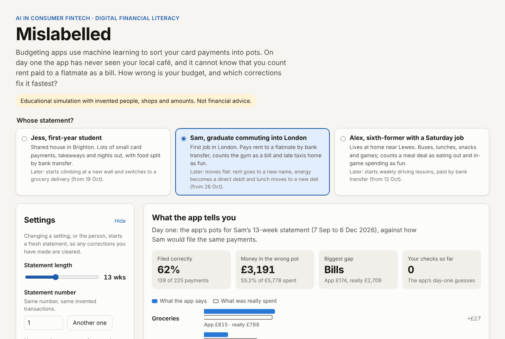
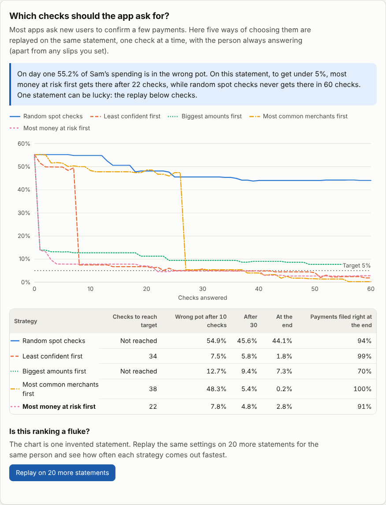
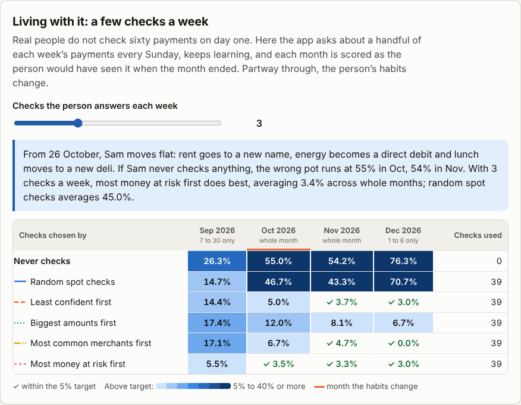
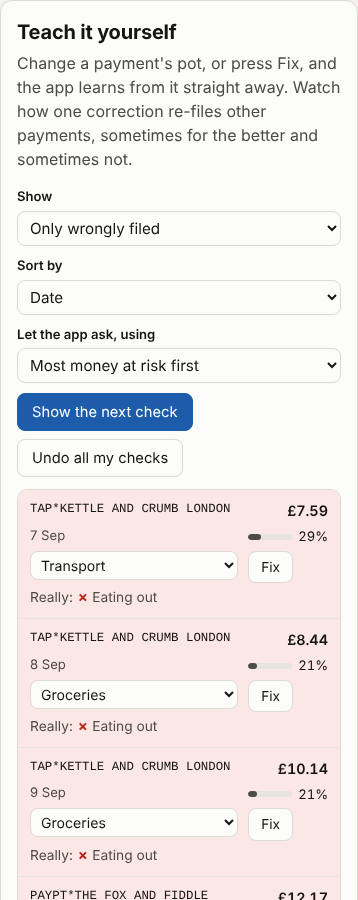

# Mislabelled

**How wrong is your budgeting app on day one, and which corrections fix it fastest?**

Budgeting apps use machine learning to sort card payments into pots such as groceries, eating out and bills. On day one the app has never seen your local caf&eacute;, and it cannot know that you count rent paid to a flatmate as a bill or a supermarket meal deal as eating out. Mislabelled simulates that cold start. It builds an invented bank statement for one of three young people, lets a generic categoriser file every payment, shows how far the resulting budget is from the truth, and then compares five ways an app could choose which payments to ask the person to check.

> Educational simulation with invented people, shops and amounts. It is not financial advice, and nothing in it describes a real app, bank or business.



## What you can do with it

- **See the damage on day one.** Pot by pot, what the app says against what was really spent, the biggest mix-ups (rent paid to a flatmate filed as a transfer, a pub filed as groceries) and the share of money sitting in the wrong pot.
- **Teach it yourself.** Re-file any payment, or press Fix or Confirm, and the model learns at once. The app tells you how many other payments moved, and whether they moved the right way.
- **Ask whether to trust its confidence.** A table shows how often the app is right when it is under 50%, 50 to 80%, 80 to 95% and over 95% sure, and how much misfiled money it was confident about.
- **Compare five checking strategies** (random spot checks, least confident first, biggest amounts first, most common merchants first, most money at risk first) on the same statement, check by check, and replay them on 20 more statements to see whether the winner was luck.
- **Live with it for a term.** In the weekly mode the person answers a few checks each Sunday, habits change partway through (a new climbing wall, a flat move, driving lessons paid by transfer), and every month is scored as it looked when the month ended.
- **Keep or share a session.** The address bar link holds the settings; a saved file also holds your checks, and the Python companion can read it.



## Why it matters

The question behind these builds is why AI so often stalls at the pilot stage, in companies and in people's everyday lives. Transaction categorisation is a small, concrete case of that problem in **consumer fintech**:

- **The first impression is the pilot.** A new user sees the app's day-one budget. If it says they spent nothing on fun and twice their real grocery bill, they stop trusting it before it has learned anything. The tool measures that first impression in pounds, not just in accuracy.
- **A generic model meets personal conventions.** Most of the money in the wrong pot is not unfamiliar shops but disagreements about what a payment *is*: rent to a flatmate, a late taxi, a meal deal. No amount of crowd data fixes that; only the user can.
- **How an app asks for help decides how fast it becomes useful.** The order of the questions matters as much as the model, and the best order depends on the person.
- **Confidence is not correctness.** Apps that only ask when unsure never raise the mistakes they are sure about, which links to the wider theme of human-AI interaction and over-reliance on AI.
- **Digital financial literacy.** For a young person the lesson is simple: an automated budget is a starting point that needs checking, and a few well-chosen checks go a long way.

## What the bundled data shows

These figures come from `python -m mislabelled compare` and `python -m mislabelled weekly` with their defaults: 20 invented 13-week statements per person, up to 60 checks, and a budget counted as trustworthy when less than 5% of spending is in the wrong pot. Your own runs will match them exactly.

| | Jess, first-year student | Sam, commuting graduate | Alex, sixth-former |
|---|---|---|---|
| Spending in the wrong pot on day one (median) | 13.7% | 55.8% | 41.2% |
| Fastest strategy most often | Most money at risk first (10 of 20) | Least confident first (11.5 of 20) | Least confident first (10.5 of 20) |
| Median checks to reach 5% with that strategy | 7 | 15 | 9 |
| Biggest amounts first reaches 5% within 60 checks | 65% of statements | 15% of statements | 65% of statements |

- **There is no single best way to ask.** Asking about the most money at risk wins most often for Jess; asking about the least confident payment wins most often for Sam and Alex. Biggest amounts first is the weakest overall: it goes straight for rent and other large payments, which are often already right, and leaves the many small misfiled ones until last.
- **Confident mistakes are common.** Across the 20 statements, the median share of misfiled money that the app filed with at least 80% confidence is 32% for Jess, 12% for Sam and 10% for Alex. For Sam, payments the app was at least 95% sure about were right only a median 82% of the time.
- **Without checks the budget gets worse, not better.** If Alex never checks anything, the wrong pot grows from a median 36% of October's spending to 51% of November's once driving lessons, paid by bank transfer, begin. With three checks a week chosen by least confident first it is 0.3% in October and 0.0% in November.
- **One good correction carries a long way.** Filing Sam's first rent transfer as a bill also re-files the rent paid to the new flat after the move, because the model learns the word RENT as well as the payee.



## Open the app

1. Download this branch (on GitHub: **Code**, then **Download ZIP**) and unzip it.
2. Double-click `app/index.html`. It opens in any modern browser and works offline: no installs, no internet connection, nothing sent anywhere.

The settings live in the address bar, so a link such as `index.html#persona=graduate&weeks=26&perweek=2` opens the app with those settings.

On a phone the payments table becomes a list of cards:



## Run the Python companion

It needs Python 3.9 or later and nothing outside the standard library. From the folder that contains `mislabelled/`:

```
python -m mislabelled compare --out results          # all five strategies on 20 statements per person (about 45 seconds)
python -m mislabelled weekly                          # three checks a week, month by month (about 30 seconds)
python -m mislabelled sample --persona graduate -o sample.csv
python -m mislabelled categorise sample.csv --replay  # replay the strategies on a labelled CSV
python -m mislabelled categorise my-statement.csv -o filed.csv
```

- `compare` prints a table per person and, with `--out`, writes `curves.csv` (every run, every check), `summary.csv` and `report.html`, a self-contained report with median curves and 10th to 90th percentile bands.
- `weekly` prints the month-by-month table and, with `--out file.csv`, every month of every run.
- `categorise` reads any CSV with `date`, `description` and `amount` columns (and an optional `category` column using the eight pot names). Rows you have labelled teach the model first; the rest are filed with a confidence. Negative amounts, pound signs, commas and UK dates (`DD/MM/YYYY`) are accepted. With `--replay` and every row labelled, it replays the five strategies on your own statement, which is something the browser app cannot do.
- `--settings saved.json` (on `compare` and `weekly`) uses a file saved from the app's **Save file** button as the defaults, so you can explore in the browser and then test the same settings on many statements.
- Other options: `--persona`, `--seeds` (`20`, `5-9` or `3,7,11`), `--weeks`, `--checks`, `--target`, `--slip`, `--weight` and `--per-week`. Run `python -m mislabelled compare --help` for details.

## Which language does what

| Part | Language | Rough size | What it does |
|---|---|---|---|
| `app/index.html` | HTML, CSS, JavaScript | about 2,250 lines: 240 CSS, 200 markup, 930 model (190 of them data), 870 interface | The whole interactive tool, offline in one file. The model sits between `/* MODEL START */` and `/* MODEL END */` and exports itself for Node.js. |
| `mislabelled/` | Python (standard library) | about 1,390 lines | The same model, line for line, plus batch runs over many statements, CSV import of your own statement, strategy replays on it, CSV exports and HTML reports. |
| `tests/` | Python and JavaScript | about 870 lines | Unit tests for both models, a cross-language agreement test, command-line tests, repository checks and browser tests. |

The two versions are not just similar: they agree **to the last bit**. Both use the same seeded random number generator, the same order of operations, and a logarithm and exponential built from plain arithmetic, so `tests/test_agreement.py` can compare statements, predictions, confidences, every strategy's choices and every figure with exact equality.

## How it works

1. **The statement.** Each person has habits: which invented shops they use, how often, on which days and roughly how much they spend, plus monthly payments and a change of habits partway through. A seeded generator turns the habits into bank descriptions with card-terminal prefixes (`TAP*`, `CRD*`, `PAYPT*`), store numbers, towns, order references, direct debits (`DD`) and transfers with a reference (`TO A PATEL REF FOOD SHOP`). Every payment carries the pot that person would choose: the truth.
2. **The generic model.** A multinomial naive Bayes classifier reads five kinds of feature: the payment channel, a merchant key (the first two meaningful words), every word, an amount band and weekday or weekend. Before you touch it, it has learned from about 1,360 invented payments filed the way most people file them, including chain shops it knows by name and generic words such as CAFE, BAR or LETTINGS.
3. **Learning from you.** A checked payment is added to the training counts as many times as the weight setting says (20 by default), so personal conventions soon outweigh the crowd's. Re-filing a checked payment takes the old lesson back out. Updates are incremental but exact: only the counts that changed are recomputed.
4. **The measure.** *Money in the wrong pot* is half the sum, over the eight pots, of the gap between what the app says and what was really spent. It counts each misplaced pound once, and mistakes that cancel out within a pot do not count, because they do not distort the budget.
5. **The strategies.** Random picks any unchecked payment; least confident picks the lowest confidence; biggest picks the largest amount; most common picks one payment from the most frequent merchant not yet checked; most money at risk adds up amount &times; (1 &minus; confidence) per merchant and asks about the merchant with the most. Slips (the person tapping the wrong pot) can be switched on.
6. **Living with it.** In weekly mode the app may only ask about that week's payments, every Sunday. When a month ends, its payments are scored as the app showed them then.

## Tests

```
node --test tests/js/*.test.js        # JavaScript model (Node.js 18 or later)
python -m unittest discover -s tests  # Python model, CLI, agreement, repository and browser tests
```

The agreement test needs Node.js and the browser tests need Playwright for Python with Chromium (`pip install playwright` then `playwright install chromium`); each is skipped if missing. The browser tests load the app at desktop and phone widths, check every control has a label, that nothing is requested from the network, that nothing scrolls sideways on a phone, and that fixing a payment, the strategy replay, links and saved files all work.

## Limitations

- Everything is invented: three people, about 35 shops and a crowd of 1,360 payments. Real categorisers use far richer models, merchant databases, location data and rules, and their mistakes will differ.
- The truth is one person's own filing. Real people are inconsistent with themselves, which the slip setting only partly captures.
- Naive Bayes confidences are not calibrated, which is realistic but means the strategies that use confidence depend on its quirks.
- The strategies are simple heuristics. Smarter active-learning methods (for example asking about the payment whose answer would change the most other payments) could do better.
- Results depend on the statement; the 20-statement replays and the Python batch runs are there to show how much.

## What could come next

- Let people import their own exported CSV in the browser, with everything staying on the device.
- Add an "ask the question that teaches the most" strategy that simulates each possible answer before asking.
- Model trust: let the person give up on the app after too many visible mistakes, to connect the cold start to churn.
- Compare a rules-only app ("always file this merchant as...") with the learning model.
