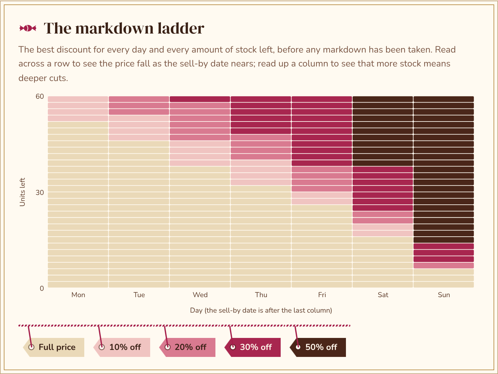
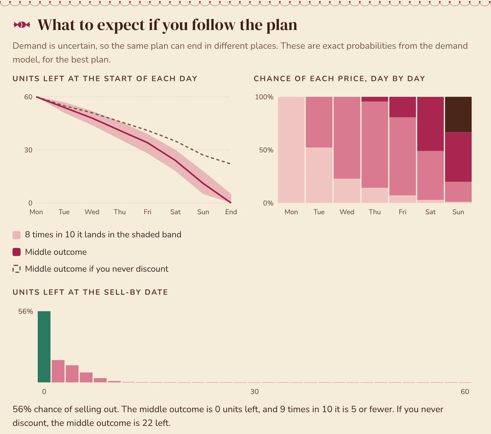

# Markdown ladder

**When should a shop cut the price of stock that is about to expire?**

A planner for short-shelf-life products: chocolate boxes, fresh mochi, eclairs, festive tins. Tell it how much stock you have, how many selling days are left, the price and how demand behaves. It works out the best discount for every day and every stock level, and shows how much that beats the simple rules shops usually use. It solves the problem exactly, with no simulation and no guesswork in the maths.

There are two versions, built on the same model:

- **The browser app** (`app/index.html`). Open the file and it works: no installs, no internet connection, nothing sent anywhere.
- **The Python companion** (`markdown_ladder/`). The same plans from the command line, a robustness check, and a planner for a whole product range that writes a report and a printable shelf card for every product. Standard library only.


## Why it exists

Markdowns are one of the oldest pricing decisions in retail, and one of the most often made by gut feel. Cut too early and you give away margin on stock that would have sold anyway. Cut too late and it ends up in the bin. Most shops settle on a rule such as "30% off with two days to go", and nobody checks what the rule costs.

This connects to three of the themes behind these builds:

- **Retail operations and forecasting.** It is the kind of model a small confectionery chain needs: demand that varies by weekday, products that lose appeal as they age, and stock that cannot be sold after a date. The example products are invented, but the questions are the ones a growing chain of shops faces every day.
- **Decision-making tools that explain themselves.** The answer is not a black box. "Today's decision" shows what each price is worth, the ladder shows the whole plan at a glance, and the shelf card turns it into a rule staff can follow from a stock count.
- **Why analytics stall at the pilot stage.** The robustness check asks the question a sceptical manager would: what if the demand forecast is wrong? A plan that only works when the forecast is perfect will not survive contact with a real shop.

## Open the app

Double-click `app/index.html`, or from a terminal:

```bash
open app/index.html        # macOS
xdg-open app/index.html    # Linux
start app\index.html       # Windows
```

What you can do in it:

- **Describe the product.** Start from one of four examples or enter your own: units in stock, days until the sell-by date, price, cost, the cost of throwing one away, demand at full price, price sensitivity, how much appeal it loses each day as it ages, today's weekday and the weekly pattern of trade. Results update as you type, and any value outside the allowed range is explained rather than silently changed.
- **See the best plan.** Expected takings, leftovers and the chance of selling out, and how much the plan beats the best of three simple rules: never discount, half price on the last day, and a rule you choose (for example 30% off with 2 days left).
- **Understand today's decision.** What each price is worth today, how many units it would sell today, and why the best one wins.
- **Read the ladder.** A map of the best discount for every day and every stock level.
- **See what to expect.** Exact probabilities for how much stock is left each morning, which price you are likely to be charging each day, and how much is left at the sell-by date.
- **Print the shelf card.** The plan as stock thresholds: "on Friday, take 20% off if 31 or more are left". The app checks how much profit, if any, the simple card loses against the full plan, and lets you download it as a CSV file.
- **Test the forecast.** A grid scoring the plan when true demand is 60% to 150% of your forecast and price sensitivity is 60% to 140% of yours.
- **Keep or share a plan.** The page address always holds the current settings, so a bookmark or a copied link opens exactly the same plan.

It works on a phone and in dark mode, and every control can be used with a keyboard and has a label for screen readers.

## Run the Python companion

Requires Python 3.9 or later (tested with 3.11 and 3.13). No packages to install.

```bash
# The best plan for one product: comparison, today's decision, expected path, ladder and shelf card
python -m markdown_ladder plan --preset truffles

# ...or your own numbers (any setting left out takes the app's default)
python -m markdown_ladder plan --stock 80 --days 5 --price 4.5 --demand 12 --elasticity 2.2 --freshness 10

# What if the demand forecast is wrong?
python -m markdown_ladder robust --preset truffles

# Plan a whole range from a CSV file, with a Markdown report and every shelf card as CSV
python -m markdown_ladder range examples/range.csv --markdown report.md --csv cards.csv
```

`examples/range.csv` is an invented range of eight products. `examples/range-report.md` and `examples/shelf-cards.csv` are what the last command produces for it (run with `--markdown examples/range-report.md --csv examples/shelf-cards.csv`).

For the example range, the plans add £573.56 of expected profit over never discounting and £269.17 over the best simple rule for each product, and cut expected leftovers from 128.6 units to 8.7.

## Run the tests

```bash
node --test                                  # the browser app's model (needs Node.js 18 or later)
python -m unittest discover -s tests         # Python tests, Python-JavaScript agreement, and the app in a browser
```

Two groups of Python tests need extra tools and are skipped without them: the agreement tests need Node.js, and the browser tests need Playwright for Python with Chromium.

## Which language does what

| Part | Language | Roughly | What it does |
| --- | --- | --- | --- |
| `app/index.html` | HTML, CSS, JavaScript | 1,010 lines: 130 CSS, 290 model, 470 interface, 120 markup | The whole browser app. The model sits between `MODEL START` and `MODEL END` and also runs in Node.js. |
| `markdown_ladder/` | Python (standard library) | 660 lines | The same model, the command line, the robustness check, range planning and the reports. |
| `tests/` | JavaScript and Python | 190 JavaScript, 360 Python | Model tests in Node.js, Python tests, agreement tests between the two languages, and browser tests. |
| `tools/` | Python | 40 lines | Regenerates the screenshots in `docs/`. |

The browser is the right place to explore one product and see why the plan looks the way it does. Python is the right place for a whole range at once, for files that feed a spreadsheet or a till system, and for repeatable reports.

The model exists in both languages, so the tests prove they agree: the settings, every price on every day for every stock level, the expected value of every option, and the full outcome distributions, for the example products and dozens of random ones.

## How it works

**Demand.** Each day, the number of customers who want the product at a given price is random (a Poisson distribution) with an average of:

> demand at full price x weekday factor x (1 - appeal lost per day) ^ days since today x (1 - discount) ^ (-price sensitivity)

So with price sensitivity 2, a 20% discount lifts demand by 1 / 0.8² = 1.56, or 56%. You sell the smaller of demand and the stock you have.

**The best plan.** The model works backwards from the sell-by date (dynamic programming). On the last day, for every possible stock level, it finds the price that maximises expected takings less the cost of throwing away what is left. On the day before, it does the same, counting the value of each possible stock level tomorrow, and so on back to today. The state is the day, the units left and the current discount, because once a price has been cut it is not raised again (an option in the app lets you drop that rule and see what it costs). The discounts on offer are 10%, 20%, 30% and 50%.

**Exact outcomes.** To score any plan, the model pushes the probability of every stock level forward one day at a time, instead of simulating thousands of random weeks. That gives exact expected takings, leftovers and sell-out chances, and the full spread of outcomes behind the charts.

**What it does not need.** The cost of the stock is already spent, so it does not change the best plan; it only changes the profit figure. Everything is calculated in your browser in a fraction of a second.

## Screenshots

| | |
| --- | --- |
|  |  |
|  |  |

`python tools/screenshots.py` regenerates them (it needs Playwright for Python).

## Limitations

- **The demand model is simple.** Real demand has trends, weather, promotions and customers who wait for markdowns. Price sensitivity is assumed constant across discounts.
- **One product at a time.** Cutting the price of one product can steal sales from another; the model ignores that.
- **Forecasts are inputs, not outputs.** The app does not estimate demand from sales history; it takes your numbers. The robustness check shows how much that matters.
- **A fixed discount ladder.** Five price points, chosen to match the ways shops usually mark down.
- **Up to 300 units and 21 days** per product, to keep every calculation instant.

## What could come next

- Estimate demand and price sensitivity from a few weeks of till data, with uncertainty that feeds straight into the robustness check.
- Plan the order quantity as well as the markdowns: how much to bake or buy in the first place.
- Several products that compete for the same customers, and a weekly view across a chain of shops.

## Files

```
app/index.html               the browser app (one self-contained file)
markdown_ladder/             the Python companion
  model.py                   the model (mirrors the app's model)
  report.py                  text, Markdown and CSV output, and range planning
  __main__.py                the command line
tests/                       Node.js and Python tests
tools/screenshots.py         regenerates docs/
examples/                    an invented product range and the report made from it
docs/                        screenshots
```
