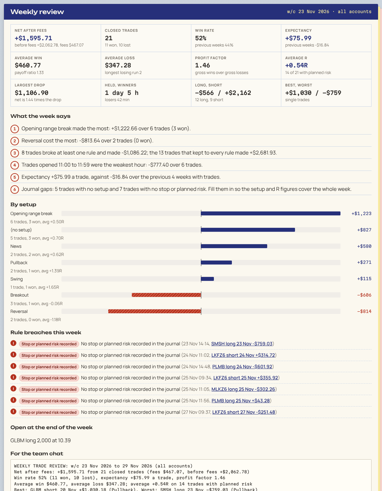
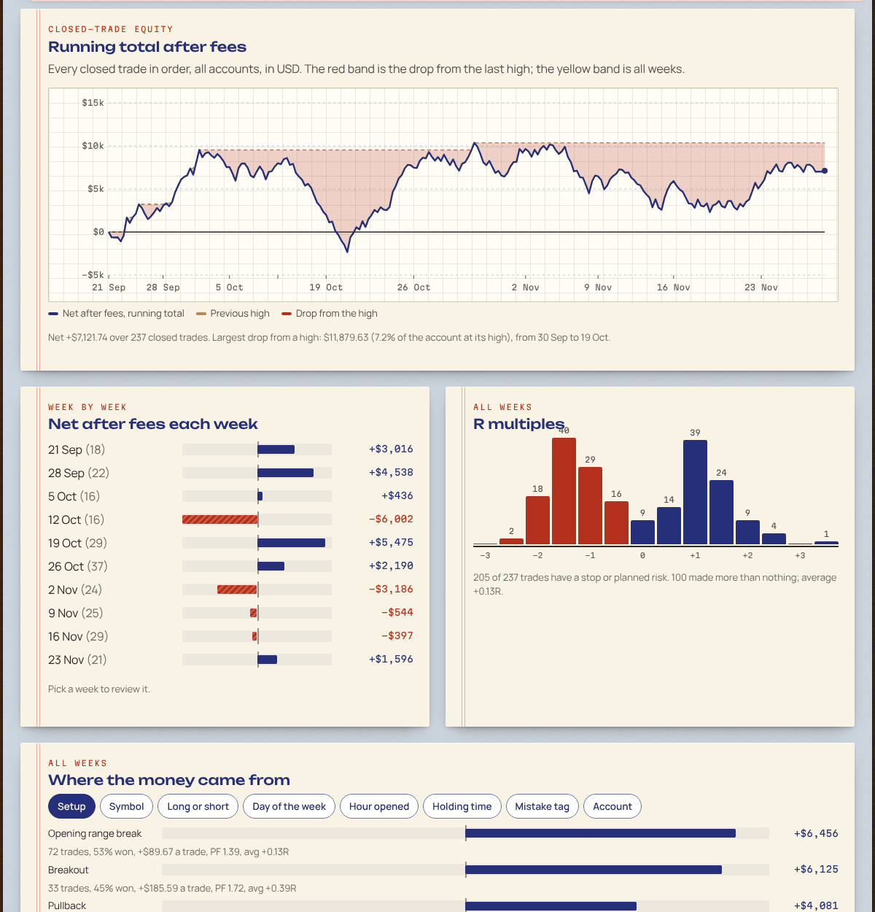
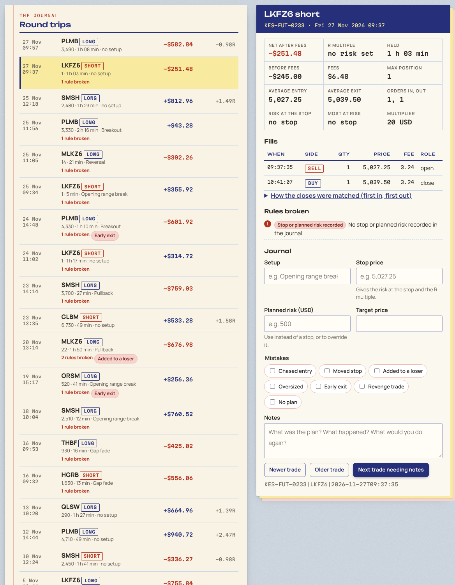
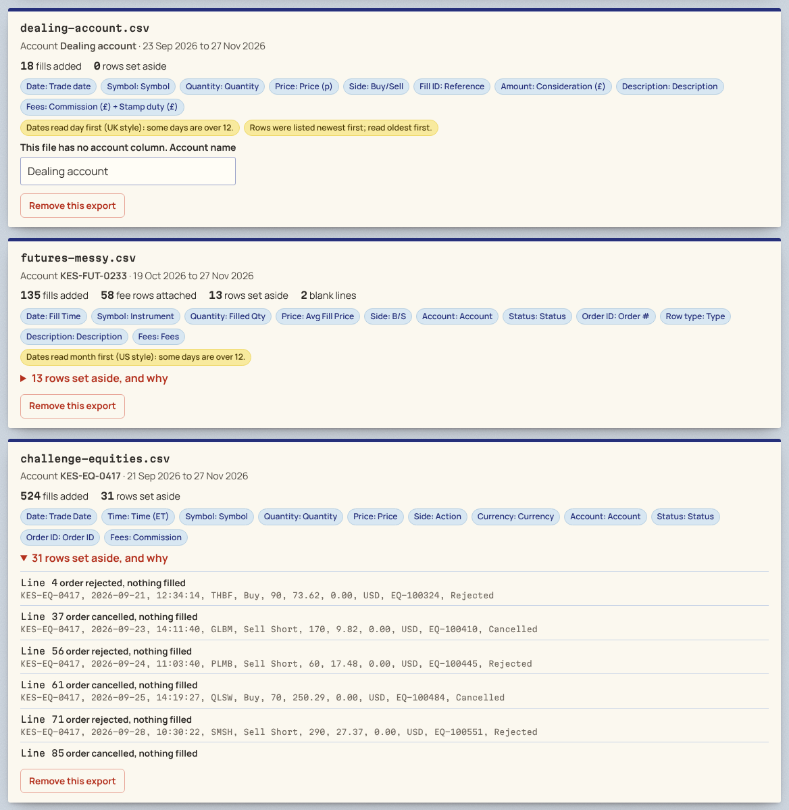
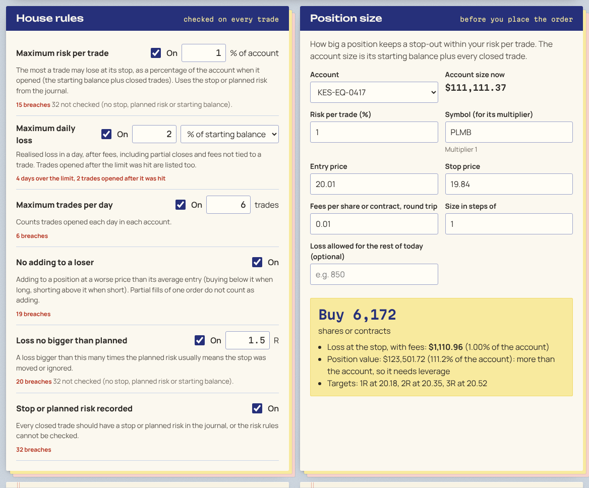
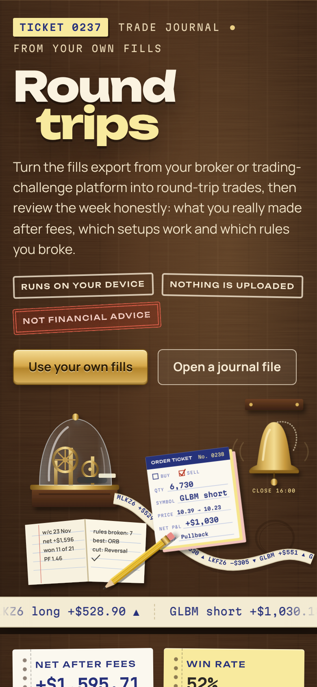
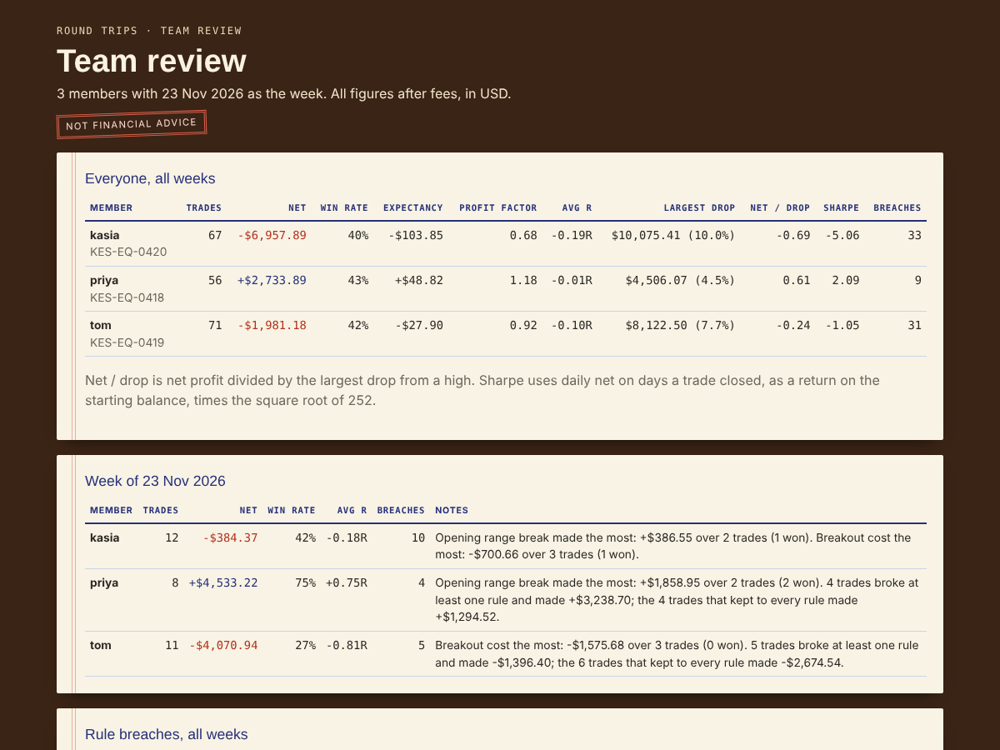

# Round trips

**A trade journal built from your own fills: drop in the trade-history export from your broker or trading-challenge platform and get round-trip trades, an honest weekly review after fees, your rule breaches and a write-up ready for the team chat.**

Not financial advice: it describes trades you have already made.

## Who it is for and the job

A university trading-challenge team (equities and futures challenges run on a platform that exports your fills), an investment society, or anyone with a broker account who reviews their trading once a week.

That review is usually done by hand in a spreadsheet: copy the fills across, pair each buy with its sell, work out what was really made after commission and exchange fees, guess which setups are working, and try to remember which rules were broken. Partial fills, scaling in and out, shorts, futures multipliers and prices quoted in pence make it slow and easy to get wrong, so it often does not happen at all.

Round trips does that job on the export you already have:

- **In:** CSV or text exports of executions or fills, in the layouts platforms and brokers use, plus a journal you fill in as you go (setup, stop or planned risk, mistakes, notes).
- **Out:** every round trip matched first in, first out, with net profit after fees, holding time, R multiple and the most it ever had at risk; statistics and breakdowns; a list of rule breaches; a position-size calculator; a weekly review that prints and copies as text; a round-trip CSV; and a journal file that reopens and takes next week's export without counting any fill twice.
- **Again:** every week, every time a new export arrives.

## Using it on your own data

Open `app/index.html` in a browser (double-click it; it works offline and nothing is uploaded). It opens on an invented team's ten weeks of fills, already worked through. Press **Use your own fills**, then **Choose exports** (or drop files on the in-tray, or paste the text).

**What it reads.** Any comma, semicolon, tab or pipe separated export with a header row that names:

| Needed | Examples of headers it recognises |
|---|---|
| date (with or without a time) | Date, Trade Date, Fill Time, Date/Time, Execution Time, Timestamp |
| symbol | Symbol, Ticker, Instrument, Contract, EPIC |
| side | Side, Action, B/S, Buy/Sell, Type (Buy, Sell, Sell Short, Buy to Cover, Bought, Sold, B, S), or a signed quantity |
| quantity | Quantity, Qty, Filled Qty, Shares, Contracts |
| price | Price, Avg Fill Price, Fill Price, T. Price, Price (p) |

Used when present: commission, fee, stamp duty and exchange fee columns (added together), currency, account, multiplier, order ID, fill ID, status, open or close, and a row type column.

**Messy files.** Quoted fields with commas, a byte order mark, blank rows, extra or reordered columns, lines above the header, ISO, UK or US dates (worked out from days over 12, or set by you), 24-hour or AM/PM times, currency signs and thousands separators, brackets for negatives, prices in pence (a `Price (p)` column or GBX), partial fills split across rows, fees in rows of their own (attached to the fill from the same order, or the same symbol that day), cancelled, rejected and expired orders, repeated headers, total rows, dividends and transfers. Exports listed newest first are read oldest first. Every row it sets aside is listed with its line number and the reason.

**When it cannot tell.** If a layout is new to it (or it picks the wrong column), open **Choose the columns yourself** on that file and point date, symbol, side, quantity, price and the rest at the right headers; it then finds the header row from your choice. If a sale closes shares bought before your first export, type in the date and price you bought at and the round trip is counted.

**The template.** `data/template.csv` (or **Download the template** in the app) shows the simplest layout:

```
Date,Time,Account,Symbol,Side,Quantity,Price,Commission,Currency,Order ID
2026-11-23,09:41:05,Challenge,HGRB,Buy,300,41.27,1.50,USD,A-1001
```

**Settings worth a minute.** Under **Rules**: each account's starting balance (for the % rules, drawdown % and the Sharpe ratio), a fixed exchange rate for any second currency, and "long only" for a cash share account where a sale with nothing held means shares bought before the export began. Under **Fills**: the contract multiplier for each futures root (for example LKF = 20, so LKFZ6 and LKFH7 both use it).

**What you get back.**

- **Fills:** the import log (columns used, date order, rows set aside and why), open positions, closes with no opening fill, and the blotter of every fill with the trade it belongs to. Fills CSV.
- **Trades:** the journal. Each round trip as a ticket: its fills, how the closes were matched, net after fees, R, risk at the stop and the most at risk, the rules it broke, and fields for setup, stop, planned risk, target, mistake tags and notes. Round-trip CSV.
- **Review:** the weekly review (headline figures, plain-English notes, setups, breaches, positions still open) with **Copy for the team chat**, **Print the review** and **Download as text**; statistics (win rate, average win and loss, expectancy, profit factor, average R, largest drop, holding times, daily Sharpe and Sortino); the closed-trade equity curve with its drawdown; net by week; R multiples; breakdowns by setup, symbol, long or short, weekday, hour, holding time, mistake and account; and every breach. Breaches CSV.
- **Rules:** your rules (maximum risk per trade as a % of the account, maximum daily loss, maximum trades per day, no adding to a loser, no loss bigger than a set number of R, a stop or planned risk on every trade), each with its breach count, and the position-size calculator.
- **Save journal file** writes everything (fills, notes, settings) to one JSON file. Open it next week, add the new export, and fills already in it are skipped (matched by fill ID, or by account, symbol, time, side, quantity and price). The browser also keeps a copy so you can pick up where you left off.

## A worked example on the sample data

The sample is an invented challenge team, "KES": an equities challenge account (`KES-EQ-0417`, starting at $100,000), a futures challenge account trading the invented Larkfield 50 index future (`KES-FUT-0233`, $50,000, $20 a point and $2 for the micro) and one member's UK dealing account (GBP 5,000, prices in pence). Ten weeks, 21 September to 27 November 2026.

- **Reading:** 677 fills from three exports. The challenge platform's file gave 524 fills and set aside 31 cancelled or rejected orders. The messy futures file gave 135 fills and attached 58 separate exchange-fee rows, and set aside 13 rows: cancelled orders, a repeated header and a total row; its dates were read month first because some days are over 12. The UK file was read in pence and oldest first; its first line sells shares bought before the export, so it is listed as a close with no opening fill rather than counted as a trade.
- **Matching:** 237 closed round trips and one position still open (GLBM, 2,000 shares bought on the Friday afternoon).
- **All ten weeks:** net **+$7,121.74 after $4,746.92 of fees** (+$11,868.66 before fees). Win rate 49% (115 won, 122 lost), expectancy +$30.05 a trade, profit factor 1.11, average +0.13R over the 205 trades with a stop or planned risk. Largest drop from a high $11,879.63 (7.2% of the accounts at their high), from 30 September to 19 October.
- **What worked:** Opening range breaks made +$6,456.33 over 72 trades; gap fades lost -$7,251.31 over 33. Trades tagged "Added to a loser" lost -$9,686.31 over 17 trades.
- **Rules:** 98 breaches. The 74 trades that broke at least one rule lost -$17,213.10; the 163 that kept to every rule made +$24,334.84.
- **The latest week (w/c 23 November):** +$1,595.71 from 21 closed trades after $467.07 of fees, 52% won, profit factor 1.46, expectancy +$75.99 a trade against -$16.84 over the previous four weeks. The review notes that the 8 trades that broke a rule made -$1,086.22 while the other 13 made +$2,681.93, that trades opened between 11:00 and 11:59 were the weakest hour, and that 5 trades still have no setup and 7 no stop.
- **Position size:** a $100,000 account risking 1% on an entry at 41.20 with a stop at 40.85 and a cent a share in fees: buy 2,777 shares, losing $999.72 at the stop.

The text the review copies for the team chat begins:

```
WEEKLY TRADE REVIEW: w/c 23 Nov 2026 to 29 Nov 2026 (all accounts)
Net after fees: +$1,595.71 from 21 closed trades (fees $467.07, before fees +$2,062.78)
Win rate 52% (11 won, 10 lost), expectancy +$75.99 a trade, profit factor 1.46
```

## Why it matters

This build sits in the brief's **Markets and trading** theme (trade journals, risk for trading challenges, analysing your own trade history), and it touches the consumer fintech and financial literacy theme too: most people who trade never see their own figures after fees. The weekly review answers the questions a team captain actually asks (did we make money after costs, which setups pay, did anyone break the risk rules, and what did the rule-breaking cost) from the export everyone already has, in minutes rather than an evening with a spreadsheet. It is honest by design: losses beyond the planned risk, adding to losers and fees eating small wins are all named.

## Opening the app and running the companion

- **App:** open `app/index.html`. One self-contained file, no internet needed, works in a frame and on a phone.
- **Companion (Python 3.9 or later, standard library only):**

```
python companion/round_trips.py trades data/challenge-equities.csv data/futures-messy.csv data/dealing-account.csv --journal data/sample-journal.json --out out
python companion/round_trips.py review data/challenge-equities.csv --journal data/sample-journal.json --week 2026-11-23 --html review.html
python companion/round_trips.py weekly --journal running-journal.json --inbox inbox --out reviews --archive archive
python companion/round_trips.py team data/team --out team-review
python companion/round_trips.py size --equity 100000 --risk 1 --entry 41.20 --stop 40.85 --fee 0.01
python companion/round_trips.py check data/futures-messy.csv
python companion/round_trips.py template
```

The companion gives exactly the same trades, figures, breaches, review text and files as the app, and adds what a browser page cannot do well:

- **`weekly`, the weekly job:** reads every export in an inbox folder, merges it into a running journal file (the same file the app saves, so your notes and settings stay in it) without double counting, backs up the old journal, writes a dated folder (`reviews/review-2026-11-23/` with `review.html`, `review.txt`, the week's and all round trips, the week's breaches and the matched fills) and moves the exports it read into an archive. Running it again on the same inbox adds nothing. On the sample, two overlapping weekly exports of the equities account give 489 and then 35 new fills (62 were already in the journal): 524, the same as the full export.
- **`team`, the team review:** a folder with one subfolder per member (their exports and, if they keep one, their journal file) or one export per member. It writes `team-review.html` and `team-review.csv`: each member's trades, net after fees, win rate, expectancy, profit factor, average R, largest drop, net over largest drop, daily Sharpe and Sortino, and breaches of each rule, plus the latest week side by side. On the sample team (`data/team`, four weeks): Priya +$2,733.89 with 9 breaches, Tom -$1,981.18 with 31, Kasia -$6,957.89 with 33.
- **Printable HTML reports** for any week (`review --html`).
- **`check`** shows how each file was read: the column chosen for each field, the date order and every row set aside.

## Tests

```
node --test tests/*.test.js          # the model in Node: parsing, matching, statistics, rules, files (20 tests)
python -m unittest discover -s tests  # companion, agreement and browser tests
```

- `tests/model.test.js`: the browser model on its own.
- `tests/test_companion.py`: reading, the jobs only the companion does, the command line and a scan for em dashes.
- `tests/test_agreement.py`: runs the model from `app/index.html` in Node and the Python package on the same inputs (the samples, edited journals and settings, the team, the weekly exports, edge-case files and twelve randomly generated exports with fractional quantities, reversals and futures) and requires every trade, statistic, breach and review to match, and every CSV and journal file to be byte for byte the same. It also checks that `app/index.html` is up to date with `src/`.
- `tests/test_app.py`: Playwright drives the app in Chromium: the sample on opening, keyboard tabs, uploading files including a bad one, writing up a trade, every download opened and checked, saving, reopening and merging next week's export, the app inside a frame, no sideways scroll at 390px, a label on every control, no console errors and no network requests.

Tests skip cleanly when Node, Playwright or Chromium is missing.

## Screenshots
















## Which language does what

| Part | Language | Lines (roughly) |
|---|---|---|
| The model: reading exports, matching, statistics, rules, review, files (`src/model.js`) | JavaScript | 1,880 |
| The interface (`src/ui.js`, `src/style.css`, `src/shell.html` with the hand-drawn hero) | JavaScript, CSS, HTML | 2,040 |
| The companion (`companion/`): the same model, plus the weekly job, team review, reports and command line | Python | 2,440 |
| Tests (`tests/`) | JavaScript, Python | 1,110 |
| Sample generator, build and screenshot tools (`tools/`) | Python | 750 |

`tools/build_app.py` writes `app/index.html` from `src/` with the fonts and samples embedded; `tools/make_samples.py` makes every sample file from a fixed seed.

## How it works

1. Each export is split into rows, the header row is found (it may sit below a few lines of preamble), and each field is matched to a column by its name and, for sides and dates, by what the values look like.
2. Every row becomes a fill, a fee row or a set-aside row with a reason. Money is held in whole cents, prices and quantities in millionths, so nothing drifts.
3. Fills are given a key (the fill ID, or account, symbol, time, side, quantity and price with a count for identical fills), which is how next week's overlapping export is merged without double counting.
4. For each account and symbol, fills are taken in time order. A trade starts when the position leaves zero and ends when it returns; adds and partial sales stay inside it, and a fill through zero closes one trade and opens the next. Closing quantities are matched to the oldest open lots first, giving each piece's profit and holding time and the profit realised each day.
5. The journal is joined on by trade ID (account, symbol and the time of the first fill), so notes survive merges. A stop gives the risk at the stop when the first order filled (the planned risk, and so the R multiple) and the most at risk at any point.
6. The rules run over the trades and the day-by-day realised profit; the statistics and breakdowns run over closed trades in your reporting currency; the weekly review picks out what changed and writes the notes.
7. The Python companion is a line-by-line port of the model, held to the same answers by the agreement tests.

## Limitations

- It is not financial advice and does not suggest trades.
- Profit counts when a position closes. Open positions are listed but not valued: an export has no current price.
- Positions opened before the first export cannot be matched; their closing fills are listed and left out (or set the account to long only).
- One fixed exchange rate per currency for totals; each trade keeps its own currency.
- Options are treated as contracts with a multiplier; exercise, assignment and expiry rows are not modelled.
- Times are used as written, without time zones. Two fills that are identical in every field and second are told apart only by their count within each file.
- The daily Sharpe and Sortino ratios use days on which a trade closed and need a starting balance; over a few weeks they are rough.
- Every company, ticker, team, person and the Larkfield 50 index future in the samples are invented.

## What could come next

- Mark open positions to a price you type in, for unrealised profit and a full account equity curve.
- Read broker statement PDFs and the Excel exports some platforms produce.
- A shared team journal where members' write-ups merge into one file for the captain.
