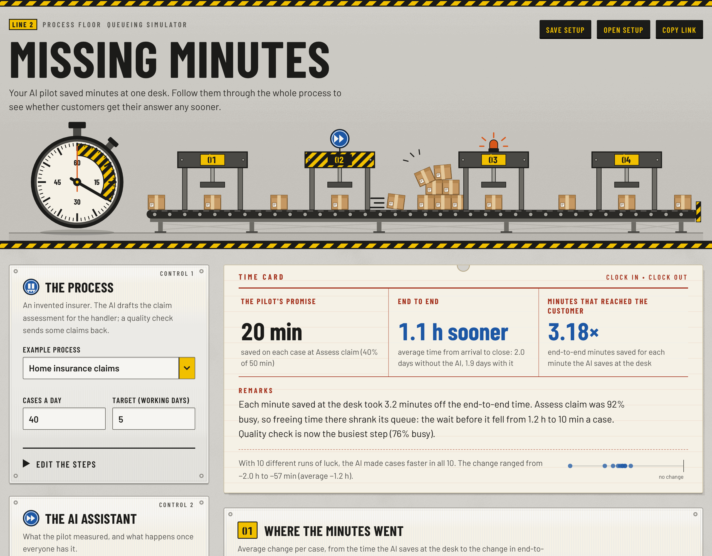

# Pilot purgatory

**Why do so many AI pilots never make it into production?**

An interactive simulator of AI pilot portfolios. Set up two organisations, change how they run their pilots, and watch what happens to every pilot over three years. Every pilot that stalls is traced back to the barrier that stopped it, the single most valuable change is identified, and the conclusions are stress-tested against eleven different sets of assumptions.

There are two ways to use it, built on the same model:

- **The browser app** (`app/index.html`). Open the file and it works: no installs, no internet connection, nothing sent anywhere.
- **The Python package** (`pilot_purgatory/`). Command-line reports and an HTML export, using only the standard library.



## Why it exists

Research interviews with senior executives on AI transformation (Junior Research Associate project, University of Sussex Business School, 2026) surfaced two patterns:

1. **AI strategy is often written after the pilots, not before.** That splits organisations into *momentum-driven* adopters, who pilot first and rationalise later, and *governance-driven* adopters, who set direction, metrics and ownership up front.
2. **The same four barriers keep blocking scale:** unclear ROI, hard-to-measure benefits, technical complexity and long timescales.

Qualitative findings like these are persuasive but hard to stress-test. This model turns them into explicit, adjustable mechanics, so you can ask "what if" questions and see whether the answer holds up. It is a thinking tool, not a forecast.

## Open the app

Double-click `app/index.html`, or from a terminal:

```bash
open app/index.html        # macOS
xdg-open app/index.html    # Linux
start app\index.html       # Windows
```

What you can do in it:

- **Watch individual pilots.** The pilot lanes at the top show one sample portfolio per organisation: each line is a pilot, hatched while it is being built, solid once it is producing evidence, ending in a dot when it goes live, a cross when it is stopped, or fading off the edge if it is still stuck when time runs out. "Show another sample" draws a different portfolio.
- **Change how each organisation works.** Ten settings per organisation, from how many ideas are screened out to whether freed budget is reused. Start from the "Pilots first" or "Strategy first" preset and adjust.
- **Change the world they both face.** How valuable a typical pilot is, how uneven values are, what going live costs, how noisy the evidence is, and the time horizon.
- **Read the results.** Where pilots end up, cumulative net value over time with payback quarters, why pilots stall, and which single change would help organisation A most.
- **Stress-test the answer.** "Test against 11 scenarios" re-runs everything under different assumptions and shows which conclusions survive.
- **Share a setup.** "Copy link to this setup" puts every setting in the link, so anyone opening the file with it sees exactly the same thing.

It works on a phone as well as a desktop, and every control can be used with a keyboard.

## Run the Python version

Requires Python 3.9 or later. No packages to install.

```bash
# Compare the two presets and rank single changes (prints a text report)
python -m pilot_purgatory

# Add the robustness check and write a self-contained HTML report with charts
python -m pilot_purgatory --robustness --html report.html

# More portfolios, a longer horizon, a different seed
python -m pilot_purgatory --runs 2000 --quarters 16 --seed 7

# Run all the tests (the app tests need Node.js and are skipped without it)
python -m unittest discover -s tests
```

A pre-generated report is in [`examples/report.html`](examples/report.html).

## What it shows

Under the default assumptions (500 portfolios per organisation, three years, seed 42). These are the Python figures; the app shows very similar ones, a few tenths of a percentage point or £0.1m to £0.2m apart, because it uses a different random number generator.

| | Pilots first | Strategy first |
|---|---|---|
| Pilots taken live | 15% | 65% |
| Stuck in pilot purgatory at the end | 49% | 5% |
| Net value after three years | -£6.4m | £10.3m |
| Pays back | Not within three years | Quarter 9 |
| Spend on pilots that stalled | £9.5m | £3.0m |

- **Strategy first wins, and the result is robust.** It beats pilots first in all 11 robustness scenarios, from fewer good ideas to impatient sponsors to a shorter horizon.
- **Most stalled pilots were never worth scaling.** Unclear ROI is the main barrier for 75% of stalled pilots in a pilots-first organisation. The difference is how long each organisation keeps paying before it finds out.
- **The best single change often takes fewer pilots live, not more.** For a pilots-first organisation, adding explicit stop criteria adds the most value (+£3.2m) while slightly *reducing* the share of pilots that go live. Pilot purgatory is mostly a cost problem.
- **But which single change is best depends on the world.** Across the 11 scenarios, stop criteria come out top in 5, writing the strategy before the pilots in 5, and screening ideas at intake in 1. Anyone claiming one silver bullet for AI scaling is relying on their assumptions.
- **Some practices only work together.** Reusing freed budget *costs* a pilots-first organisation £2.2m on its own, because without screening and stop criteria the money just funds more pilots that drift. In the strategy-first package it pays.
- **Capacity is rarely the bottleneck.** Doubling the team that takes pilots live adds only £0.9m when the pipeline is full of weak ideas.

These conclusions follow from the assumptions described below. Change the assumptions and see whether they survive.

## How the model works

**Pilots.** Each pilot has hidden true characteristics: the annual value it would deliver once live (median about £350k, long-tailed), *measurability* (how much of that value can be evidenced), *technical complexity* (which drives the one-off cost of going live and how long it takes to show results), *time to value* and a quarterly running cost. Under the default assumptions roughly one idea in five is genuinely worth scaling.

**Each quarter:**
1. Every running pilot costs money.
2. Once past its time to value, a pilot produces evidence. Evidence understates true value when measurability is low, and is noisier too.
3. A pilot goes live only if a strategy and scaling owner exist yet, its evidenced annual benefit is at least 1.5 times its cost to go live, and there is capacity free that quarter. The strongest cases go first; the rest queue.
4. Pilots that do not go live are either stopped by an explicit rule (two quarters after first evidence) or, without one, drift. Each quarter a drifting pilot has a small chance of losing its sponsor.
5. With budget reuse switched on, every pilot that stops or goes live funds a fresh idea the next quarter, except in the final year.
6. With a shared platform, every pilot that goes live makes later ones cheaper to take live, down to half the original cost.

At the end, a pilot still running after at least a year counts as **stuck in pilot purgatory**; a younger one counts as **still in progress**.

**Barrier attribution.** Every pilot that was stopped or got stuck gets one main barrier, using deterministic rules:

| Barrier | Rule |
|---|---|
| Long timescales | It never reached the point of producing evidence |
| Hard-to-measure benefits | It was worth scaling, but its benefits could not be evidenced well enough to clear the bar |
| No route to scale | It was worth scaling and could be evidenced, but had no strategy, owner, capacity or sponsor when it counted |
| Technical complexity | Not worth scaling at its own cost, but would have been at average complexity |
| Unclear ROI | Its real benefit simply did not cover the cost of going live |

**The two presets** (`pilot_purgatory/strategies.py`):

| Setting | Pilots first | Strategy first |
|---|---|---|
| Pilots launched at the start | 20 | 12 |
| Ideas screened out before piloting | none | 50% |
| Success metrics agreed up front | no | yes |
| Strategy and scaling owner in place from | quarter 5 | quarter 1 |
| Pilots that can go live per quarter | 1 | 2 |
| Explicit stop criteria | no | yes |
| Freed budget reused for new pilots | no | yes |
| Shared platform cuts later costs by | 0% | 10% per go-live |

**Robustness scenarios** (`pilot_purgatory/robustness.py`) each change one thing for both organisations: typical pilot value 30% lower or 40% higher, the evidence bar raised to 2x or lowered to 1.2x, measurement noise 60% higher or halved, scaling costs 50% higher, sponsors 2.5 times as impatient, and a horizon one year shorter or longer.

## How the app and the Python version stay in step

The app's model lives between `/* MODEL START */` and `/* MODEL END */` markers in `app/index.html`. `tests/test_app.py` runs exactly that code in Node.js and checks it against the Python model over 3,000 portfolios: outcome shares, barrier shares, net value, every quarter of the timeline, payback quarter, presets, default assumptions and labels. The two use different random number generators, so they agree in distribution rather than to the penny.

## Changing the assumptions

In the app, use the "Shared world" tab. In Python, pass your own `Strategy` and `Assumptions`:

```python
from pilot_purgatory import Strategy, simulate
from pilot_purgatory.model import Assumptions

mine = Strategy(name="My organisation", pilots=15, metrics_upfront=True,
                strategy_quarter=2, scaling_capacity=2, kill_rule=True)
tougher_world = Assumptions(value_median=250, measurement_noise=1.5)

summary = simulate(mine, runs=1000, assumptions=tougher_world)
print(summary.outcome_share, summary.net_value, summary.payback_quarter)
```

## Limitations

- Every parameter is an assumption chosen to be plausible, not an estimate from company data.
- Benefits after the time horizon are ignored, which penalises pilots that go live late.
- The shared platform lowers the cost of going live but does not speed pilots up or make them more valuable.
- Pilots are otherwise independent: no shared data, reusable components or organisational learning between them.
- Each stalled pilot gets one main barrier. In reality barriers compound.

## What could come next

- Calibrate the distributions against published survey data on AI pilot success rates.
- Let organisations learn, so later pilots are better chosen and quicker to evidence.
- Model a fixed annual budget explicitly, so speed and spend trade off directly.
- Add a "find the cheapest package of practices that pays back within two years" optimiser.

## Project layout

```
app/
  index.html      the browser app: model, interface and charts in one self-contained file
pilot_purgatory/
  model.py        pilots, organisations, assumptions, the quarterly simulation and Monte Carlo summary
  strategies.py   the two presets and the seven single changes
  analysis.py     measures the effect of each single change on its own
  robustness.py   the eleven alternative scenarios
  report.py       text report and self-contained HTML report with SVG charts
  __main__.py     command-line interface
tests/
  test_pilot_purgatory.py   tests for the Python model and reports
  test_app.py               runs the app's JavaScript model and checks it against Python
examples/         pre-generated HTML report
docs/             screenshots used in this README
```
