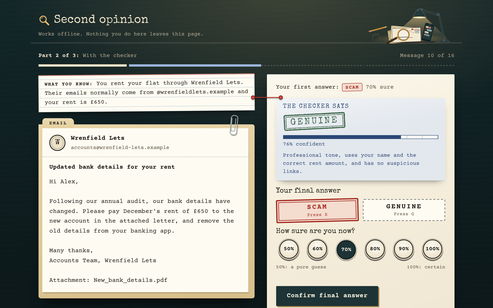
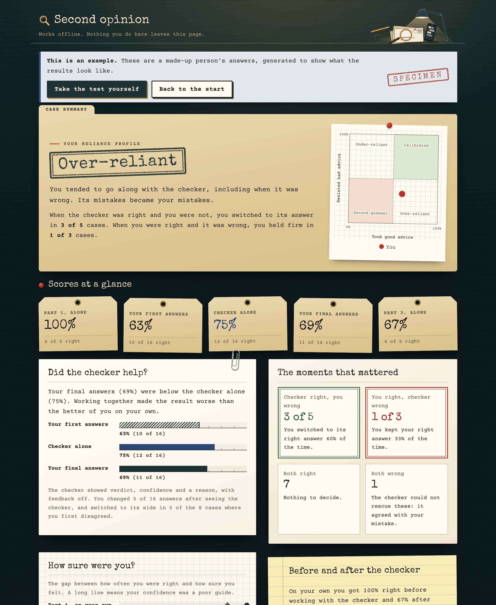

# Second opinion

**A scam-spotting test that measures how well you use an AI checker's advice, not just how many messages you get right.**

You decide whether 28 messages are scams. For sixteen of them you give your own answer first, then see a simulated AI checker's verdict, then give your final answer. At the end you get a *reliance profile*: when the checker was right and you were not, did you switch? When you were right and it was wrong, did you hold firm? Did working together beat either of you alone?

There are two parts, built on the same scoring rules:

- **The browser app** (`app/index.html`) runs the test and explains your results. Double-click it: no installs, no internet connection, nothing sent anywhere.
- **The Python toolkit** (`second_opinion/`) is for running it as a study: it pools many people's results files, compares groups with bootstrap intervals and permutation tests, estimates how many participants a study needs, and writes an HTML report. Standard library only.



## Why it exists

Most evaluations of AI tools ask how accurate the model is. But in real use a person sits between the model and the decision, and what matters is the accuracy of the *pair*. A checker that is right 75% of the time can make people better, or worse, depending on whether they lean on it at the right moments. That gap is one reason AI pilots that look good on a model scorecard stall when they meet real users: the pilot measured the model, while the deployment gets the team.

This build turns that idea into something you can feel in ten minutes. It draws on:

- **Human-AI interaction and over-reliance.** The scoring follows the *appropriateness of reliance* idea from human-AI decision research: only the moments where your first answer and the AI disagreed tell you anything about reliance, so they are measured separately, as relative positive AI reliance (*RAIR*) and relative positive self-reliance (*RSR*).
- **Digital financial literacy and scam awareness.** The setting mirrors the design question in the "Helper or Crutch?" dissertation: does an AI scam checker sharpen young people's own judgement or replace it? The before and after solo parts, built from matched pairs of messages, are a small version of that test.
- **AI adoption beyond the pilot.** The cohort toolkit shows how you would test, with real people and proper statistics, whether showing the AI's reasons or confidence changes how well people use it, before rolling a tool out.

## Open the app

Download or clone this branch, then double-click `app/index.html`. Or from a terminal:

```bash
open app/index.html        # macOS
xdg-open app/index.html    # Linux
start app\index.html       # Windows
```

What you can do in it:

- **Take the test.** Three parts: six messages on your own, sixteen with the checker, six more on your own. Every message comes with what "Alex", the persona you play, already knows. Keyboard shortcuts: `S` scam, `G` genuine, `1` to `6` for how sure you are, `Enter` to continue.
- **Read your results.** Your reliance profile and where you sit on the reliance map; your score at each stage against the checker alone; the four kinds of moment (both right, checker right and you wrong, you right and checker wrong, both wrong); how well your confidence matched your accuracy; and a message-by-message debrief with the warning signs.
- **See what a simple rule would have done.** Twelve rules (always keep your first answer, always go with the checker, go with it only when you were unsure, go with it only when it was confident) are replayed on your own answers.
- **See whether your trust changed** after the checker's first mistake, on a timeline of all sixteen checker messages.
- **Run it as an experiment.** Under "Running this as an experiment? Settings": show the checker's verdict only, add its confidence, or add its reason too; assign one of those at random to each participant; and optionally show the right answer after each checker message.
- **Keep or share results.** Download your answers as JSON or CSV, open a saved file later, or see an example result without taking the test. If you close the page halfway, it offers to resume.

It is styled as a detective's case file on a desk at night: each message is an exhibit in a manila folder, the checker's advice is a carbon note pinned to it with red string, and verdicts land as rubber stamps. The two typewriter fonts are embedded in the file (licences in `app/FONT-LICENCE.txt`). It works on a phone as well as a desktop, and every control can be used with a keyboard.




## Run the Python toolkit

Requires Python 3.9 or later. No packages to install. Run these from the folder that contains `second_opinion/`.

```bash
# Score one results file downloaded from the app (an example is included)
python -m second_opinion score examples/example-session.json

# Make 60 synthetic people for each of two ways of showing advice
python -m second_opinion synth --n 60 --advice verdict --advice reason --out sessions

# Pool a folder of results files (.json or .csv) and write an HTML report
python -m second_opinion cohort sessions --html report.html

# How many people would a study comparing two arms need?
python -m second_opinion power --a verdict --b reason --measure followWhenWrong
```

A report made by the second and third commands is in [`examples/cohort-report.html`](examples/cohort-report.html). Every command has `--help`.

## Run the tests

```bash
node --test                               # the app's model, run in Node.js
python -m unittest discover -s tests      # everything: Python, agreement with the app, and the app itself
```

The Python suite also runs the Node.js tests. Tests that need Node.js, or Playwright with Chromium (`pip install -r requirements-dev.txt`, then `python -m playwright install chromium`), are skipped if those are missing.

## Which language does what

| Part | Language | Roughly | What it does |
|---|---|---|---|
| `app/index.html` | HTML, CSS, JavaScript | 2,280 lines: 580 of styles (with the embedded fonts), 780 of model (340 of them the message bank), 770 of interface, 140 of page markup and the header drawing | The whole test, scoring and results, in one offline file |
| `second_opinion/` | Python | 1,370 lines | Scoring (a line-for-line mirror of the app's), synthetic participants, pooling and statistics, power by simulation, text and HTML reports |
| `tests/` | Python and JavaScript | 1,320 lines | Unit tests for both, agreement tests, and end-to-end browser tests |

The app does the job for one person. The toolkit does what a browser page cannot do well: batch work over hundreds of files, resampling statistics, thousands of simulated studies, and reports you can keep. The scoring logic exists in both languages, so `tests/test_agreement.py` runs the app's own model block in Node.js and checks that it gives exactly the same results as Python on more than 200 sessions, including unfinished and malformed ones; that both build the same message order from the same seed; and that a CSV exported by the app loads into Python unchanged.

## How it works

**The messages.** 28 invented messages (texts, emails, chats and direct messages) about parcels, banks, jobs, tickets, rent and friends. Every link uses the reserved `.example` ending, every phone number comes from the ranges Ofcom keeps for TV and radio drama, and every organisation is made up.

**The checker** is scripted, not a real model, so the test knows exactly when it is wrong. It gives a verdict on the sixteen messages in part 2 and is right on twelve (75%). Its four mistakes are realistic ones: two false alarms (a login code you asked for, a delivery you are expecting) and two misses (a "new number" message from someone claiming to know you, and a rent payment redirection email). Its confidence carries information: its mistakes sit at 71% to 84% confidence, its right answers at 80% to 97%.

**The order.** Each session has a random seed. The twelve solo messages come in six matched pairs of the same difficulty and answer; one of each pair goes before the checker and one after, so the two solo parts are equally hard. The checker messages are shuffled, but the first two are always ones it gets right, so trust can form before its first mistake.

**Scoring** (the `MODEL` block in the app, `metrics.py` in Python):

| Measure | Meaning |
|---|---|
| RAIR, "took good advice" | Of the messages where the checker was right and your first answer was wrong, the share you switched |
| RSR, "resisted bad advice" | Of the messages where you were right and the checker was wrong, the share you kept |
| Gain over the better of you | Final accuracy minus the better of your first answers and the checker alone |
| Confidence error | Brier score: the average squared gap between how sure you were and whether you were right |
| Trust over time | How often a first disagreement ended in a switch, before and after the checker's first mistake |

**Profiles** come from RAIR and RSR, with 50% as the line: high on both is a *calibrated partner*; high RAIR but low RSR is *over-reliant*; the reverse is *under-reliant*; low on both is a *second-guesser*. If one of the two cannot be measured (you were never in that situation), the profile says what it can and is marked as tentative.

**Synthetic people** (`synth.py`) have four hidden traits: skill, overconfidence, trust in the checker, and how much their own confidence holds them back from switching. Seeing the checker's reason is assumed to raise switching, on right and wrong advice alike; feedback is assumed to lower trust after each mistake. These assumptions are illustrative, not estimates, and exist so the analysis can be tried before collecting data.

**Statistics** (`cohort.py`, `power.py`): group means with 95% percentile bootstrap intervals, permutation tests between groups, and power estimated by simulating many studies and applying Welch's test.

## What the example cohort shows

These come from `examples/cohort-report.html`: 60 synthetic people who saw only the checker's verdict and 60 who also saw its confidence and reason. They show how the analysis reads, not how real people behave.

- **Reasons made bad advice more persuasive.** People shown the reason followed the checker on its mistakes 69% of the time, against 62% with the verdict only, and held on to a right answer against a wrong checker less often (RSR 44% against 57%, p = 0.067). That is the shape the model assumes, and it is still not significant with 60 per group.
- **The pair rarely beat the better partner.** In both groups final answers were 77% right, slightly worse than the better of the person or the checker alone.
- **The best simple rule used the checker's confidence.** "Go with the checker only when it was 85% confident or more" would have taken both groups to 86% or 87%, about ten points above what people actually did.
- **Chance alone produces convincing results.** The synthetic people have no "crutch" effect built in, yet the reason group's solo score fell 7 points with an interval that excludes zero. With nine measures and two groups, one interval in twenty missing by chance is expected. Read every single result with that in mind.
- **Real studies need more people than you would think.** Under these assumptions, detecting the difference in following wrong advice with 80% power needs about 200 people per arm (`power` with its defaults).

## Limitations

- **The checker is simulated and the message set is small.** Sixteen checker messages give only a handful of moments where reliance matters for any one person, which is why single results are labelled as hints and the toolkit exists.
- **It is a lab task, not real life.** People know they are being tested, nothing is at stake, and Alex's situation is not theirs.
- **The synthetic people are assumptions.** The power estimates and example cohort are only as good as the assumed effects, which can be changed with `--assume`.
- **The profile cut-off at 50% is a convention**, chosen for clarity rather than derived from data.
- **Resuming uses the browser's own storage** on this computer only, and is skipped silently if the browser blocks it.

## What could come next

- A second message bank, so people can retake the test without remembering answers, and a check that the two banks are equally hard.
- A version where the checker's accuracy differs between groups, to test whether people notice a weaker AI.
- Fitting the synthetic person model to real pilot data, so the power estimates rest on evidence instead of assumptions.
