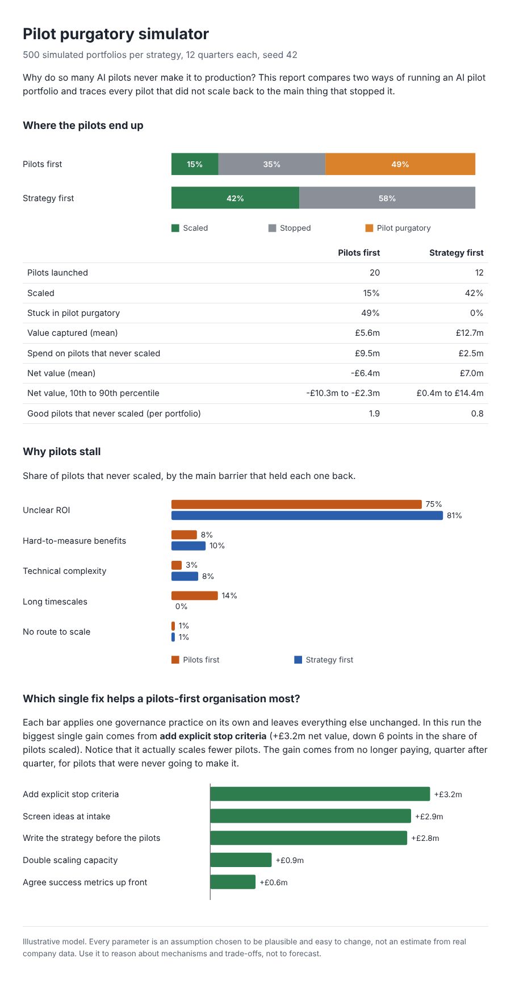

# Pilot purgatory simulator

**Why do so many AI pilots never make it to production?**

A small Monte Carlo model that runs hundreds of simulated AI pilot portfolios, compares a *pilots-first* organisation with a *strategy-first* one, and traces every pilot that did not scale back to the main barrier that stopped it. It then tests which single governance practice does the most good on its own.

Pure Python standard library: no installs, no API keys, runs offline in under a second.



## Why it exists

Research interviews with senior executives on AI transformation (Junior Research Associate project, University of Sussex Business School, 2026) surfaced two patterns:

1. **AI strategy is often written after the pilots, not before.** That splits organisations into *momentum-driven* adopters, who pilot first and rationalise later, and *governance-driven* adopters, who set direction, metrics and ownership up front.
2. **The same four barriers keep blocking scale:** unclear ROI, hard-to-measure benefits, technical complexity and long timescales.

Qualitative findings like these are persuasive but hard to stress-test. This model turns them into explicit, adjustable mechanics, so you can ask "what if" questions: what happens if success metrics are agreed up front? Is scaling capacity the bottleneck, or is it the ideas themselves? It is a thinking tool, not a forecast.

## Quick start

Requires Python 3.9 or later.

```bash
# Compare the two archetypes and rank single fixes (prints a text report)
python -m pilot_purgatory

# Also write a self-contained HTML report with charts
python -m pilot_purgatory --html report.html

# More runs, a longer horizon, a different seed
python -m pilot_purgatory --runs 2000 --quarters 16 --seed 7

# Run the tests
python -m unittest discover -s tests
```

A pre-generated report is in [`examples/report.html`](examples/report.html).

## Example output

```
Pilot purgatory simulator  |  500 runs, 12 quarters, seed 42

                                            Pilots first      Strategy first
Pilots launched                                       20                  12
Scaled                                               15%                 42%
Stopped                                              35%                 58%
Stuck in pilot purgatory                             49%                  0%
Value captured (mean)                              £5.6m              £12.7m
Pilot spend (mean)                                £10.8m               £3.6m
Spend on pilots that never scaled                  £9.5m               £2.5m
Net value (mean)                                  -£6.4m               £7.0m
  10th to 90th percentile              -£10.3m to -£2.3m     £0.4m to £14.4m
Good pilots that never scaled                        1.9                 0.8
Median quarter of scaling                             Q6                  Q4

Why pilots stall (share of pilots that never scaled)
  Unclear ROI                                        75%                 81%
  Hard-to-measure benefits                            8%                 10%
  Technical complexity                                3%                  8%
  Long timescales                                    14%                  0%
  No route to scale                                   1%                  1%

Single fixes for 'Pilots first', ranked by net value
  1. Add explicit stop criteria               +£3.2m net value, -6 pts scaled, -49 pts in purgatory
  2. Screen ideas at intake                   +£2.9m net value, +12 pts scaled, -9 pts in purgatory
  3. Write the strategy before the pilots     +£2.8m net value, +2 pts scaled, -1 pts in purgatory
  4. Double scaling capacity                  +£0.9m net value, +1 pts scaled, -1 pts in purgatory
  5. Agree success metrics up front           +£0.6m net value, +4 pts scaled, -3 pts in purgatory
```

## What it shows (under the default assumptions)

- **Strategy first scales almost three times the share of pilots** and pilot purgatory all but disappears, turning a loss-making portfolio into a positive one.
- **Most stalled pilots were never worth scaling.** "Unclear ROI" dominates in both archetypes. The difference is how long each organisation keeps paying before it finds out.
- **The best single fix scales fewer pilots, not more.** Explicit stop criteria cut the share scaled slightly but add the most value, because the organisation stops funding pilots that were never going to make it. Purgatory is mostly a cost problem, not a success problem.
- **Capacity is rarely the binding constraint** when the pipeline is full of weak ideas. Doubling the team that productionises pilots helps far less than better intake and an earlier strategy.

These conclusions follow from the assumptions below. Change the assumptions and see whether they survive.

## How the model works

**Pilots.** Each pilot has hidden true characteristics: annual value once scaled (median about £350k, long-tailed), *measurability* (how much of that value can be evidenced), *technical complexity* (which drives the one-off cost of scaling and how long it takes to show value), *time to value* and a quarterly running cost. Roughly one candidate in five is genuinely worth scaling.

**Each quarter:**
1. Every running pilot costs money.
2. Once past its time to value, a pilot produces evidence. Evidence understates true value when measurability is low, and is noisier too.
3. A pilot scales only if a strategy and scaling owner exist yet, its evidenced annual benefit is at least 1.5 times its scaling cost, and there is capacity free that quarter. The strongest cases go first; the rest queue.
4. Pilots that do not scale are either stopped by an explicit rule (two quarters after first evidence) or, without one, drift. Each quarter a drifting pilot has a small chance of losing its sponsor.

Anything still running at the end of the horizon is counted as **pilot purgatory**.

**Barrier attribution.** Every pilot that never scaled gets one main barrier, using deterministic rules:

| Barrier | Rule |
|---|---|
| Long timescales | It never reached the point of producing evidence |
| Hard-to-measure benefits | It was worth scaling, but its benefits could not be evidenced well enough to clear the hurdle |
| No route to scale | It was worth scaling and could be evidenced, but had no strategy, owner, capacity or sponsor when it counted |
| Technical complexity | Not worth scaling at its own cost, but would have been at average complexity |
| Unclear ROI | Its real benefit simply did not cover the cost of scaling |

**The two archetypes** differ on five levers (see `pilot_purgatory/strategies.py`):

| Lever | Pilots first | Strategy first |
|---|---|---|
| Pilots launched | 20 | 12 |
| Ideas screened out at intake | none | 50% |
| Success metrics agreed up front | no | yes |
| Strategy and scaling owner in place from | quarter 5 | quarter 1 |
| Pilots productionised per quarter | 1 | 2 |
| Explicit stop criteria | no | yes |

## Changing the assumptions

Edit the presets in `pilot_purgatory/strategies.py` or the constants at the top of `pilot_purgatory/model.py`, or define your own strategy in Python:

```python
from pilot_purgatory import Strategy, simulate

mine = Strategy(name="My organisation", pilots=15, metrics_upfront=True,
                strategy_quarter=2, scaling_capacity=2)
summary = simulate(mine, runs=1000)
print(summary.outcome_share, summary.net_value)
```

## Limitations

- Every parameter is an assumption chosen to be plausible, not an estimate from company data.
- Budget freed by stopping a pilot is not recycled into new ideas, so stop criteria are, if anything, undervalued.
- Benefits after the time horizon are ignored, which penalises pilots that scale late.
- Pilots are independent: no shared data platforms, reusable components or organisational learning.
- Each stalled pilot gets one main barrier. In reality barriers compound.

## What could come next

- Recycle freed budget into a rolling pipeline of new pilots.
- Add platform effects, where each scaled pilot makes the next one cheaper.
- Calibrate the distributions against published survey data on AI pilot success rates.
- An interactive web version with sliders for every lever.
- A full sensitivity analysis showing which assumptions the conclusions depend on most.

## Project layout

```
pilot_purgatory/
  model.py        pilots, strategies, the quarterly simulation and Monte Carlo summary
  strategies.py   the two archetypes and the five single-fix levers
  analysis.py     measures the effect of each lever on its own
  report.py       text report and self-contained HTML report with SVG charts
  __main__.py     command line interface
tests/            unit tests (standard library unittest)
examples/         pre-generated HTML report
docs/             screenshot used in this README
```
