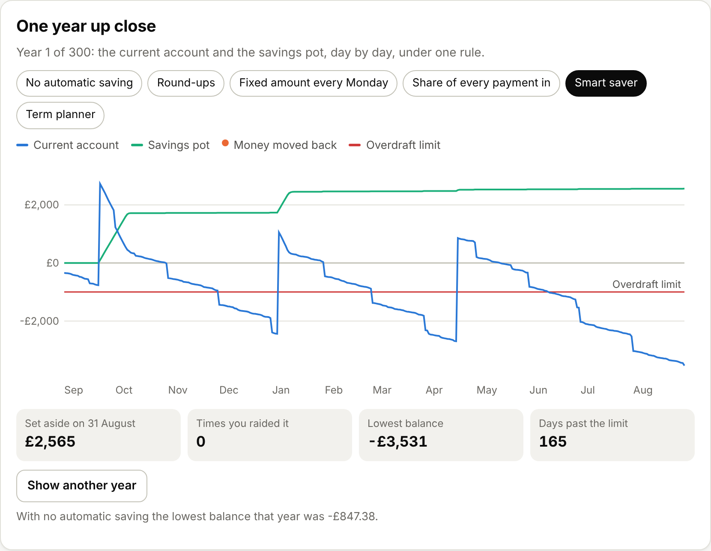
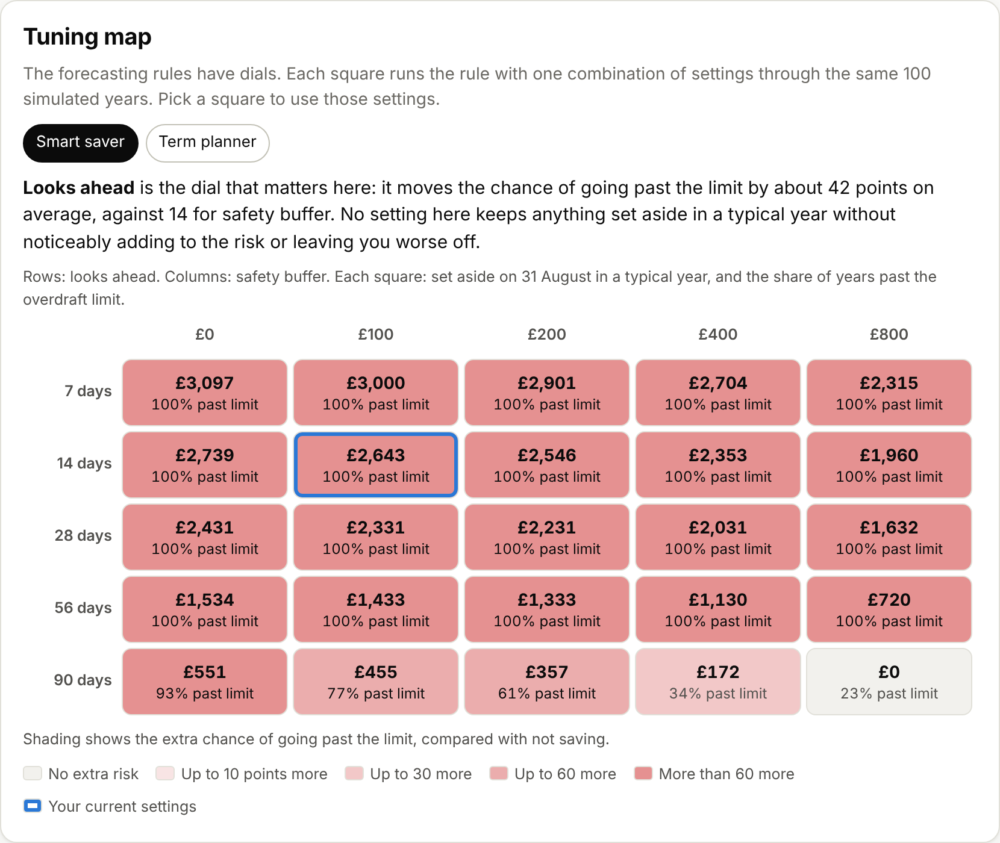
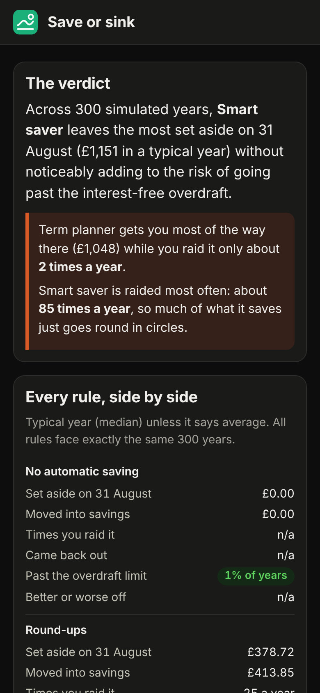

# Save or sink

**Does automatic saving leave a student better off, or just push them into their overdraft?**

Save or sink stress-tests six ways of saving automatically against hundreds of synthetic student years:

- no automatic saving (the baseline);
- round-ups on card spending;
- a fixed amount every Monday;
- a share of every payment in;
- a "smart saver" that forecasts what is safe to save;
- a "term planner" that budgets all the way to the next loan payment.

It shows how much each rule really leaves you with on 31 August. It also shows how often you would raid the pot, how much of the money just goes round in circles, and how often a rule pushes you past the interest-free overdraft into paid borrowing.


## Why it matters

Banking apps increasingly decide on your behalf when to move money into savings. Some use fixed rules; others use forecasts of your spending, sold as "smart" or "AI-powered" saving. For a student, the question that matters is not how much an app moves into savings. It is whether that money is still there at the end of the year, and what it cost to keep it there.

Save or sink makes three things visible that a savings app's dashboard usually hides:

1. **Churn.** A saver that moves £5,800 into a pot over a year, while you move £4,700 back out, has saved far less than its total suggests. The table shows this as "Came back out".
2. **Forecast blind spots.** A two-week forecast made the day after a loan payment sees a full account. It does not see the rent due over the rest of the term. On a tight budget, a smart saver with a short horizon can leave you with £2,600 "saved" while your current account sits £3,500 overdrawn.
3. **Moving your own money creates nothing.** In this model, the only real gain from saving is interest. So a rule that pushes you into paid overdraft can leave you worse off than not saving at all.

This is a teaching tool for financial literacy, not financial advice. Every student, bank and amount in it is invented.

## How to run it

**The app.** Double-click `app/index.html`. It runs entirely in the page, works offline and sends nothing anywhere.

**The Python package.** It uses the same engine with Python 3.9 or later and the standard library only. Run these from the repository folder:

```bash
python -m saveorsink run                              # every rule, 1,000 simulated years, steady part-time job
python -m saveorsink run --preset tight --rescue never
python -m saveorsink year --rule smart --csv year.csv  # one year, month by month, plus every day as CSV
python -m saveorsink sweep --preset tight --rescue never --csv sweep.csv
python -m saveorsink sweep --rule planner --dial buffer=0,200,400 --dial cap=20,100
python -m saveorsink settings shifts -o my-settings.json
python -m saveorsink run --settings my-settings.json
python -m saveorsink run --link "<a link copied from the app>"
```

**The tests.** Parity and app tests need Node.js; the browser tests need Playwright for Python. Each group skips itself if its tool is missing.

```bash
python -m unittest discover -s tests
```

## Screenshots

| One year up close (tight budget, never raiding savings) | The tuning map | On a phone, dark mode |
|---|---|---|
|  |  |  |

## Which language does what

| Part | Language | Lines | What it does |
|---|---|---|---|
| `app/index.html` (model) | JavaScript | 511 | The engine: synthetic years, the six rules, rescues, interest, stress test, tuning sweep, settings links |
| `app/index.html` (interface) | JavaScript | 506 | Controls, verdict, results table, the year chart, the tuning map, saving, opening and sharing settings |
| `app/index.html` (layout) | HTML and CSS | 210 | Light and dark themes, the phone layout, accessible markup |
| `saveorsink/model.py` | Python | 616 | The same engine, line for line, so both give identical answers |
| `saveorsink/report.py` and `__main__.py` | Python | 286 | Plain-text reports, CSV and JSON output, and the command line |
| `tests/` | Python and JavaScript | 857 | Parity between the two engines, the model's rules, the command line, and the app in a real browser |

The app is for exploring; Python is for running many more years, sweeping settings and exporting results. Settings move freely between them: the app saves a JSON file that the command line reads, and a link copied from the app works with `--link`.

## How it works

**A synthetic year.** Each year runs from Monday 1 September to 31 August (365 days):

- Student loan payments arrive on 22 September, 5 January and 20 April, at the start of each term.
- Wages arrive on Fridays for that week's hours, which vary at random around the setting.
- Rent leaves on the 1st of each month and bills on the 10th.
- Everyday spending is one to three card purchases a day. Nights out fall on Fridays and Saturdays.
- An unexpected cost may land at the end of any month, with a lognormal size.

All amounts are whole pennies. A year is fully determined by its seed, so every rule faces exactly the same years.

**The rules.** At the end of each day, the rule decides how much to move into savings:

- **Round-ups** save the change from each card purchase, optionally multiplied.
- **Fixed amount** saves a set sum every Monday.
- **Share of payments** saves a percentage of everything coming in.
- **Smart saver** takes the last 28 days of card spending, projects it over its forecast window, adds the rent and bills it knows are due, keeps a safety buffer, and moves a share of what is left (up to a daily cap). It waits a week to learn first.
- **Term planner** does the same sums, but always looks as far as the next loan payment (or 31 August after the last one). Every rent payment that loan must cover is in view.

**Raids.** If the current account then falls below the student's comfort point, they move money back from the pot. The comfort point is overdrawn at all, within £100 of the limit, or never.

**Interest.** Overdraft interest is charged only on the part beyond the interest-free limit. Savings interest is paid on the pot. Both are simple annual rates, accrued daily and settled at each month end.

**The verdict.** A rule is called safe when it meets all three of these tests:

- it is no more than 2 percentage points more likely than not saving to go past the limit in a year;
- it spends no more days past the limit on average;
- it does not leave the student worse off in a typical year.

Among the safe rules, the verdict names the one that leaves the most set aside. It then points out churn, risk and losses.

**The tuning map and sweep.** These run one forecasting rule many times over the same years, with a grid of settings (for the smart saver, how far it looks ahead against its safety buffer). On the tight budget the map makes one thing plain. How far the saver looks ahead moves the chance of going past the limit by about 42 points; the size of its buffer moves it by about 14. The Python sweep also marks the frontier: settings where nothing else leaves the student better off without more years past the limit or more raids.

**Two engines, one answer.** The JavaScript model in the app and the Python package are written to agree to the penny. They use the same random number generator (mulberry32), the same inverse normal, the same rounding and the same order of additions. The tests run the app's model in Node.js and compare every year, every rule, every stress test and every sweep with Python's results.

## Limitations

- **Invented numbers.** The presets are plausible, not researched, and nothing here describes a real bank, app or student.
- **Simple interest.** Rates are simple annual rates settled monthly. There are no fees for unarranged overdrafts, no credit score effects and no limits on how often you can withdraw from savings.
- **A stylised year.** Loan dates are fixed, rent is monthly and the same every month, and wages are weekly. Real money does not arrive on such a tidy calendar.
- **Fixed raiding habits.** People do not raid savings to a fixed rule. The three habits are bounds, not predictions.
- **Simple forecasters.** The smart saver is a moving average, not a trained model. It stands in for any forecaster with a limited view ahead.
- **Pennies only matter so much.** The "better or worse off" figure counts only interest. It does not count the value of having a pot to fall back on, or the stress of being overdrawn.

## Next steps

- Let the year start on a different date, and give loan payments a realistic spread of arrival dates.
- Add overdraft fees and a cap on withdrawals from savings, as some savings accounts have.
- Add a forecaster that learns from the wage pattern, to see whether a better forecast or a longer view matters more.
- Run the tuning map over three dials at once in Python and plot the frontier.
