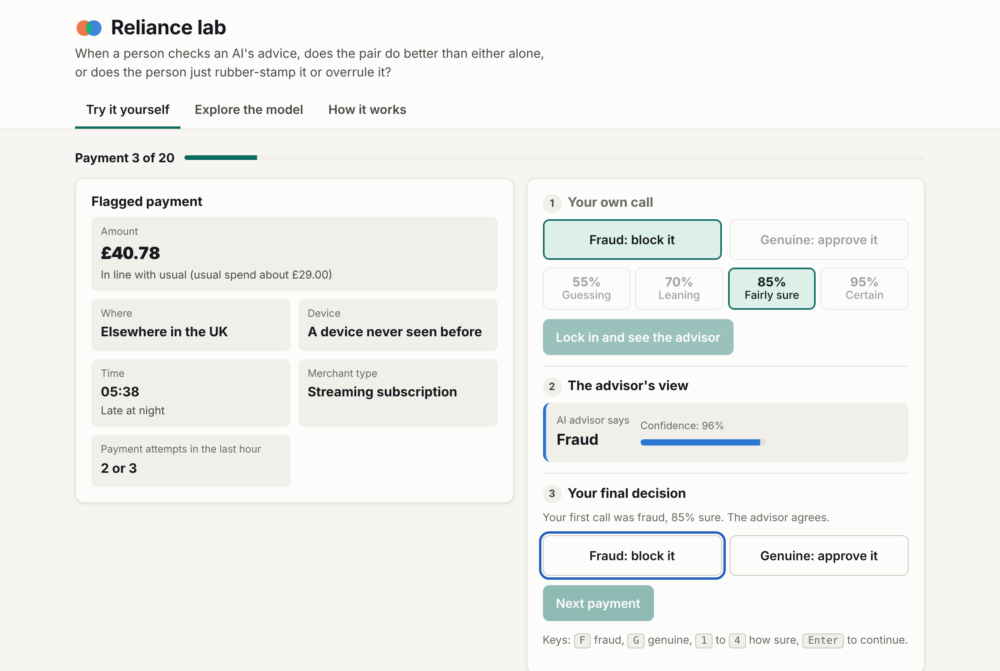
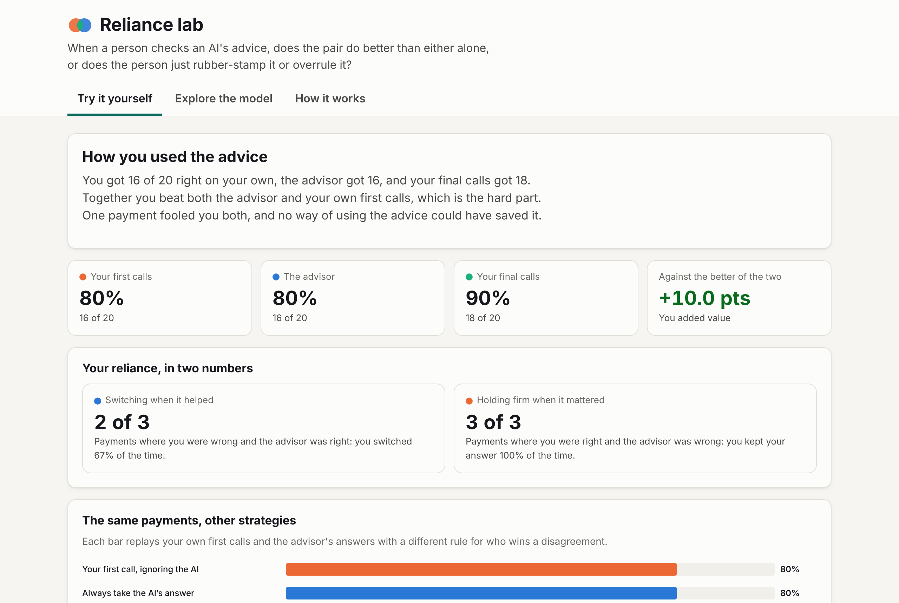
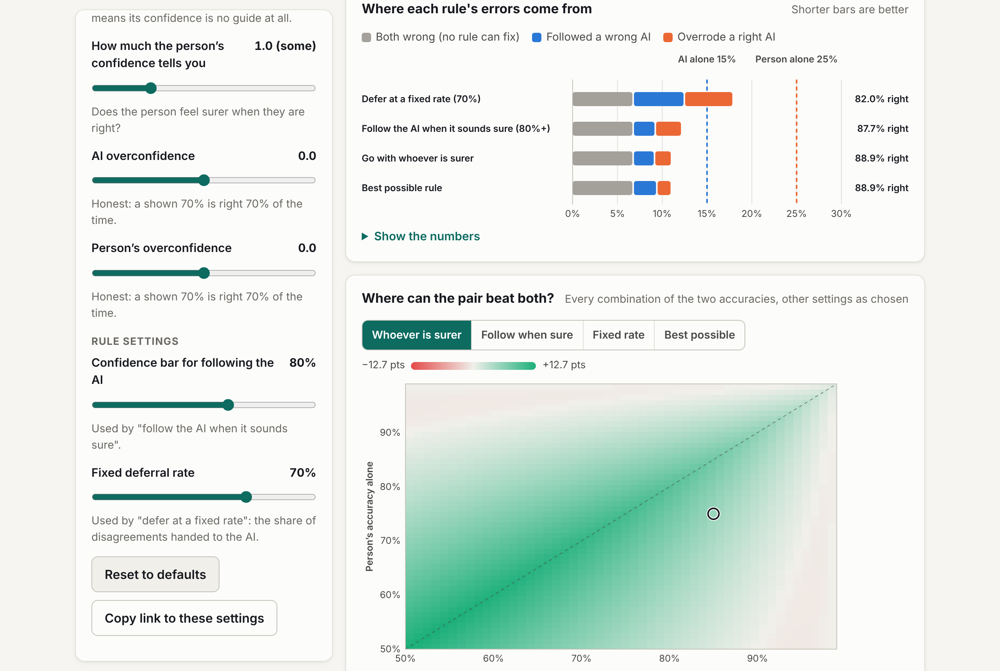
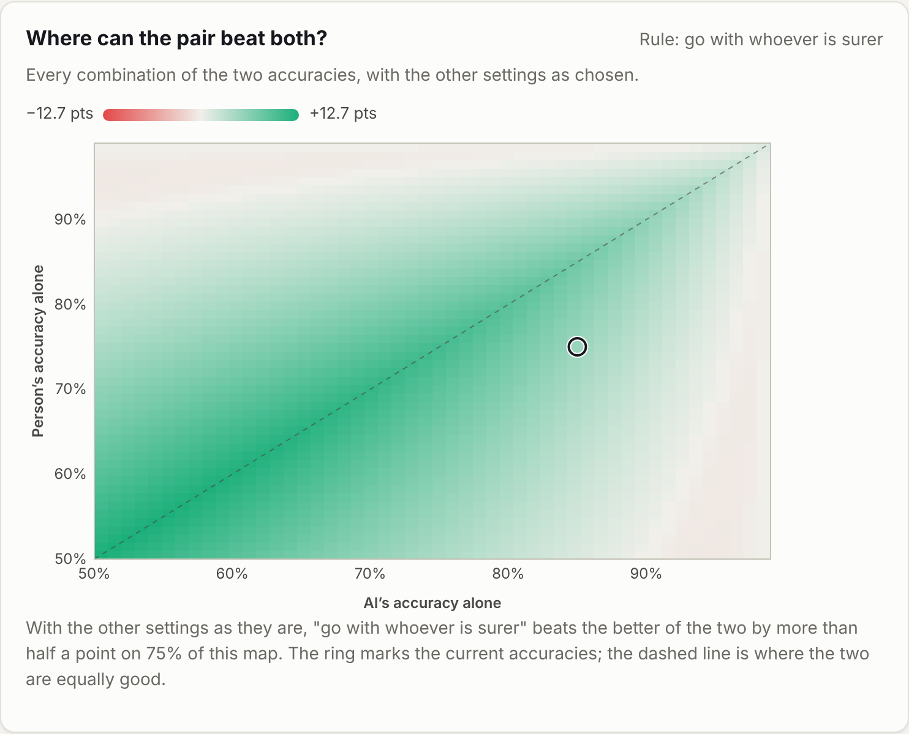

# Reliance lab

**When a person checks an AI's advice, does the pair do better than either alone?**

"A human will review it" is the standard answer to AI risk. But a reviewer only adds value if they know *when* to trust the AI. Someone who agrees with everything adds nothing, and someone who overrules the AI too often makes things worse. Reliance lab lets you measure that on yourself, then shows exactly when a person-plus-AI team can beat both of its members, and what it would take.



There are two parts, built on the same logic:

- **The browser app** (`app/index.html`). Review 12, 20 or 30 synthetic flagged card payments with an AI advisor, get a debrief on how well you used its advice, and explore the model behind it. One file, no installs, works offline, nothing leaves the page.
- **The Python companion** (`reliance_lab/`). Scores a whole class's downloaded result files at once with bootstrap intervals and an HTML class report, runs the model across thousands of assumption combinations, and generates synthetic classes for demos. Standard library only.

## Why it matters

- **AI adoption beyond the pilot.** Pilots usually measure the AI on its own. The deployed system is a person plus the AI, and if the person rubber-stamps or second-guesses it, the promised gain never shows up in the numbers. That is a quiet, under-measured reason pilots fail to scale: the business case was written for the model, not for the team.
- **Human-AI interaction and over-reliance.** The exercise uses the two-step design from research on AI advice (decide, see the advice, decide again) and reports the two standard measures of appropriate reliance from Schemmer and colleagues (2023).
- **AI governance.** Article 14 of the EU AI Act asks that people overseeing high-risk AI stay aware of automation bias. The model shows what effective oversight has to mean in numbers: a reviewer adds value only when something (usually confidence) tells them which disagreements to give to the AI.
- **Consumer fintech and scam awareness.** The cases are card payments flagged as possible fraud, the kind of decision where a person and a model already work together.

## Open the app

Download or clone this branch, then double-click `app/index.html`. Or from a terminal:

```bash
open app/index.html        # macOS
xdg-open app/index.html    # Linux
start app\index.html       # Windows
```

It has three tabs.

**Try it yourself.** Choose how many payments, how often the advisor is right (70, 80 or 90%), what it says about its confidence (honest, always sure, or hidden), and where its mistakes fall (anywhere, on the tricky payments or on the obvious ones). For each payment you make your own call and say how sure you are, then see the advisor's view and make a final call. Everything works from the keyboard: <kbd>F</kbd> and <kbd>G</kbd> for fraud or genuine, <kbd>1</kbd> to <kbd>4</kbd> for how sure, <kbd>Enter</kbd> to continue. A session code means everyone in a class who types the same code sees the same payments.

The debrief shows your first calls, the advisor and your final calls side by side; your two reliance numbers (how often you switched when the advisor was right and you were wrong, and how often you held firm when you were right and it was wrong); how other strategies would have scored on exactly the same payments; how well your confidence tracked your accuracy; and every payment one by one. You can download the results as a small JSON file, open a saved file later, or send your numbers to the model.



**Explore the model.** Nine sliders (or six ready-made scenarios) set the person's and the AI's accuracy, how often they get the same cases wrong, how much each side's confidence says about whether it is right, and whether either side is overconfident. Four views update as you move them:

- where each reliance rule's errors come from (both wrong, followed a wrong AI, overrode a right AI);
- a map of every combination of the two accuracies, showing where a rule lets the pair beat both;
- which lever matters most, with each assumption nudged down and up;
- what happens as you raise the confidence bar for following the AI.

"Copy link to these settings" puts every setting in the address, so the same file opened with that link shows the same picture.



It works on a phone as well as a desktop, in light and dark mode, and every control has a label for screen readers.


## Run the Python companion

Requires Python 3.9 or later. Nothing to install.

```bash
# Every reliance rule under the default assumptions (add --json for everything)
python -m reliance_lab model
python -m reliance_lab model --human 0.8 --ai 0.8 --overlap 0 --ai-signal 2 --human-signal 2

# Score result files downloaded from the app; with several files you also get a class summary
python -m reliance_lab score examples/sessions/*.json
python -m reliance_lab score examples/sessions/*.json --html class-report.html --csv class.csv

# Run the model across 3,888 combinations of assumptions
python -m reliance_lab sweep --csv sweep.csv

# Make a synthetic class of 24 session files (clearly marked as synthetic)
python -m reliance_lab demo-class --out my-class --mistakes hard
```

The `examples/sessions` folder holds a synthetic class of 24 sessions and [`examples/class-report.html`](examples/class-report.html) is the HTML report made from it. None of these are real people.

## What the model shows

All figures below come from `python -m reliance_lab model` and `python -m reliance_lab sweep` and match the app.

**The default case: a good model and a decent reviewer** (person 75% accurate, AI 85%, error overlap 0.2, AI confidence d' 1.5, person d' 1.0, nobody overconfident):

| Rule for settling disagreements | Team accuracy | Against the AI alone |
|---|---|---|
| Defer to the AI 70% of the time | 82.0% | 3.0 points worse |
| Follow the AI when it shows 80% or more | 87.7% | +2.7 points |
| Go with whoever is surer | 88.9% | +3.9 points |
| Best possible rule | 88.9% | +3.9 points |

6.8% of cases are wrong for both of them, and no rule can fix those.

**What that means:**

- **A fixed deferral habit can never beat the better of the two.** In a yes/no decision, when the person and the AI disagree exactly one of them is right, so any habit that treats every disagreement the same way lands between the two solo accuracies. Across all 3,888 combinations in the sweep, deferring 70% of the time never beats both. Beating both needs a signal for *which* disagreements to give to the AI.
- **If both sides' confidence is honest and their mistakes are unrelated, "go with whoever is surer" is the best possible rule.** Overconfidence on either side, or mistakes that cluster on the same cases, is what breaks it. Across the sweep, "whoever is surer" beats both in 72% of combinations, against 77% for the best possible rule and 44% for "follow the AI when it shows 80% or more".
- **Pairing pays most between equals.** Two equally accurate partners (80% each) with honest, informative confidence and unrelated mistakes reach 93.5%, 13.5 points above either of them. A strong model with a weaker reviewer who cannot tell when they are right (the "rubber-stamp risk" scenario: 70% against 92%) gains nothing even with the best rule, and "whoever is surer" loses half a point.
- **An assistant that always sounds sure defeats the "follow it when it sounds sure" rule.** In the "chatty assistant" scenario every answer clears an 80% bar, so the rule becomes "always follow" (82.0%, no gain), while the best rule, which leans on the person's own confidence instead, still adds 3.3 points.
- **Shared blind spots and vague confidence are the biggest brakes.** In the sweep, the best rule's average gain falls from 5.8 points with unrelated mistakes to 2.6 points when the overlap is 0.4, and rises from 2.5 points when the AI's confidence says nothing to 6.1 points when it is informative.

The map shows the second and third points at a glance: under the default confidence settings, "go with whoever is surer" lets the pair beat both (green) along the diagonal where the two are about equally good, and adds little or nothing (grey) where one side is far better.



The levers chart turns the same model into a "where should we invest?" question. Under the defaults, a model five points more accurate adds 2.8 points to the team, cutting shared blind spots adds 1.9, and making the AI's confidence more informative adds 1.2.


## Which language does what

| Part | Language | Roughly | What it does |
|---|---|---|---|
| `app/index.html` | HTML and CSS | 590 lines | Layout, light and dark themes, responsive design |
| | JavaScript (model block) | 710 lines | The reliance model, the payment generator, session scoring; runs in the browser and in Node.js for tests |
| | JavaScript (interface) | 1,070 lines | The exercise, debrief, charts, presets, links and file loading |
| `reliance_lab/` | Python | 1,300 lines | The same model and scoring (tested to agree), plus what a browser page does badly: batch scoring of many files, bootstrap intervals, an HTML class report, a 3,888-scenario sweep and synthetic classes |
| `tests/` | Python and JavaScript | 1,020 lines | Unit tests for both, agreement tests between them, and browser tests of the app |

The browser app is the version anyone can open and use. The Python companion is for whoever runs a class or wants to go beyond one set of assumptions.

## How it works

**The exercise.** Each payment is generated from six cues (amount against usual spend, location, device, time, merchant type and recent attempts), each with fixed odds of fraud. An ideal reader of the cues would get about 85% right. Half the payments are fraud. The advisor's mistakes are chosen in advance by weighted sampling, so it is right as often as you set, to the nearest whole payment: "tricky" mistakes favour payments whose cues point the wrong way, which you are likely to miss too. The honest advisor's confidence is drawn from a beta distribution between 50% and 100% built so that it is calibrated: answers shown at 80% are right about 80% of the time (tested within four points in every ten-point band). Everything is seeded by the session code, so the same code gives the same payments in any browser.

**The model.** Signal detection theory. For each case the AI has a hidden signal that is higher, on average, when it is right; its displayed confidence is a calibrated function of that signal, shifted up if it is overconfident. The person's confidence works the same way. With the two accuracies and an error correlation, this gives exact formulas (no simulation) for how often each rule follows the AI when it is right and when it is wrong. The best possible rule weighs both signals with Bayes' rule, which is why no other rule can beat it. A simulation in the tests confirms every formula to within 0.6 points.

**Session scoring.** Relative AI reliance is the share of cases where you were wrong and the AI right in which you switched; relative self-reliance is the share of cases where you were right and the AI wrong in which you held firm. Confidence is checked with the area under the ROC curve. The Python companion adds percentile bootstrap intervals, because 20 payments is a small sample.

**Files.**

- `app/index.html`: the whole browser app. The logic sits between `/* MODEL START */` and `/* MODEL END */` and exports itself for Node.js.
- `reliance_lab/model.py`: the model (port of the app's model block). `sessions.py`: loading and scoring result files, bootstrap intervals. `sweep.py`: the scenario sweep. `synthetic.py`: virtual participants. `report.py` and `html_report.py`: text, CSV and HTML output. `__main__.py`: the command line.
- `tests/`: `test_agreement.py` runs the app's model in Node.js through `model_harness.js` and checks every output against Python; `app_model.test.js` tests the app's model directly; `test_app.py` drives the app in headless Chromium; `test_model.py` and `test_sessions.py` test the Python package.

## Tests

```bash
python -m unittest discover -s tests -t .    # everything: 52 tests
node --test tests/app_model.test.js          # just the browser app's model
```

The agreement and JavaScript tests need Node.js, and the browser tests need Playwright for Python with Chromium. Each group is skipped, not failed, if its tool is missing.

## Limitations

- The model is a simplification. Real confidence is coarser than a smooth signal, and people's habits drift as they learn whether the AI tends to be right; the model has no learning.
- The model treats every disagreement as a yes/no choice with one right answer. Tasks with many possible answers, or with no clear ground truth, behave differently.
- A session of 20 payments is a small sample. The bootstrap intervals in the Python report are wide for a reason: treat a single session as a conversation starter, not a diagnosis.
- The payment cues and their odds are invented for teaching. They are not a real fraud model, and the advisor is simulated, not a trained classifier.

## What could come next

- **Learning over time.** Let the person see whether the advisor was right after each payment and model how their trust shifts, to test whether feedback cures over-reliance or just swaps it for under-reliance.
- **Explanations as a third condition.** Add an advisor that shows which cues drove its answer, and compare reliance with and without explanations, the question at the heart of much of the research on appropriate reliance.
- **A pilot calculator.** Turn the model round: given an AI's accuracy in a pilot and a few measured reliance numbers from reviewers, estimate the accuracy the deployed team will actually deliver.

## Sources

- Schemmer, M., Kühl, N., Benz, C., Bartos, A. and Satzger, G. (2023) "Appropriate reliance on AI advice: conceptualization and the effect of explanations", *Proceedings of the 28th International Conference on Intelligent User Interfaces*.
- Bansal, G. and colleagues (2021) "Does the whole exceed its parts? The effect of AI explanations on complementary team performance", *Proceedings of CHI 2021*.
- Regulation (EU) 2024/1689 (the AI Act), Article 14: human oversight.
