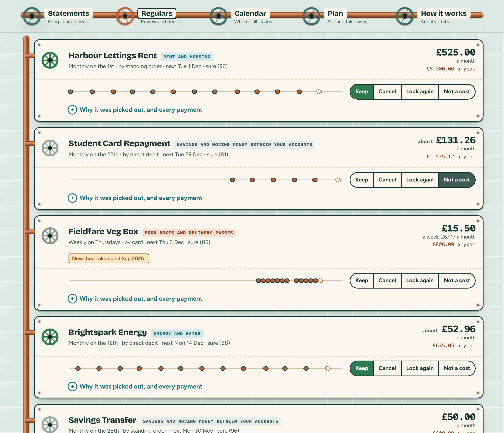
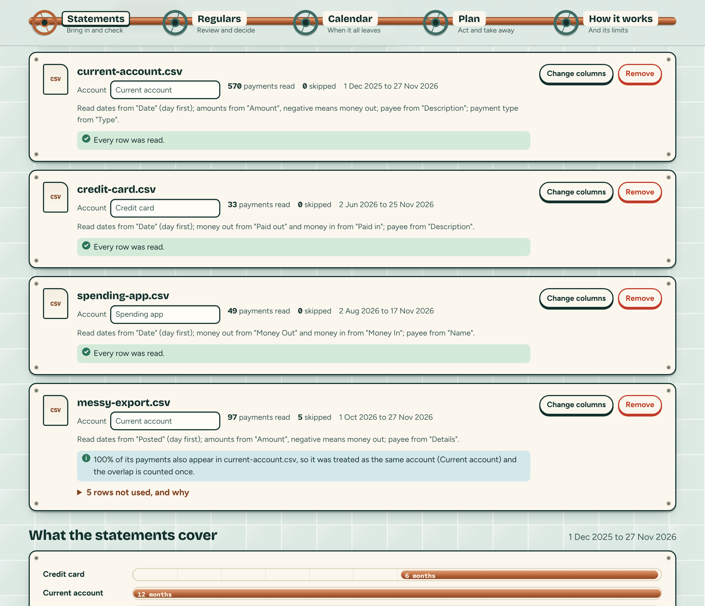
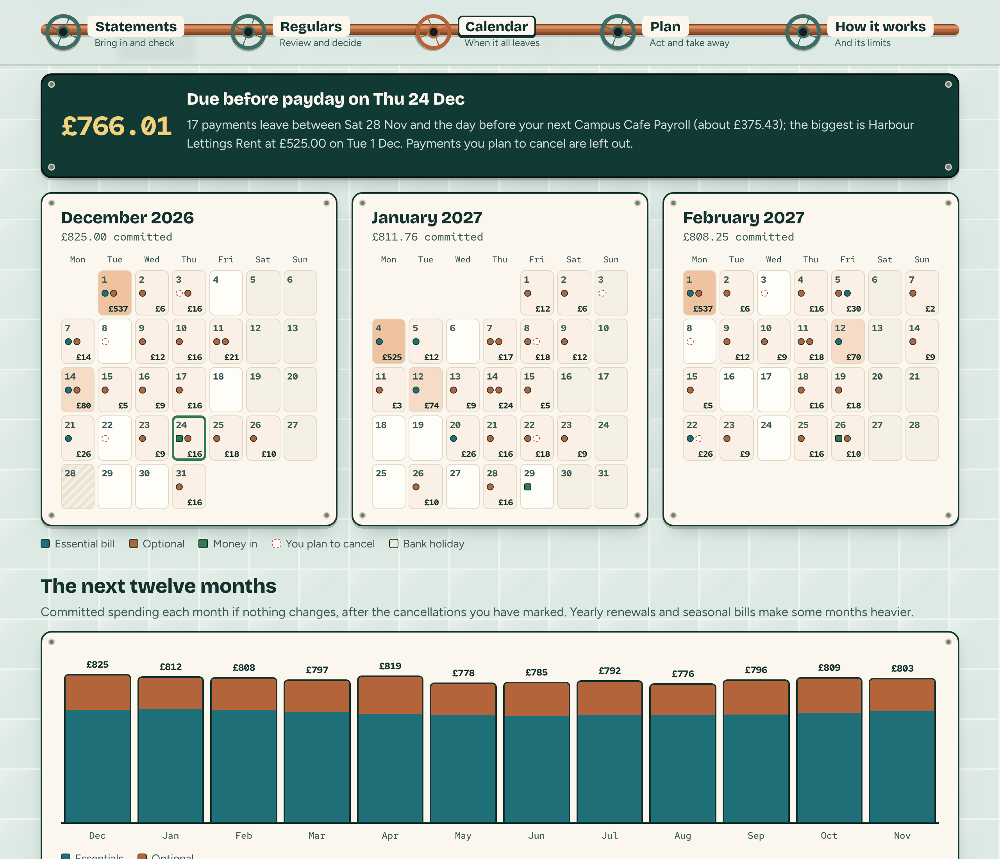
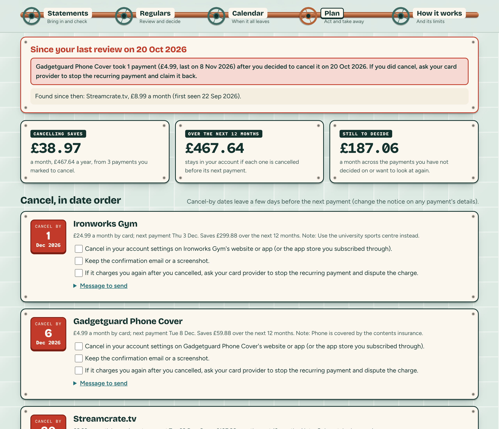
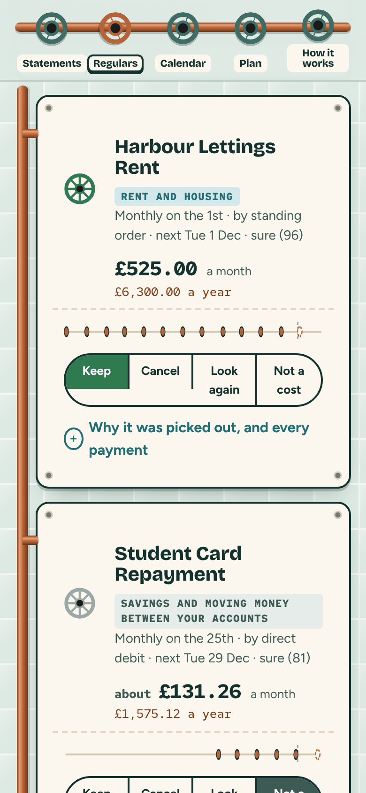

# Still paying?

**Find every subscription, direct debit and standing order in your own bank export, see exactly when each one leaves next, and decide what to keep before it renews.**

Most people cannot list what leaves their account on its own each month. Free trials turn into full price, prices creep up mid-contract, a gym membership outlives the habit, and the phone cover you cancelled carries on charging. Banking apps show transactions one at a time; spotting the pattern is left to you.

Still paying? does that job on the CSV export you can already download from your bank. It picks out every payment that comes round on a schedule, explains why it thinks so, flags the ones worth a second look, works out when each will next leave (moving direct debits past weekends and bank holidays), and gives you a plan to act on: what to cancel and by when, a message ready to send, a calendar of reminders, a register for your spreadsheet and a review file to reopen next month, when it checks that what you cancelled really stopped.

Everything runs in your browser or on your own computer. Nothing you load is sent anywhere.

## Who it is for

- **Students and graduates** checking what their loan and part-time pay is really committed to before the next instalment.
- **Shared houses** working out which bills come out when, before payday.
- **Society treasurers and small businesses** reviewing a business account for software, hosting and membership renewals that nobody remembers signing up to.
- **Anyone** who wants a once-a-month, ten-minute check of what they are still paying for.

## Use it on your own data

1. **Download an export.** In your banking app or online banking, find the option to export or download transactions, choose CSV (or "spreadsheet") and pick the longest date range you can. A full year finds yearly renewals as well as monthly ones. Download each account or card you use.
2. **Open the app** (`app/index.html`, see below) and drop the files onto the Statements step, or choose them, or paste a table copied from online banking.
3. **Check the import.** Each file shows how it was read, which rows were skipped and why, and whether it overlaps another file. If a column was guessed wrongly, choose the columns by hand.
4. **Decide** on each regular payment: keep, cancel, look again, or not a cost (money to your own savings).
5. **Take it away** from the Plan step and **save the review**. Next month, open the review file and add the new export.

### What it reads

- CSV, TSV and pasted tables with commas, semicolons, tabs or pipes, quoted fields (including line breaks inside quotes), a byte order mark, blank rows, account details above the header, repeated header rows and total lines.
- Column names used by UK banks and apps: Date, Transaction date, Posted, Completed date; Description, Name, Payee, Counter party, Details, Narrative; Amount, Paid out and Paid in, Money out and Money in, Debit and Credit, a separate debit or credit marker; plus payment type, category, balance, currency and status columns where they exist. Unfamiliar names are worked out from the contents, and you can always choose the columns yourself.
- Amounts written as `-12.99`, `£1,234.56`, `(24.99)`, `18.30 DR`, `5.00 CR`, `£18.00-` or `12,50`. Credit card exports where spending is positive are recognised (and you can switch the sign by hand).
- Dates as `14/03/2026`, `14-03-26`, `2026-03-14`, `14 Mar 2026`, `Sat 14 Mar 2026`, `March 14, 2026` or timestamps. If every date could be read either way, UK order is assumed and the app says so.
- Declined, reversed and pending rows are left out, because no money left the account.

The file [`data/template.csv`](data/template.csv) shows the layout that always reads cleanly:

```
Date,Description,Type,Amount,Balance
01/11/2026,HARBOUR LETTINGS RENT,Standing order,-525.00,812.40
```

### What you get back

| From the Plan step | What it is |
|---|---|
| Review file (`.json`) | Every payment, decision, note and correction. Reopen it next month to see what changed and anything still charging after you cancelled. |
| Calendar (`.ics`) | Every expected payment with a reminder the day before, and a reminder on each cancel-by date. Opens in Google, Apple and Outlook calendars. |
| Register (`.csv`) | One row per regular payment: how often, typical amount, monthly and yearly cost, next due, checks and your decision. |
| Twelve-month budget (`.csv`) | Committed spending by category for each of the next twelve months, after your cancellations. |
| Printed checklist | The plan with tick boxes, cancel-by dates and the steps for each payment. |
| Summary and messages | A plain-text summary and a cancellation message for each payment, ready to paste. |

## A worked example

The app opens with four invented exports for a fictional student (every company is made up): a current account in the signed-amount layout, a credit card export with four lines of account details above a "Paid out / Paid in" header, a spending app export with ISO dates and notes, and a deliberately messy re-export of the current account's last two months.

It reads 749 payments from the 754 rows, notices that the messy file is the current account again (100% of its payments match, so its 97 payments are counted once, leaving 652), lists the 5 rows it could not use with the reason for each (a date of "TBC", an amount of "n/a", the impossible date 32/10/2026, a repeated header and a total line), and matches 10 transfers between the student's own accounts.

It finds **22 regular payments**: weekly, fortnightly, every-four-weeks and monthly ones, card payments, direct debits and standing orders. Committed spending comes to **£838.93 a month (£10,067.13 a year)**, of which £621.31 is essentials, not counting £50 a month to savings or the credit card repayment that only moves money between the student's accounts. Among the checks:

- Hilltop Broadband went up from £24.00 to £26.40 (+10.0%) in April, and Tunewave Music from £10.99 to £11.99.
- The Daily Lantern's £1.00 intro price ended in September; it is now £8.99. The language app did the same.
- Ironworks Gym took £24.99 twice in March.
- Two video services overlap, and an app store bill is really two subscriptions at different prices.
- Pixelbox TV stopped in July. Three single payments that look like yearly renewals (home insurance, web hosting and a chess app) are listed as possible regulars, with the date each is likely to come round again.
- Payday (the last Friday of the month) falls on Christmas Day, so the next one is expected on Thursday 24 December, and £766.01 is due before then.

The sample is shown reopened a month after an earlier review on 20 October, and the plan leads with the most useful finding of all: **Gadgetguard Phone Cover took £4.99 on 8 November, after the student decided to cancel it on 20 October.**

## Why it matters

This is a tool for the third research theme in the brief, **AI in consumer fintech and digital financial literacy**: making sense of your own bank export. Banks and budgeting apps increasingly use machine learning to label subscriptions, but their judgements arrive unexplained and are hard to check. Still paying? takes the opposite approach: every regular payment comes with the reasons it was picked out, a confidence score and every payment behind it, so the person stays the judge of what is regular and what is worth keeping. That matters for the brief's second theme too: a tool that shows its working invites checking rather than blind reliance.

It is also a small study in why good intentions stall: cancelling is easy to decide and easy to forget. The plan turns the decision into dated steps, and the monthly recheck closes the loop by catching payments that carried on regardless.

## Open the app and run the companion

**The app:** download this branch (on GitHub, use **Code**, then **Download ZIP**), unzip it and double-click `app/index.html`. It works offline in any modern browser; there is nothing to install.

**The Python companion** (Python 3.9 or later, standard library only):

```bash
# Everything in a folder of exports: register, budget, calendar, review file and an HTML report
python companion/still_paying.py scan data --out my-review

# The monthly job: drop this month's exports in a folder, compare with your last review
python companion/still_paying.py monthly ~/Downloads/statements --history ~/still-paying-history

# A month-by-month budget spreadsheet, or the template
python companion/still_paying.py budget data --months 12 --out budget.csv
python companion/still_paying.py template --out template.csv
```

**Tests:**

```bash
node --test tests/*.test.js                 # the browser app's model
python -m unittest discover -s tests -v     # the companion, agreement with the app, and the app in a headless browser
```

The browser tests need Playwright for Python and Chromium (`pip install playwright` then `playwright install chromium`); without them they are skipped. The agreement tests need Node.js and are skipped without it.

## Screenshots












## Which language does what

| Part | Language | Lines (roughly) | What it does |
|---|---|---|---|
| `src/model.js` | JavaScript | 1,830 | Reading exports, finding regular payments, checks, forecasting, the plan, and every file the app hands back. Runs in the browser and in Node.js for the tests. |
| `src/ui.js`, `src/style.css`, `src/shell.html` | JavaScript, CSS, HTML | 1,700 | The four views, uploads, decisions, downloads and the utility-cupboard design. |
| `app/index.html` | (built) | | The single self-contained app, assembled by `tools/build_app.py` with the fonts and sample statements inside it. |
| `companion/` | Python | 3,500 | The same model, line for line, plus the jobs a browser is not good at: a whole folder of exports at once, a monthly run that compares with your last review and keeps a price history, an HTML report and a budget spreadsheet from the command line. |
| `tests/` | JavaScript, Python | 1,400 | Model tests, companion tests, tests that prove the two versions agree to the penny and the day, and browser tests of the app. |
| `tools/` | Python | 520 | Builds the app, makes the sample statements (seeded, so they are the same every time) and takes the screenshots. |

## How it works

1. **Reading.** The model finds the header row (anywhere in the first 40 lines), maps each column to a role by the names banks use, and reads every row into a date (a day number) and an amount (whole pence, so nothing is lost to rounding). Two files that are the same account are recognised when at least 80% of one file's payments in the days both cover also appear in the other; payments in the overlap are then only counted once. Money out of one account and into another within three days is matched as a transfer.
2. **Grouping.** Each description is cleaned of what changes every month (dates, card numbers, references, prefixes such as "CARD PAYMENT TO", and payment processors before a star) to give a payee key. Keys that begin with another key's words are grouped (so "TUNEWAVE" and "TUNEWAVE MUSIC" are one payee).
3. **Finding the schedule.** Each payee's payments are tested against weekly, fortnightly, four-weekly, monthly, two-monthly, quarterly, six-monthly and yearly schedules. Monthly ones keep a day of the month (allowing for weekends, bank holidays and short months) or a rule such as "last Friday" or "last working day". One missed payment in four is allowed, and an extra payment close to another is reported as a possible double charge. If a payee's payments do not fit as a whole, they are split by amount, and runs at different amounts that follow on from each other are joined (a price change or an intro offer ending).
4. **Checks and confidence.** Each series gets plain-English reasons, a confidence score built from how many payments there are, how regular they are, how stable the amount is and whether it is a direct debit or standing order, and checks for price rises, intro prices ending, double charges, new and stopped payments and overlapping services.
5. **Forecasting and the plan.** Each series is projected from its last due date, rolled to the next working day for direct debits and standing orders. Variable bills use the same month last year when there is a year of history. The plan adds up what cancelling saves, sets a cancel-by date a few days before the next payment and lists the steps for each way of paying.

The same logic lives in `src/model.js` and `companion/stillpaying/`; the agreement tests run both on the same files and compare everything, including the bytes of every exported file.

## Limitations

- It only sees what is in the exports you load: a renewal paid from another account will not appear.
- A payee that changes its name completely looks like one payment stopping and another starting; join them with "Same company as".
- Commitments that are regular in your head but not in the data (termly fees, bills that drift by weeks) may only appear as possible regulars, or not at all.
- Bank holidays are those of England and Wales.
- Categories come from keywords in descriptions and are a starting point; change any of them by hand.
- It is a checking tool, not financial advice. The steps for cancelling are general; each company's own terms apply.

## What could come next

- Reading OFX and QIF files, which some banks offer alongside CSV.
- Suggesting cheaper switches for the essentials (broadband and phone contracts that have passed their minimum term).
- A shared-house mode that splits the household bills between housemates and works out who owes what.
