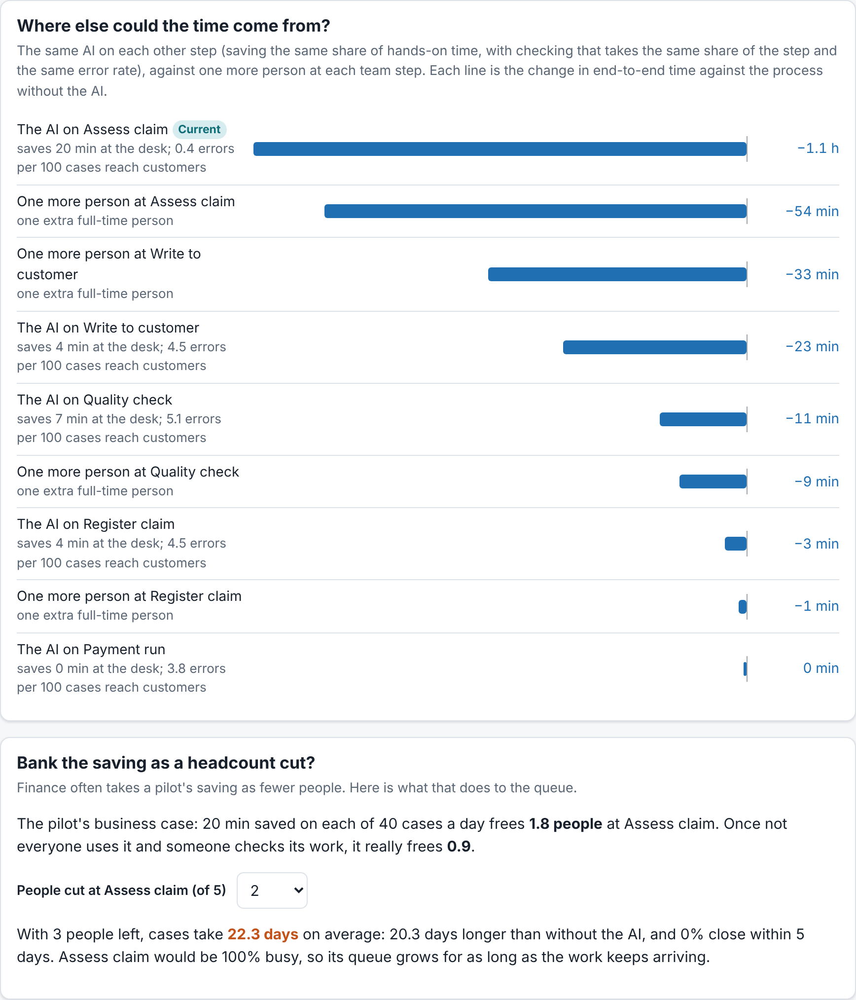

# Missing minutes

**Your AI pilot saved 20 minutes a case at one desk. Did customers get their answer any sooner?**

Pilots of AI assistants usually measure one thing: how much faster a person does one task with the tool. The business case then multiplies those minutes by the volume and calls the result a saving. But a case does not leave the building when one task is done. It queues, gets checked, waits for a committee or a customer, and sometimes comes back. Whether the saved minutes ever reach the customer depends on where in that flow they were saved.

Missing minutes is a discrete-event simulation of a whole process, run twice with exactly the same cases and the same luck: once without the AI and once with it on one step. It follows the minutes the AI saves at the desk and shows where they went: into shorter queues, into checking the AI's work, into rework when it gets things wrong, or into waiting for the next committee meeting.

There are two ways to use it, built on the same model:

- **The browser app** (`app/index.html`). Double-click it: no installs, no internet connection, nothing sent anywhere.
- **The Python companion** (`missing_minutes/`). Command-line reports, ranked options, parameter sweeps to CSV, robustness checks and a shareable HTML report. Standard library only, and it gives the same numbers as the app.


## Why it matters

The question behind this project is why AI so often stalls at the pilot stage. Research interviews with senior executives keep returning to the same blockers: **unclear ROI and benefits that are hard to measure**. This tool makes one of the mechanisms concrete.

- **The same minutes can be worth very different amounts.** Saved at a step that is 92% busy, 20 minutes a case took over an hour off the end-to-end time. Saved before a committee that meets twice a week, 43 minutes a case were absorbed by the calendar, and the AI's errors made things slower.
- **The pilot measures the best case.** In a pilot, keen users try the tool on every case, and the minutes spent checking it or the cases sent back are rarely counted. At scale those come off the saving first.
- **A cost saving and a speed gain are not the same saving.** Banking the pilot's "1.8 people" as a headcount cut turns a two-day claims process into one that takes more than four working weeks, because the AI really frees 0.9 people at that step.
- **Where you put the AI matters as much as how good it is.** The options appraisal often finds that one more person at the real bottleneck beats the AI, or that the fastest place for the AI is one with no check after it, so its errors go straight to customers.

It sits across two of the brief's themes: AI adoption and scaling beyond the pilot, and the consulting toolkit (process mapping, bottlenecks, business cases).

## Open the app

Double-click `app/index.html`, or from a terminal:

```bash
open app/index.html        # macOS
xdg-open app/index.html    # Linux
start app\index.html       # Windows
```

What you can do in it:

- **Pick an example process** (home insurance claims, small business loans, customer complaints) or build your own of up to eight steps. A step can be a team working cases first come, first served; a meeting or run on set weekdays (a credit committee, a payment run); or a wait on someone outside the team (a repairer's quote, a customer's documents). A team or a meeting can send a share of cases back to an earlier step, as a quality check does.
- **Set up the AI**: which step it helps with, how much hands-on time it saves, how many cases it is used on, how long checking its work takes, how often it is wrong and how many of its errors a later check catches.
- **Read the headline**: the pilot's promise, the change in end-to-end time, and how many end-to-end minutes each minute saved at the desk is worth, with a check against 10 runs of different luck.
- **See where the minutes went**: a waterfall from the time saved at the desk, through non-use, checking and rework, to the change in waiting at every step.
- **See why**: each step's hands-on time, waiting and how busy it is, and the queueing-theory curve that explains why a small cut in work at a busy step makes a big cut in waiting.
- **See what it means for customers**: the spread of times to close, the share closed within your target, staff time freed, cases sent back and AI errors that reach customers.
- **Compare other options**: the same AI on every other step against one more person at each team step.
- **Bank the saving as a headcount cut** and watch what that does to the queue.
- **See what moves the answer**: a tornado of five assumptions, each set lower and higher.
- **Save, open and share setups** as a JSON file or a link. Saved files also run in the Python companion.

It works on a phone as well as a desktop, in light and dark mode, and every control can be used with a keyboard.




## Run the Python companion

Requires Python 3.9 or later. No packages to install. Run these from the folder that contains `missing_minutes/`.

```bash
# Compare one example without and with the AI (a text report)
python -m missing_minutes run --preset loans

# Rank the same AI on every step against one more person at each step, and save a CSV
python -m missing_minutes rank --preset complaints --out options.csv

# Sweep one setting and write a row of results for each value
python -m missing_minutes sweep --preset claims --param adoption --values 0.2:1:0.2 --out adoption.csv

# Re-run with 10 runs of different luck, and nudge each assumption down and up
python -m missing_minutes robust --preset claims

# Write a self-contained HTML report to share
python -m missing_minutes report --preset claims --out report.html

# Run your own process: start from an example, edit the JSON, then run it
python -m missing_minutes export --preset claims --out my-process.json
python -m missing_minutes run --config my-process.json

# A setup saved from the app works too, including its seed
python -m missing_minutes run --config missing-minutes-setup.json
```

`run` also has `--json` for the full result and `--cut N` to choose how many people to cut when banking the saving. `sweep` can vary `saving`, `adoption`, `checkMinutes`, `errorRate`, `catchRate`, `arrivalsPerDay` or `step`. A pre-generated report for the claims example is in [`examples/claims-report.html`](examples/claims-report.html), and a sweep of adoption in [`examples/claims-adoption-sweep.csv`](examples/claims-adoption-sweep.csv).

## Run the tests

```bash
python -m unittest discover -s tests   # Python model, CLI, agreement with the app, and the app in a headless browser
node --test                            # the app's model in Node.js
```

The agreement tests run the app's model in Node.js and check it matches the Python model to within one part in a billion on every output, for all three examples, two hand-made processes and odd inputs. They are skipped if Node.js is missing; the browser tests are skipped without Playwright for Python.

## Which language does what

| Part | Language | Lines (roughly) | What it does |
|------|----------|-----------------|--------------|
| `app/index.html` model block | JavaScript | 725 | The simulation, the decomposition, options, banking, robustness, the tornado and the queueing theory |
| `app/index.html` interface | HTML, CSS, JavaScript | 910 | Controls, step editor, charts, save, open and share |
| `missing_minutes/model.py` | Python | 880 | A line-for-line port of the model block, giving the same numbers |
| `missing_minutes/cli.py`, `report.py` and the two package files | Python | 550 | Command line, text reports, CSV exports and the HTML report |
| `tests/` | Python and JavaScript | 900 | Unit tests, agreement tests and browser tests |

In all, about 1,640 lines of HTML, CSS and JavaScript and about 1,430 lines of Python, plus the tests.

The browser app is the version anyone can open and use. The Python companion is for what a browser is less suited to: batch sweeps, ranked options and robustness runs written to CSV, a report file to attach to an email, and running a process definition kept under version control.

## How it works

1. **Cases arrive** at random through the working day (a Poisson process). A working day is 7.5 hours and a week five days, so nights and weekends are skipped.
2. **Each step** is a team of people working cases first come, first served; a meeting or run that clears waiting cases, oldest first, on set weekdays at the start of the day; or a wait on someone outside the team. Hands-on times vary around their average (a lognormal spread).
3. **The AI**, on one step, cuts the hands-on time on the cases where it is used and adds a fixed check. A share of the cases it touches carry an error. A later step that sends cases back catches most of them, and the case returns to be fixed by hand at half the usual effort. Errors with no later check reach the customer.
4. **Two runs, the same luck.** Every visit of a case to a step draws its random numbers from its own stream, seeded by the case, the step and the visit. So the run with the AI and the run without it see exactly the same cases and the same luck, and the difference between them is the AI, not chance (common random numbers). The first 20 working days warm the queues up; the next 120 are measured.
5. **Where the minutes went.** Each case's time from arrival to close is its hands-on time plus its waiting, step by step. So the change in the average splits exactly into: the time the AI saves if everyone uses it, the cases where it is not used, checking, rework, and the change in waiting at every step. The parts add up to the total to within rounding, and the tests check that.
6. **Other options** re-run the comparison with the AI on each other step (saving the same share of hands-on time, with checking that takes the same share of the step) and with one more person at each team step.
7. **Banking the saving** removes the people the pilot's business case promised (its minutes times the volume, rounded) from the AI's step and re-runs.
8. **Robustness** re-runs with 10 consecutive seeds, and the tornado re-runs with each of five assumptions set lower and higher.
9. **The queueing curve** is the Allen-Cunneen approximation: the Erlang C probability of waiting, times a variability factor. It is checked against the simulation in the tests.

## What the examples show

All figures are for the default seed (42), as in the app.

| Example | The pilot's promise | End to end, without to with the AI | Minutes reaching the customer per minute saved |
|---------|---------------------|-------------------------------------|------------------------------------------------|
| Home insurance claims (AI drafts the assessment) | 20 min a case | 2.0 days to 1.9 days: 1.1 h sooner | 3.18 |
| Small business loans (AI summarises the accounts) | 43 min a case | 3.4 days to 3.5 days: 14 min later | -0.34 |
| Customer complaints (AI drafts the reply) | 15 min a case | 1.8 days to 1.9 days: 35 min later | -2.30 |

- **Claims: the minutes multiply.** Assessing claims was 92% busy, so the saving shrank its queue from 1.2 hours to 10 minutes a case. The quality check becomes the busiest step. The AI made cases faster in all 10 runs of different luck (from 57 minutes to 2.0 hours sooner). If demand were 10% higher, the team could not keep up without the AI, and the AI is what keeps the process working.
- **Claims: the first users matter most.** The adoption sweep in [`examples/claims-adoption-sweep.csv`](examples/claims-adoption-sweep.csv) shows that using the AI on just 20% of claims already takes 31 minutes off, nearly half the 69 minutes it gives when used on every claim, because waiting falls fastest when a step first drops back from being nearly full.
- **Claims: banking the saving breaks the process.** The pilot's business case says 1.8 people; the AI really frees 0.9 at that step. Cutting two of the five assessors leaves them 100% busy, and cases take 22.3 days on average instead of 2.0.
- **Loans: the calendar absorbs the minutes, and the errors cost a cycle.** The credit committee meets on Tuesdays and Thursdays, so reaching the committee about 40 minutes sooner rarely catches an earlier meeting, while every AI error the committee catches sends the case back for another cycle. The AI made cases slower in 9 of 10 runs. The answer hinges on the error rate: halve it and the AI saves 22 minutes a case; double it and it costs 1.3 hours. Among the alternatives, one more person issuing offers saves 44 minutes, because the committee releases cases in waves.
- **Complaints: the AI floods the bottleneck.** Drafting replies was not where cases waited. The single team leader signing every reply off was, and the AI's errors add to that pile. Cases got slower in all 10 runs. One more person at sign-off would save 1.1 hours; the AI on sign-off saves about as much, but 6.4 of its errors per 100 cases would reach customers because nothing checks after it.

## Limitations

- **Invented processes and synthetic numbers.** The examples are plausible, not measured. Use them to reason about where a saving lands, not to forecast one.
- **A simple world.** Demand is steady, everyone on a team is interchangeable and works one case at a time, first come, first served; there are no priorities, breaks, sickness, overtime or people moving between steps. Real teams adapt, which usually softens the extremes.
- **The AI is simple too.** It saves a fixed share of hands-on time and makes independent errors. It does not change how much work arrives, how people behave or what they learn.
- **Overloaded steps.** When a step cannot keep up, its queue grows for as long as the simulation runs, so averages depend on the run length. The app and the reports say so when it happens.
- **The queueing curve is an approximation.** For the busy steps in the examples it is usually within about 20% of the simulation, and more at quiet steps where waits are short anyway. It tends to overstate the wait a little, because cases arriving from an earlier team are more evenly spaced than purely random arrivals.

## What could come next

- **Calibrate from a real event log**: read an anonymised case log (case, step, start, end) and estimate arrival rates, hands-on times, waits and rework, so the "before" run matches reality.
- **Smarter staffing responses**: let people move between steps when queues build, or give AI-assisted cases a fast lane, to test whether redesigning the process captures more of the saving than the tool itself.
- **Costs and value**: put a price on staff time, customer waiting and errors to turn the minutes into a fuller business case with a range rather than a point estimate.
