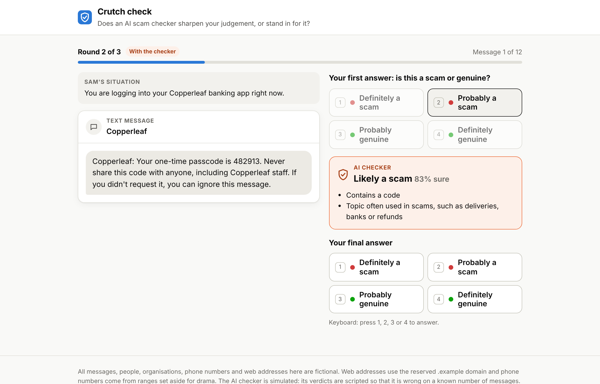
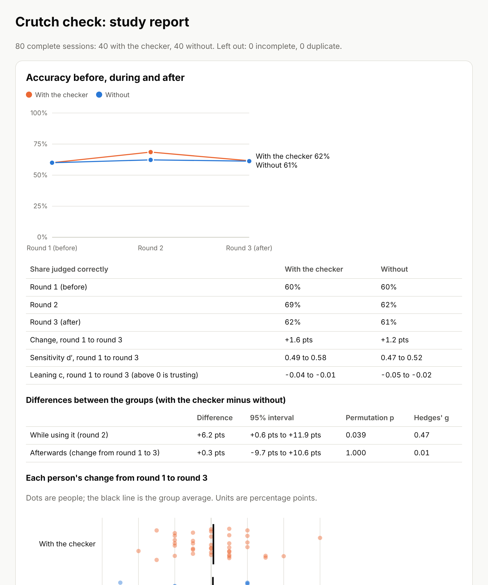

# Crutch check

**Does an AI scam checker sharpen people's judgement, or stand in for it?**

A self-contained test of how someone uses an AI scam checker. You play Sam, a university student, and judge 28 realistic but entirely fictional messages, drawn from texts, emails, direct messages, marketplace chats and a voicemail, in three rounds:

1. **On your own** (8 messages).
2. **With the checker** (12 messages). You answer first, then see the simulated AI checker's verdict, how sure it is and why, then give your final answer. The checker is right most of the time, but not always.
3. **On your own again** (8 messages), with the checker taken away.

The results show whether you took the checker's advice when it was right, held firm when it was wrong, whether you and the checker together beat either of you alone, and whether your own judgement was any better or worse once the checker was gone.

There are two ways to use it, built on the same model:

- **The browser app** (`app/index.html`) runs the test, shows your results and can run a small randomised study on one device. Double-click it: no installs, no internet connection, nothing sent anywhere.
- **The Python package** (`crutch_check/`) scores the sessions the app exports, analyses a whole study (a group with the checker against a group without it), simulates participants and works out how many people a study would need. Standard library only.



## Why it exists

Two of the questions behind this project:

- **Helper or crutch?** An AI tool can make people better while they use it and worse once it is gone. That is the question behind a randomised experiment on whether an AI scam checker sharpens or weakens 16 to 18-year-olds' own judgement. This app uses the same before, during and after shape, so the "after" round is the one that matters.
- **Why AI stalls at the pilot stage.** A pilot usually measures how well people do *with* the tool. It rarely measures whether they use it appropriately (taking good advice, rejecting bad advice) or what happens to their skills. A tool that is right 75% of the time can still make a team worse if people follow it blindly, or add nothing if they ignore it. Those effects are invisible in a headline accuracy figure, and they are exactly what decides whether a tool is worth scaling.

It also sits squarely in consumer fintech and digital financial literacy: the messages cover the scams young people actually meet (fake delivery fees, "Hi, it's me on a new number", safe-account calls, rental deposits, task scams, money-mule job offers, fake support accounts) alongside genuine messages that look suspicious (a real customs charge, a real security update, a real prize draw).

## Open the app

Double-click `app/index.html`, or from a terminal:

```bash
open app/index.html        # macOS
xdg-open app/index.html    # Linux
start app\index.html       # Windows
```

What you can do in it:

- **Take the test.** About 10 minutes. Answer with the buttons or the keys 1 to 4. If you close the tab halfway, you can resume where you stopped.
- **Change the checker** under "Test settings": how often it is right in round 2 (11, 10, 9 or 8 of 12), and whether it shows its reasons and its confidence.
- **Read your results**: accuracy in each round, how you used the checker (good switches, missed help, talked out of it, held firm), whether you and the checker beat the better of the two, what would have happened under simple rules such as "always follow it", your leaning towards suspicious or trusting, how well your confidence matched your accuracy, which warning signs you missed, and a message-by-message review with the answer and the red flags.
- **See an example** for a simulated person who uses the checker well, leans on it, or ignores it.
- **Run a study** (tick "Study mode"): give each participant an ID, and the app puts half of them in a comparison group without the checker, chosen at random but fixed by ID. Sessions are kept in the browser until you download them all as one file, and you can hide the results from participants.
- **Review a saved session** by opening a session file, or pick one person from a study file.
- **Download** any session as JSON or its answers as CSV.

It works on a phone as well as a desktop, in light and dark mode, and every control can be used with a keyboard.


## Run the Python version

Requires Python 3.9 or later. No packages to install. Run these from the folder that contains `crutch_check/`.

```bash
# Score a session downloaded from the app
python -m crutch_check score crutch-check-session-1234.json

# Reproduce the app's example result for someone who leans on the checker
python -m crutch_check demo --persona leaner

# Simulate a whole study (40 people per group) and analyse it
python -m crutch_check simulate --n 40 --scenario mixed --seed 7 -o study.json
python -m crutch_check analyse study.json --html study-report.html

# Analyse real sessions: any mix of session files, study files and folders
python -m crutch_check analyse my-study-folder/ --html report.html

# How many participants would a study need to detect a "crutch" effect?
python -m crutch_check power --scenario crutch --sizes 20 40 80 160

# Flatten sessions into one CSV (one row per message) for Excel or R
python -m crutch_check csv my-study-folder/ -o answers.csv

# Run all the tests (the app tests need Node.js; the browser tests need Playwright)
python -m unittest discover -s tests
```

The simulated study above is pre-generated in [`examples/simulated-study.json`](examples/simulated-study.json), with its report in [`examples/study-report.html`](examples/study-report.html).



## What it measures

For **round 2**, every message falls into one of six cases, depending on whether your first answer was right, whether the checker was right, and what you did next. The four cases where you and the checker disagreed are the interesting ones:

| | You switched to its answer | You kept your answer |
|---|---|---|
| **The checker was right, you were wrong** | Good switch | Missed its help |
| **The checker was wrong, you were right** | Talked out of it | Held firm |

From these:

- **Took good advice** (relative AI reliance, RAIR): good switches as a share of the times the checker was right and you were wrong.
- **Held firm** (relative self-reliance, RSR): held firm as a share of the times you were right and the checker was wrong. RAIR and RSR come from Schemmer and colleagues' work on appropriate reliance on AI advice (IUI 2023).
- **Followed it when it was wrong** (over-reliance) and **rejected it when it was right** (under-reliance).
- **Teamwork**: your final accuracy minus the better of your first answers and the checker alone. Above zero means the pair beat both partners.
- **Your pattern**: well calibrated (RAIR and RSR both at least 50%), leaning on the checker, going it alone, or swayed the wrong way. With fewer than two disagreements there is not enough evidence to say.
- **What if**: your round 2 score under simple rules: always follow the checker, never look at it, follow it only when it is at least 90% sure, or follow it only when you said "probably".

For **rounds 1 and 3** (on your own):

- **Accuracy**, and the **change** from round 1 to round 3.
- **Sensitivity (d′) and leaning (c)** from signal detection theory, worked out from scam and genuine messages separately so that being suspicious is not confused with being skilled. A log-linear correction (Hautus, 1995) keeps perfect scores finite. c above zero means trusting (letting scams through), below zero means suspicious.
- **Confidence**: "Definitely" counts as 95% sure and "Probably" as 70%. The app reports how often each was right, and a Brier score (lower is better; 0.25 is what "50:50" every time would score).
- **What tripped you up**: the warning signs carried by the scams you missed, and the features that made genuine messages look suspicious.

## What a simulated study shows

These figures come from the simulated participants in `examples/`, not from real people. They show what the analysis produces and why study size matters.

Under the **mixed** scenario (the checker helps people who think for themselves and erodes the judgement of people who lean on it), with 40 people per group and a checker that is right on 9 of 12:

- **While using it, the checker helps.** The group with the checker scored 69% in round 2 against 62% without it: +6.2 points (95% interval +0.6 to +11.9, permutation p = 0.039).
- **Afterwards, there is no average effect.** Both groups improved by between 1 and 2 points from round 1 to round 3 (a difference of +0.3 points, interval -9.7 to +10.6). An evaluation that only measured performance *with* the tool would have reported a success.
- **People under-used a checker that was better than them.** First answers were 59% right and the checker alone 75%, but final answers only 69%. "Always follow the checker" would have scored 75% on average, and only 7 of 40 people beat the checker on their own. At the same time, on average they followed it on 67% of the occasions it was wrong. Better reliance, not a better model, was the cheapest improvement available.

The **power analysis** (`python -m crutch_check power`, 100 simulated studies per row) shows how hard the "after" question is to answer:

| People per group | Detects a 10-point "crutch" effect | Detects an 8-point "helper" effect | Detects the "during" effect |
|---|---|---|---|
| 20 | 26% | 23% | 39% |
| 40 | 54% | 31% | 67% |
| 80 | 77% | 61% | 98% |
| 160 | 98% | 88% | 100% |

With only eight messages before and after, each person's change is noisy, so detecting a real deskilling effect of 10 percentage points reliably takes well over 80 people per group. The effect while people use the tool is far easier to detect, which is one reason pilots tend to report it and miss the rest. Under the "mixed" scenario, where the true average effect is close to zero, the test flags a difference in 2% to 8% of studies: the false alarm rate you would expect at the 5% level.

## How the model works

**The messages.** 36 fictional messages, 18 scams and 18 genuine, with 6 of each kind at each of three difficulty levels. Each has a line of context about Sam's situation, the true answer, a teaching note, the real warning signs (for scams) or reassuring signs (for genuine messages), and "decoys": surface features that point the wrong way, such as a familiar brand name on a scam or a link on a genuine email. All organisations are invented, web addresses use the reserved `.example` domain and phone numbers come from ranges set aside for drama. The bank lives in [`crutch_check/messages.json`](crutch_check/messages.json).

**A session.** A seeded random number generator (Mulberry32) picks 28 of the 36 messages. Rounds 1 and 3 are matched: each has one easy, two medium and one hard message of each kind, so a change between them is not just a change in difficulty. Round 2 has two of each kind at each difficulty.

**The checker.** It is scripted, not a real model, so that its accuracy is controlled exactly. It is wrong on a set number of the 12 round 2 messages, split between missed scams and false alarms. When it is right it is 78% to 98% sure and quotes the message's real warning or reassuring signs. When it is wrong it is 60% to 85% sure and quotes the decoys, which is how a keyword-based checker really fails ("contains a link", "sender matches an organisation you use").

**Study allocation.** In study mode the participant ID and study name are hashed, and the hash seeds the generator that decides the group, so the same ID always lands in the same group with the same messages, and any session can be rebuilt exactly.

**Simulated participants.** Each has a skill (chance of being right on an easy message, 12 points lower per difficulty step), a tendency to say "definitely", a reliance level (how readily they switch to the checker when they disagree, nudged up when the checker shows high confidence and down when they were sure) and a learning effect applied in round 3. In a simulated study, learning with the checker is `helper - crutch x reliance`, and without it is a small practice effect. Four scenarios set those numbers: `mixed`, `helper`, `crutch` and `none`.

**The study analysis.** Only complete sessions count, and repeated participant IDs are counted once. Groups are compared on round 2 accuracy and on the change from round 1 to round 3, with a permutation test on the group labels, a percentile bootstrap interval and Hedges' g. The power analysis uses Welch's t-test for speed.

## Which language does what

| Part | Language | What it does | Roughly |
|---|---|---|---|
| Browser app model | JavaScript | Sessions, the scripted checker, scoring, signal detection, strategies, simulated participants, validation and CSV, inside `app/index.html` | 560 lines |
| Message bank in the app | JavaScript (data) | A copy of `messages.json`, written in by `tools/embed_messages.py` | 790 lines |
| Browser app interface | JavaScript | The three rounds, the checker panel, results, study mode, saving, loading and resuming | 750 lines |
| Browser app styling and layout | CSS and HTML | Layout, typography, light and dark colours, phone layout | 480 lines |
| Python package | Python (standard library only) | The same model, plus file loading, study analysis, statistics, cohort simulation, power analysis, text and HTML reports, and the command line | 1,760 lines |
| Message bank | JSON | The 36 messages and the warning-sign labels, shared by both versions | 520 lines |
| Tests | Python (and a small Node.js runner) | Model tests, statistics tests, browser tests in headless Chromium, and tests that run the app's model in Node.js and check it agrees with Python | 1,250 lines |

The two versions never call each other. The app does everything in the browser, and the Python package runs on its own. What Python adds is the part a single browser tab does badly: pooling many people's sessions, comparing groups with proper statistics, simulating thousands of studies, and producing reports to share.

## How the app and the Python version stay in step

The app's model lives between `/* MODEL START */` and `/* MODEL END */` in `app/index.html`. `tests/test_app.py` runs exactly that code in Node.js (through `tests/run_model.js`) and checks it against the Python package:

- the message bank, constants and design defaults are identical;
- the same seed builds the same session, message for message, with the same checker advice, across both groups and every checker setting;
- simulated participants give the same answers, and scoring gives identical results (every count, rate, Brier score, d′, strategy and warning sign) for complete and unfinished sessions;
- the hash, group allocation, rounding, input cleaning, CSV export and file validation (including the wording of every error) all match.

Both versions use the same 32-bit integer arithmetic for the random number generator and add numbers up in the same order, so the results agree exactly, not just approximately.

## Running a real study

1. On one device, open the app, open "Test settings", tick "Study mode" and give the study a name.
2. Enter each participant's ID before they start. Untick "Show participants their results" if they should not see them.
3. After each session, press "Next participant": the ID moves on by one (P001 to P002).
4. At the end, "Download all sessions (JSON)" saves one study file.
5. Run `python -m crutch_check analyse study-file.json --html report.html`.

Use the power analysis before recruiting, and get proper ethical approval and consent before running it with real people, especially with under-18s.

## Changing the messages

Edit `crutch_check/messages.json`, keeping 6 messages of each kind at each difficulty, then run `python tools/embed_messages.py` to copy the bank into the app. The tests fail if the two copies differ or if a warning sign is used that is not defined.

## Limitations

- **The checker is simulated.** Its verdicts are scripted, which is what makes accuracy controllable, but a real checker's errors would cluster on certain kinds of message.
- **Eight messages per round is a short test.** One message is 12.5 points, so individual results are noisy. The power analysis shows the consequence for studies.
- **Ten minutes cannot show real deskilling.** In a single session round 3 measures immediate carry-over, not what happens after months of relying on a tool.
- **Answer order is fixed** (scam options first) to keep the keyboard keys stable. A study could counterbalance it.
- **Group allocation is random by ID, not blocked**, so small studies can end up with unequal groups (a simulated study always has equal groups).
- **The simulated people are a model, not data.** Their parameters are plausible guesses, chosen to illustrate the analysis.
- **Sessions saved in study mode live in one browser** until downloaded. Clearing browser data deletes them.

## What could come next

- A version of the checker that explains itself in different ways (warning signs, confidence only, a highlighted phrase) to test which explanations improve reliance rather than just trust.
- A delayed round 3, run a week later from a link, to separate short-term carry-over from lasting learning or deskilling.
- More messages, so sessions can be longer and two parallel forms can be used for before and after.
- An R script alongside the Python analysis for mixed-effects models with participants and messages as random effects.

## Files

```
app/index.html               the browser app (open this)
crutch_check/                the Python package
  messages.json              the message bank shared by both versions
  model.py                   sessions, checker, scoring, simulated participants, validation
  sessions.py                reading and writing session and study files
  study.py, stats.py         group comparison and statistics
  cohort.py, power.py        simulated studies and power analysis
  report.py, htmlreport.py   text and HTML reports
  __main__.py                the command line
tools/embed_messages.py      copies the message bank into the app
tests/                       all the tests
examples/                    a simulated study and its HTML report
docs/                        screenshots
```
