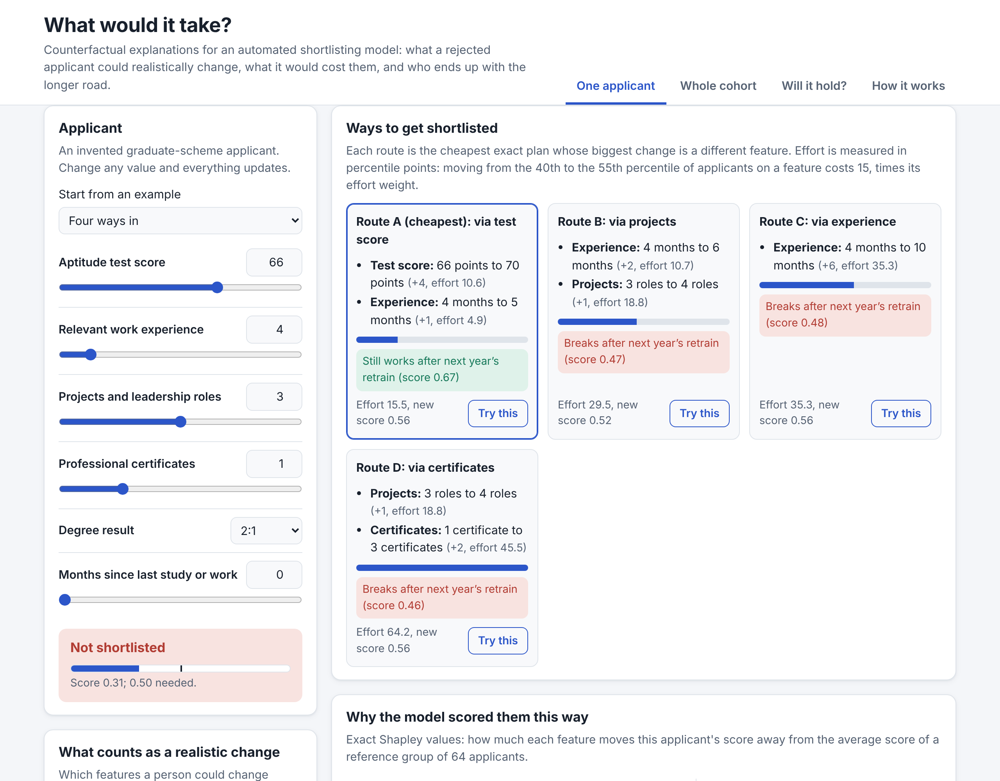
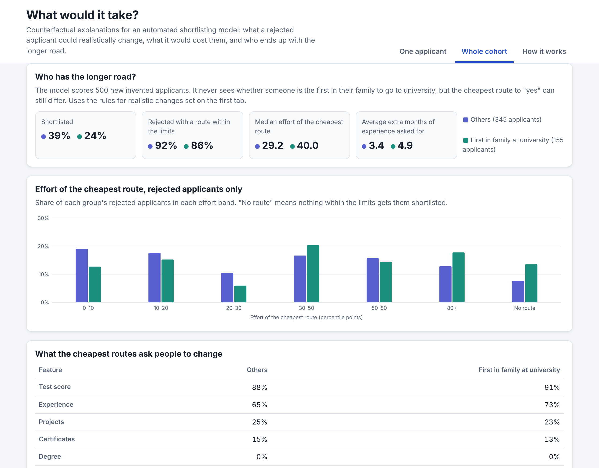

# What would it take?

**Counterfactual explanations for an automated shortlisting model.** When a model says "no", the most useful explanation is often not "which features counted against you" but "what would have had to be different, realistically, for the answer to be yes". This project computes exactly that for an invented graduate-scheme screening model, measures how much effort each route asks of the person, and checks whether some groups of applicants face a longer road than others, even though the model never sees the group.

Everything is synthetic and runs offline. It is a learning tool about explanations of automated decisions, not a hiring tool.



## Why it matters

- **Explainable AI and decision-making tools.** Most explainability tools answer "why?" with feature attributions such as SHAP. This tool puts attributions next to counterfactual routes and shows how often they point at different things: the feature that hurts most (a past gap, a degree result) is frequently the one nobody can change.
- **AI that stalls at the pilot stage.** Automated screening pilots often stall at sign-off because nobody can say what a rejected person should be told. A counterfactual route is the kind of answer a risk team, a regulator or the applicant can act on, and the cohort view shows the fairness question that comes with it.
- **Human-AI interaction.** A route is only meaningful if it is realistic. The rules table makes the assumptions behind an explanation explicit (what can change, by how much, how hard it is), which is where most of the judgement in real counterfactual explanations hides.

## Open the app

Download or clone this branch, then double-click `app/index.html`. It opens in any modern browser, needs no internet connection and sends nothing anywhere.

- **One applicant:** pick an example or set the six features yourself. You get the decision, up to four routes to being shortlisted (each the exact cheapest plan whose biggest change is a different feature), the Shapley values behind the score, and a decision map of any two features with the routes drawn on it. "Try this" applies a route.
- **What counts as a realistic change:** which features can move, by how much and how hard each is. Degree result and past gaps are fixed by default.
- **Whole cohort:** 500 new applicants scored by the model, split by whether they are the first in their family at university: shortlist rates, the share of rejected applicants with any route within the limits, the effort of the cheapest route and what the routes ask people to change.
- **Will it hold?** A route is a promise about this year's model. The tool retrains the model on next year's applicants (the same kind of pool, or a stronger one, with the same quota) and checks how many routes still work, at seven safety margins. With no margin only about a third of the cheapest routes survive a routine retrain; it takes a margin of about +0.25 to keep 90% of them, which asks for much more effort and leaves a third of rejected applicants with no route at all. Each route card on the first tab also says whether it survives.



## Run the Python companion

Python 3.9 or later, standard library only. From the repository root:

```bash
python3 -m whatwouldittake explain --preset "Near miss"
python3 -m whatwouldittake explain --test 62 --experience 9 --projects 3 --certs 1 --degree Third --gap 3 --weight experience=2
python3 -m whatwouldittake sample --n 40 --out applicants.csv
python3 -m whatwouldittake plans applicants.csv --out plans.csv
python3 -m whatwouldittake audit --csv applicants.csv --out audit.md
python3 -m whatwouldittake hold --retrains 20 --points 0 2 --out hold.md --raw hold.csv
```

- `explain` prints one applicant's decision, Shapley values and routes.
- `plans` reads a CSV of applicants (columns `test, experience, projects, certs, degree, gap`, optional `id`) and writes each one's decision, biggest drag and cheapest route to CSV: the batch job a screening team would run.
- `audit` compares recourse burden between groups, for the synthetic cohort or your own CSV with a `first_in_family` column, and writes a Markdown report.
- `hold` checks every route against many retrained models (20 by default, `--points 0 2 4` for stronger pools) and reports, for each safety margin, the mean, lowest and highest share of routes that survive, by group, plus the smallest margin that keeps your `--target` share on average and in the worst retrain. `--raw` writes every retrain's numbers to CSV.
- Every command accepts the same rules as the app: `--allow degree`, `--fix test`, `--cap experience=6`, `--weight test=2`, `--max-levers 2`, `--margin 0.05`.

## Run the tests

```bash
node --test                          # the app's model, run in Node.js
python3 -m unittest discover -s tests   # Python, JavaScript/Python agreement, browser UI
```

The agreement tests run the app's model in Node.js and check that the Python port gives identical numbers. The UI tests need Playwright for Python and are skipped without it. `python3 docs/make_screenshots.py` regenerates the screenshots.

## Which language does what

| Part | Language | Lines (approx.) | Does |
|---|---|---|---|
| `app/index.html` | HTML, CSS, JavaScript | 1,220 | The whole interactive tool, offline. Model logic sits between `MODEL START` and `MODEL END`. |
| `whatwouldittake/` | Python | 780 | The same model, plus batch routes for a CSV of applicants and audit reports. |
| `tests/` | JavaScript and Python | 630 | Exactness against brute force, Shapley properties, cross-language agreement, CLI and browser tests. |

## How it works

1. **Synthetic applicants.** 1,600 invented past applicants with six features: aptitude test score, months of relevant experience, projects and leadership roles, certificates, degree result and months since last study or work. About a third are the first in their family at university; on average they have less relevant experience and fewer projects, and more of them have gaps. Past decisions came from a hidden rule plus noise, with 38% shortlisted.
2. **The model.** Gradient boosting with 60 trees, each two splits deep, fitted to those decisions. A score of 0.50 or more means "shortlist".
3. **Exact routes.** Because the model is a sum of trees, the score only changes where a tree splits. For each feature the search only needs the current value and the first value past each split point in the allowed direction. It explores those combinations cheapest first and stops at the first one that reaches 0.50, so the answer is the exact cheapest plan. The tests check this against a brute-force search over every integer combination.
4. **Effort.** The cost of moving a feature is the percentile shift among past applicants (with one pseudo-count per value, so every step costs something), times the effort weight. Moving from a common value to a rare one costs more.
5. **Several routes.** For every subset of movable features the tool finds the cheapest plan that uses exactly that subset, then keeps the cheapest plan for each feature that carries most of the cost.
6. **Shapley values.** Exact interventional Shapley values against 64 reference applicants, over all 64 combinations of features, so they add up exactly to the gap between the average score and this applicant's score.
7. **Cohort audit.** Runs the cheapest-route search for every rejected applicant and compares groups.
8. **Will it hold?** Next year's model is trained the same way on 1,600 fresh applicants, optionally stronger on average; with the same quota, a stronger pool raises the bar. The order in which the search visits plans does not depend on the target score, so a single search notes the first plan that clears each of the seven margins, exactly as seven separate searches would (a test checks this).

## Limitations

- The data, the employer and the hidden rule are invented. The group difference is built into the synthetic data to show the mechanism; it is not an estimate of anything real.
- Effort as a percentile shift is one reasonable choice among several. It ignores time, money and the fact that some changes depend on others.
- "Will it hold?" retrains on data from the same hidden rule. Real models also change features, thresholds and quotas, which would break even more routes.

## What could come next

- Let the user upload their own model as a set of trees.
