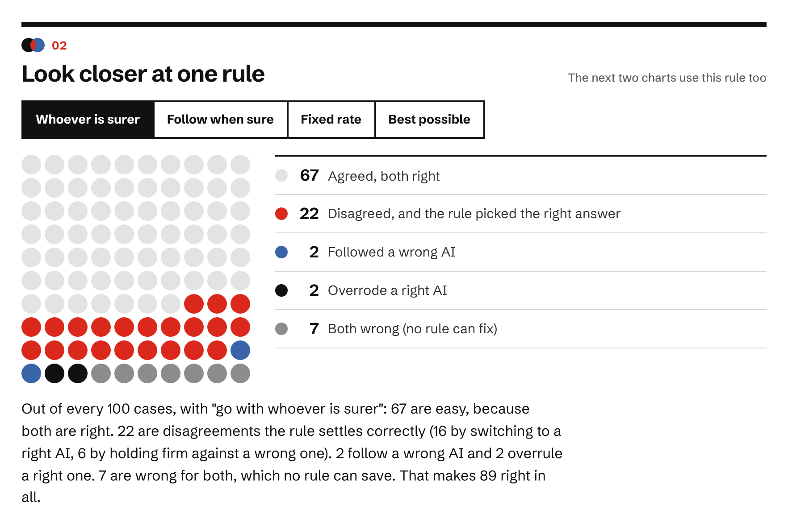
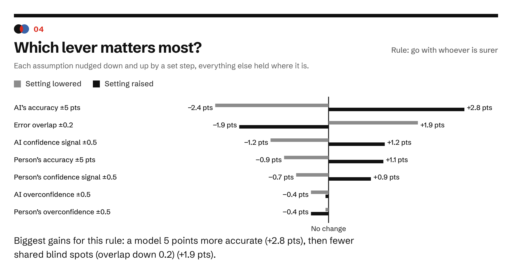

# Reliance lab

**When a person checks an AI's work, can the pair beat both of them?**

"A human will review it" is the standard answer to AI risk. But a reviewer only adds value if they know *when* to trust the AI. Someone who agrees with everything adds nothing, and someone who overrules the AI too often makes things worse. Reliance lab is an interactive model of the person-plus-AI team: set how good each side is, how often they fail on the same cases and how much their confidence tells you, and it shows exactly how accurate the team will be under four ways of settling disagreements, where pairing pays, and which lever would help most.


There are two parts, built on the same model:

- **The browser app** (`app/index.html`). Sliders, six ready-made scenarios and five linked views of the model. One file, no installs, works offline, nothing leaves the page.
- **The Python companion** (`reliance_lab/`). The same model from the command line, plus a sweep across 3,888 combinations of assumptions with a CSV export and a self-contained HTML report of what drives the gain. Standard library only.

## Why it matters

- **AI adoption beyond the pilot.** Pilots usually measure the AI on its own. The deployed system is a person plus the AI, and if the person rubber-stamps or second-guesses it, the promised gain never shows up. The business case was written for the model, not for the team. This model says what the team will actually deliver, and what has to be true for it to beat the model alone.
- **Human-AI interaction and over-reliance.** The four rules span the range from rubber-stamping to ignoring the AI, and every error is split into the three kinds that matter: both wrong, followed a wrong AI (over-reliance) and overrode a right AI (under-reliance).
- **AI governance.** Article 14 of the EU AI Act asks that people overseeing high-risk AI stay aware of automation bias. The model shows what effective oversight has to mean in numbers: a reviewer adds value only when something, usually confidence, tells them which disagreements to give to the AI.
- **Innovation and investment decisions.** The levers view turns the model into a "where should we spend?" question: a more accurate model, more honest confidence, or reviewers whose mistakes differ from the AI's.

This build models the team. Its sibling build, [Second opinion](https://github.com/bb414/daily-builds/tree/build/2026-11-24-second-opinion), measures how one real person relies on an AI checker; the two work well side by side.

## Open the app

Download or clone this branch, then double-click `app/index.html`. Or from a terminal:

```bash
open app/index.html        # macOS
xdg-open app/index.html    # Linux
start app\index.html       # Windows
```

What you can do in it:

- **Set the assumptions.** Nine sliders: the person's and the AI's accuracy, error overlap, how much each side's confidence tells you (d', from 0 to 4), whether either side is overconfident, and the settings for two of the rules. Or start from one of six scenarios, from "two equals with honest confidence" to "a chatty assistant that always sounds sure".
- **Compare the rules.** The headline tiles and a short explanation update as you move anything. "Where each rule's errors come from" splits every rule's mistakes into the three kinds, with a full table underneath.
- **Look closer at one rule.** A grid of 100 typical cases shows how many are easy (both right), how many disagreements the rule settles correctly, and how many go wrong and why.
- **See where pairing pays.** A map of every combination of the two accuracies shows where the chosen rule lets the pair beat both.
- **Find the biggest lever.** Each assumption is nudged down and up in turn, and the chart ranks what helps most.
- **Raise the bar.** The last chart shows team accuracy as the confidence bar for following the AI rises; click it to set the bar.
- **Share a setup.** "Copy link to these settings" puts every setting in the address, so the same file opened with that link shows the same picture.

It works on a phone as well as a desktop, every control can be used with a keyboard, and every control has a label for screen readers. The look borrows from Swiss poster design: a visible grid, thick black rules, Schibsted Grotesk type, and one colour per side (black for the person, blue for the AI, red for the pair).


## Run the Python companion

Requires Python 3.9 or later. Nothing to install.

```bash
# Every rule under the default assumptions, with 100 typical cases for "go with whoever is surer"
python -m reliance_lab model

# Change any assumption; pick the rule for the 100-case breakdown; or get everything as JSON
python -m reliance_lab model --human 0.8 --ai 0.8 --overlap 0 --ai-signal 2 --human-signal 2
python -m reliance_lab model --rule fixed --defer-rate 1
python -m reliance_lab model --json

# Run the model across 3,888 combinations of assumptions, with a CSV and an HTML report
python -m reliance_lab sweep --csv sweep.csv --html sweep-report.html
```

A pre-generated report is in [`examples/sweep-report.html`](examples/sweep-report.html).

## What the model shows

All figures below come from `python -m reliance_lab model` and `python -m reliance_lab sweep`, and the app shows the same ones.

**The default case: a good model and a decent reviewer** (person 75% accurate, AI 85%, error overlap 0.2, AI confidence d' 1.5, person d' 1.0, nobody overconfident):

| Rule for settling disagreements | Team accuracy | Against the AI alone |
|---|---|---|
| Defer to the AI 70% of the time | 82.0% | 3.0 points worse |
| Follow the AI when it shows 80% or more | 87.7% | +2.7 points |
| Go with whoever is surer | 88.9% | +3.9 points |
| Best possible rule | 88.9% | +3.9 points |

Out of every 100 cases under "go with whoever is surer", 67 are easy because both are right, 22 are disagreements the rule settles correctly (16 by switching to a right AI, 6 by holding firm against a wrong one), 2 follow a wrong AI, 2 overrule a right one, and 7 are wrong for both, which no rule can save.



**What that means:**

- **A fixed deferral habit can never beat the better of the two.** In a yes or no decision, when the person and the AI disagree exactly one of them is right, so any habit that treats every disagreement the same way lands between the two solo accuracies. Across all 3,888 combinations in the sweep, deferring 70% of the time never beats both. Beating both needs a signal for *which* disagreements to give to the AI.
- **If both sides' confidence is honest and their mistakes are unrelated, "go with whoever is surer" is the best possible rule.** Overconfidence on either side, or mistakes that cluster on the same cases, is what breaks it. Across the sweep, "whoever is surer" beats both in 72% of combinations, against 77% for the best possible rule and 44% for "follow the AI when it shows 80% or more".
- **Pairing pays most between equals.** Two equally accurate partners (80% each) with honest, informative confidence and unrelated mistakes reach 93.5%, 13.5 points above either of them. A strong model with a weaker reviewer who cannot tell when they are right (the "rubber-stamp risk" scenario: 70% against 92%) gains nothing even with the best rule, and "whoever is surer" loses half a point.
- **An assistant that always sounds sure defeats the "follow it when it sounds sure" rule.** In the "chatty assistant" scenario every answer clears an 80% bar, so the rule becomes "always follow" (82.0%, no gain), while the best rule, which leans on the person's own confidence instead, still adds 3.3 points.
- **Shared blind spots and vague confidence are the biggest brakes.** In the sweep, the best rule's average gain falls from 5.8 points with unrelated mistakes to 2.6 points when the overlap is 0.4, and rises from 2.5 points when the AI's confidence says nothing to 6.1 points when it is informative.
- **The gap in overconfidence matters more than overconfidence itself.** "Whoever is surer" beats both in 76% of scenarios when the two sides are equally overconfident, and 66% when one is a full step more overconfident than the other.

The map shows the third point at a glance: under the default confidence settings, "go with whoever is surer" lets the pair beat both (red) along the diagonal where the two are about equally good, and adds little or nothing where one side is far better.


The levers chart turns the same model into a "where should we invest?" question. Under the defaults, a model five points more accurate adds 2.8 points to the team, cutting shared blind spots adds 1.9, and making the AI's confidence more informative adds 1.2.



## Which language does what

| Part | Language | Roughly | What it does |
|---|---|---|---|
| `app/index.html` | HTML and CSS | 600 lines | Layout, the poster styling with its embedded fonts, responsive design |
| | JavaScript (model block) | 340 lines | The reliance model; runs in the browser and in Node.js for tests |
| | JavaScript (interface) | 730 lines | Sliders, scenarios, the five charts and settings links |
| `reliance_lab/` | Python | 670 lines | The same model (tested to agree), a command-line report, and what a browser page does badly: a 3,888-scenario sweep with main effects, a CSV of every scenario and a self-contained HTML report |
| `tests/` | Python and JavaScript | 680 lines | Unit tests for both, agreement tests between them, and browser tests of the app |

## How it works

**The set-up.** A yes or no decision, such as "is this payment fraud?". The person and the AI each give an answer. Where they agree there is nothing to decide. Where they disagree, exactly one of them is right, and a *reliance rule* decides whether the person switches to the AI's answer. Cases both get wrong are lost whatever the rule does.

**Who is right.** The two accuracies and an error correlation (the "overlap") give the chance of each combination: both right, only the person right, only the AI right, both wrong. The overlap is capped at what the two accuracies allow, and the app says when that happens.

**Confidence.** Signal detection theory. On each case the AI has a hidden signal that is higher, on average, when it is right; the gap between the two averages is d'. Its shown confidence is the calibrated chance of being right given that signal, shifted up if it is overconfident. The person's confidence works the same way.

**The rules.** Because the signals are normally distributed, each rule's chance of following the AI when it is right, and when it is wrong, has an exact formula: a fixed rate; a confidence bar; comparing the two shown confidences; and the best possible rule, which weighs both signals with Bayes' rule and so cannot be beaten by any rule using the same information. Nothing is simulated, so the app updates instantly. A simulation in the tests checks every formula to within 0.6 points.

**The views.** Errors by rule come straight from the formulas. The 100 typical cases round the expected counts so they add to exactly 100. The map evaluates the chosen rule on a 50 by 50 grid of accuracies. The levers nudge each assumption by a set step (five points of accuracy, 0.2 of overlap, 0.5 of d' or overconfidence) in each direction.

**Files.**

- `app/index.html`: the whole browser app. The model sits between `/* MODEL START */` and `/* MODEL END */` and exports itself for Node.js.
- `reliance_lab/model.py`: the model, a line-for-line port of the app's model block. `sweep.py`: the scenario sweep and its summary. `report.py` and `html_report.py`: text and HTML output. `__main__.py`: the command line.
- `tests/`: `test_agreement.py` runs the app's model in Node.js through `model_harness.js` and checks every output against Python; `app_model.test.js` tests the app's model directly (and `test_js.py` runs it from Python); `test_app.py` drives the app in headless Chromium; `test_model.py` and `test_cli.py` test the Python package.

## Tests

```bash
python -m unittest discover -s tests -t .    # everything: 40 tests
node --test tests/app_model.test.js          # just the browser app's model
```

The agreement and JavaScript tests need Node.js, and the browser tests need Playwright for Python with Chromium. Each group is skipped, not failed, if its tool is missing.

## Limitations

- This is a model, not a measurement. Every number follows from the assumptions you set. To see how real people rely on an AI, you need to test people (the Second opinion build does that).
- Real confidence is coarser than a smooth signal, and people's habits drift as they learn whether the AI tends to be right. The model has no learning.
- It covers yes or no decisions with one right answer. Tasks with many possible answers, or with no clear ground truth, behave differently.
- The error overlap is a single correlation. Real blind spots cluster in particular kinds of case, which a single number cannot describe.

## What could come next

- **Costs, not just accuracy.** Add the cost of a review, a missed fraud and a false alarm, so the model answers "is human review worth paying for here, and for which cases?" rather than only "is the team more accurate?".
- **A pilot calculator.** Turn the model round: from a pilot's measured accuracies and a sample of disagreements, estimate the model's settings and the accuracy the deployed team will actually deliver.
- **Learning over time.** Let trust update after each case the person sees resolved, to test whether feedback cures over-reliance or just swaps it for under-reliance.

## Sources

- Schemmer, M., Kühl, N., Benz, C., Bartos, A. and Satzger, G. (2023) "Appropriate reliance on AI advice: conceptualization and the effect of explanations", *Proceedings of the 28th International Conference on Intelligent User Interfaces*.
- Bansal, G. and colleagues (2021) "Does the whole exceed its parts? The effect of AI explanations on complementary team performance", *Proceedings of CHI 2021*.
- Regulation (EU) 2024/1689 (the AI Act), Article 14: human oversight.
