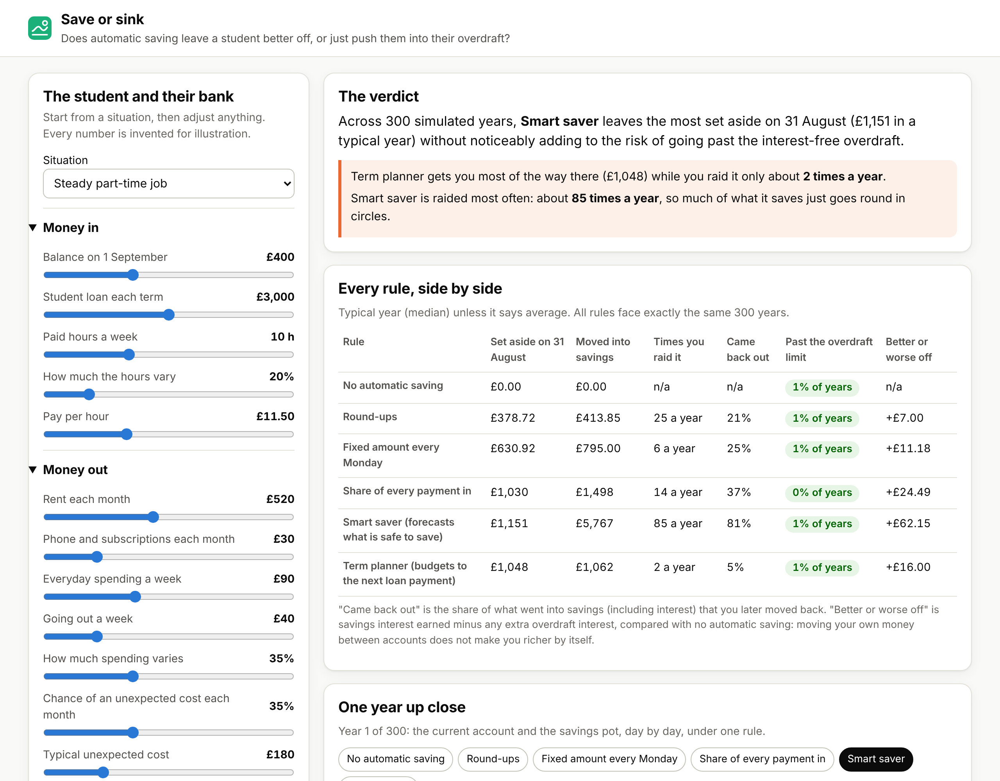
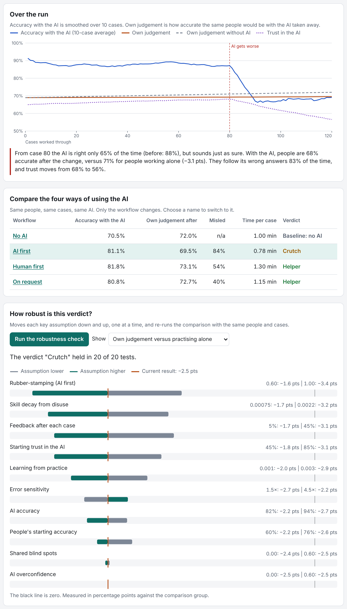

# Reliance Lab

**Helper or crutch? What does AI advice do to people's own judgement?**

Reliance Lab simulates people making yes-or-no decisions (is this message a scam? is this invoice fraudulent?) with an AI adviser on hand. You choose how the AI is built into the work, how good the people and the AI are, and how often anyone finds out the right answer. Then you watch accuracy, trust and each person's unaided judgement change case by case. Every run is compared with the same people practising without the AI, so the app can say whether the AI was a **helper** (more accurate, judgement intact) or a **crutch** (more accurate, but worse on their own afterwards).

It comes in two parts built on the same model:

- **The browser app** (`app/index.html`). Double-click it and it works: no installs, no internet connection, nothing sent anywhere.
- **The Python companion** (`reliance_lab/`). The same model on the command line, plus a virtual randomised experiment with noisy tests and a power analysis: how many participants a real study would need to detect the effects. Standard library only.



## Why it matters

Pilots of AI tools usually measure one thing: how accurate people are *with* the tool. They rarely measure what happens to people's own judgement, how often people follow the tool when it is wrong, or how they cope when it quietly gets worse. Those are exactly the effects that decide whether a tool is safe to scale, so they are part of why AI stalls between pilot and production.

The project sits on two of the brief's priority themes:

- **Human-AI interaction and over-reliance.** It separates *over-reliance* (following wrong advice) from *under-reliance* (ignoring right advice), and shows how a workflow can raise today's accuracy while eroding tomorrow's skill.
- **AI adoption beyond the pilot.** The fastest workflow (show the AI's answer first) is the one that looks best in a pilot dashboard and does the most hidden damage, which is a plausible reason organisations choose it.

It grew out of a research question about young people and an AI scam checker: does the checker sharpen their judgement or replace it? The first preset ("Scam checks: 16 to 18-year-olds") is a stylised version of that setting, and the Python power analysis asks how large a study would need to be to tell the difference.

## Open the app

Double-click `app/index.html`, or from a terminal:

```bash
open app/index.html        # macOS
xdg-open app/index.html    # Linux
start app\index.html       # Windows
```

What you can do in it:

- **Pick a scenario**: scam checks by 16 to 18-year-olds, invoice fraud screening by a finance team, or lead triage by new sales reps. Every setting can then be changed.
- **Choose how the AI is used**: *No AI* (the comparison group), *AI first* (the answer is shown straight away), *Human first* (people commit to an answer, then see the AI's) or *On request* (people ask only when unsure).
- **Read the verdict** (Helper, Crutch, No lift or Liability), a small map showing where the result lands, and plain-English reasons built from the numbers.
- **Watch it over time**: accuracy with the AI, own judgement, own judgement without the AI, and trust.
- **Stress-test it**: make the AI silently worse part-way through (a new kind of scam it has never seen) while it keeps sounding just as sure.
- **Compare all four workflows** on the same people and cases, including time per case.
- **Check robustness**: move ten key assumptions down and up and see whether the verdict survives.
- **See where disagreements go**: how often the AI could have misled people and did, and how often it could have rescued them and did.
- **Save and share**: copy a link that holds every setting, or download the settings as a file that the Python version can read.

It works on a phone as well as a desktop, every control can be used with a keyboard, and it supports dark mode.



## What it shows

All figures below come from the default "Scam checks" scenario (300 simulated people, 120 cases each, seed 42), produced by `python -m reliance_lab compare`. The browser app shows the same numbers.

| Workflow | Accuracy with the AI | Own judgement afterwards | Followed wrong AI advice | Minutes per case | Verdict |
|---|---|---|---|---|---|
| No AI | 70.5% | 72.0% | n/a | 1.00 | Baseline |
| AI first | 87.5% | 69.4% | 87% | 0.76 | Crutch |
| Human first | 86.4% | 73.0% | 57% | 1.30 | Helper |
| On request | 84.2% | 72.7% | 42% | 1.15 | Helper |

Three things stand out:

1. **The pilot metric hides the cost.** *AI first* is the most accurate and the fastest, yet people end up 2.6 points worse on their own than if they had practised without the AI. They accepted its answer without thinking on 54% of cases.
2. **Over-reliance depends on the workflow, not just on the AI.** With the same AI, people followed its wrong answers 87% of the time under *AI first* but 42% under *On request*.
3. **The crutch shows up when the AI fails.** If the AI drops from 88% to 65% accuracy after case 80, people using *AI first* score 67.8% from then on, below the 71.0% of people working alone, while *Human first* (72.7%) and *On request* (73.9%) stay ahead.

The same pattern (AI first is a crutch, the other two are helpers) holds in the other two scenarios and in all 20 runs of the robustness check, but it is not built in: with no feedback and no skill decay, for example, *AI first* becomes a helper.

## Run the Python version

Requires Python 3.9 or later. No packages to install. Run these from the project folder.

```bash
python -m reliance_lab run                      # one workflow against the comparison group, with reasons
python -m reliance_lab compare                  # all four workflows side by side
python -m reliance_lab compare --set driftAt=80 # with the AI getting worse after case 80
python -m reliance_lab robustness               # which assumptions could change the verdict?
python -m reliance_lab experiment               # a virtual randomised experiment with noisy tests
python -m reliance_lab power                    # how many participants a study would need

# Options shared by every command
python -m reliance_lab run --preset invoice_fraud --workflow human_first
python -m reliance_lab run --set feedbackRate=0.5 --set aiAccuracy=0.9
python -m reliance_lab run --config reliance-lab-settings.json   # settings downloaded from the app
python -m reliance_lab experiment --csv participants.csv --markdown report.md
```

The **virtual experiment** is the part the browser app cannot do. Each simulated participant takes a 20-item test on their own, works through the cases with the AI, then takes a second test on their own, so the results include the measurement noise a real study would have. With 60 participants per arm (seed 42):

```text
  Arm               Pre     Post   Change   With AI  Deferred
  No AI           68.8%    72.4% +3.6 pts     70.8%      0.0%
  AI first        65.8%    67.7% +1.8 pts     87.8%     54.3%
  Human first     69.3%    71.9% +2.6 pts     85.9%      0.0%

Compared with No AI (change in own test score):
  AI first     -1.7 pts (95% CI -6.6 pts to +3.1 pts), d = -0.13, p = 0.477
  Human first  -1.0 pts (95% CI -5.7 pts to +3.7 pts), d = -0.08, p = 0.675
```

The accuracy gain during training is obvious (about +17 points, p < 0.001), but the erosion of people's own judgement is not detectable at this size. The **power analysis** shows why: the effect is about -2.7 points (Cohen's d of about -0.19), and with 20-item tests a study would need roughly 460 participants per arm for 80% power. A small study that finds "no harm to judgement" may simply be too small to see it.

## Which language does what

| Part | Language | Lines (approx.) | What it does |
|---|---|---|---|
| `app/index.html` | HTML and CSS | 270 | Layout, styling, light and dark themes, phone layout |
| `app/index.html` (model block) | JavaScript | 550 | The simulation, verdicts, explanations, robustness check, settings links and files |
| `app/index.html` (interface) | JavaScript | 600 | Controls, charts, tables, chunked running so large simulations never freeze the page |
| `reliance_lab/model.py` | Python | 640 | A line-for-line port of the model block |
| `reliance_lab/experiment.py`, `stats.py`, `cli.py` | Python | 590 | Virtual experiment, power analysis, Welch's t-test, command-line tool and exports |
| `tests/` | JavaScript and Python | 930 | Model tests in Node.js, Python tests, a parity test and browser tests |

The browser app is the version anyone can open and use. Python adds the heavier, batch-style work: many participants, repeated studies for the power analysis, CSV and Markdown exports.

**Both versions agree.** The model uses the same random number generator (Mulberry32) and draws numbers in the same order in both languages, so the same settings give the same results. `tests/test_parity.py` runs the browser app's own model code in Node.js and checks it against Python, setting by setting, for whole runs, the workflow comparison, the robustness check, the explanations and the way odd inputs are read.

## How it works

Each simulated person works through a series of yes-or-no cases.

1. **Skill and difficulty.** A person's chance of being right is a logistic function of their skill minus the case's difficulty. The AI works the same way. *Shared blind spots* sets how far the AI finds the same cases hard (0 means unrelated, 1 means identical). Skills are calibrated so that the average starting accuracy and the AI's accuracy match the sliders exactly.
2. **Confidence.** People feel more confident on cases they are more likely to get right, with noise. The AI states a confidence too; *AI overconfidence* inflates it.
3. **Workflow.**
   - *AI first*: the more people trust the AI, the more often they accept its answer without thinking (*rubber-stamping*). When they do think, its answer still pulls them towards it.
   - *Human first*: people always form their own answer first.
   - *On request*: people ask only when their confidence is below a threshold.
4. **Switching.** When a person and the AI disagree, the person weighs their own confidence against their trust in the AI and, if it is shown, how sure the AI sounds.
5. **Trust.** When people find out the right answer, trust rises after the AI was right and falls three times as fast after it was wrong (adjustable).
6. **Own judgement.** Thinking for yourself and then getting feedback builds skill, twice as fast after a visible disagreement with the AI. Accepting the AI without thinking gives no practice and lets skill fade towards a coin flip.
7. **Stress test.** After a chosen case the AI's real accuracy drops (it can only get worse), but its stated confidence does not change, so nobody is warned.
8. **Verdict.** The same people and cases are run without the AI. More than 1 point more accurate with the AI counts as a lift; ending more than 1 point worse on their own than the comparison group counts as eroded judgement. The four combinations give Helper, Crutch, No lift and Liability.

The fixed behavioural constants (how decisive people are, how noisy confidence is, how much the AI's answer anchors people, minutes per case) are listed at the top of the model block in `app/index.html` and in `reliance_lab/model.py`.

## Tests

```bash
node --test "tests/*.test.js"          # the browser app's model, run in Node.js
python -m unittest discover -s tests   # Python, parity and browser tests
```

The browser tests need Playwright for Python (`pip install -r requirements-dev.txt` then `python -m playwright install chromium`) and are skipped if it is missing; the parity test needs Node.js and is skipped without it. The browser tests load the app in headless Chromium and check that it makes no network requests, logs no errors, labels every control, fits a phone screen, restores settings from a link and a file, keeps focus where it should and stays responsive at its most extreme settings. `python tools/screenshots.py` regenerates the pictures in `docs/`.

## Limitations

- **Illustrative, not calibrated.** The mechanisms come from research on automation bias, algorithm aversion and deskilling, but the numbers are assumptions. Use it to see how the effects interact, not to predict a real programme.
- **Simple decisions.** Every case is a yes-or-no call with immediate (or no) feedback. Real work has partial answers, delayed feedback and people learning from each other.
- **Simple people.** Everyone follows the same rules; only their starting skill differs. Motivation, fatigue and explanations from the AI are not modelled.
- **Time costs are assumed** (one minute to think, 0.3 minutes to weigh or accept the AI's answer).
- **The robustness check moves one assumption at a time**, so it can miss combinations that flip the verdict.
- **Parity relies on maths libraries agreeing.** JavaScript engines and Python can differ in the last digit of functions such as `exp` and `log`. In every test so far this has never changed a single outcome, and the parity test allows for differences of that size, but on another browser or operating system a result could in principle differ very slightly.

## What could come next

- **AI explanations as an intervention**: model whether showing reasons makes people better at spotting when the AI is wrong, or simply more persuaded.
- **Fit the model to real data**: estimate the behavioural constants from a real experiment, such as a pre-test and post-test study of a scam checker, so the presets stop being illustrative.
- **Fading the AI out**: a training mode where the AI is withdrawn gradually, to test whether a "scaffold" design avoids the crutch effect.
