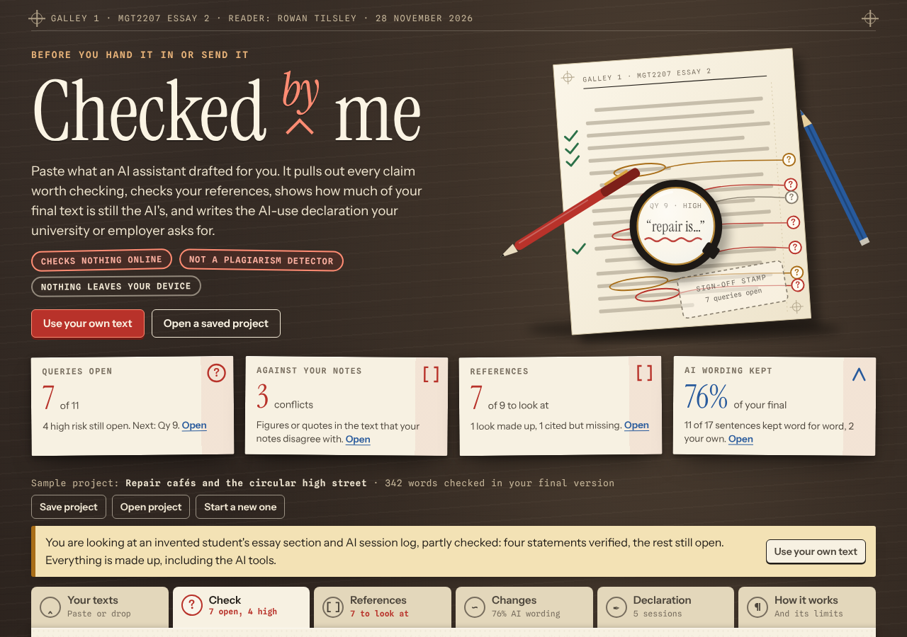
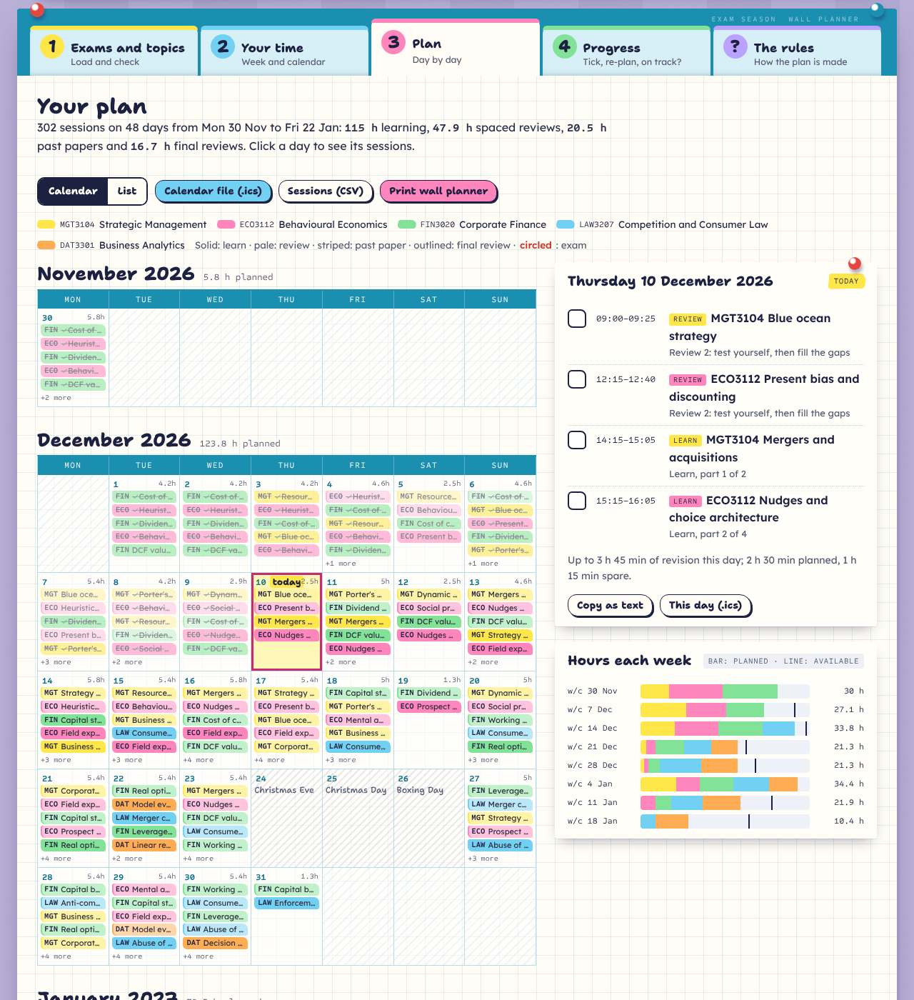
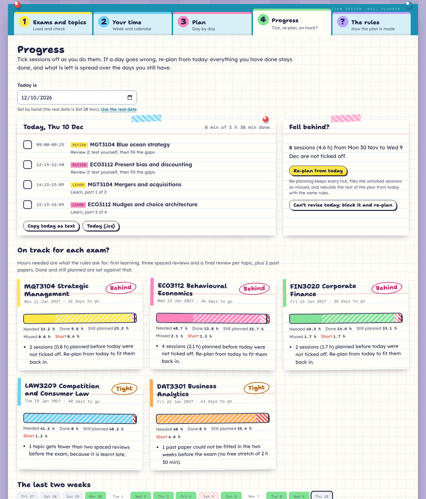
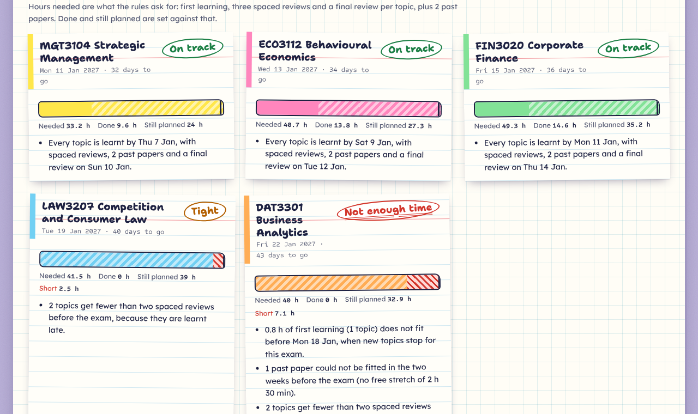
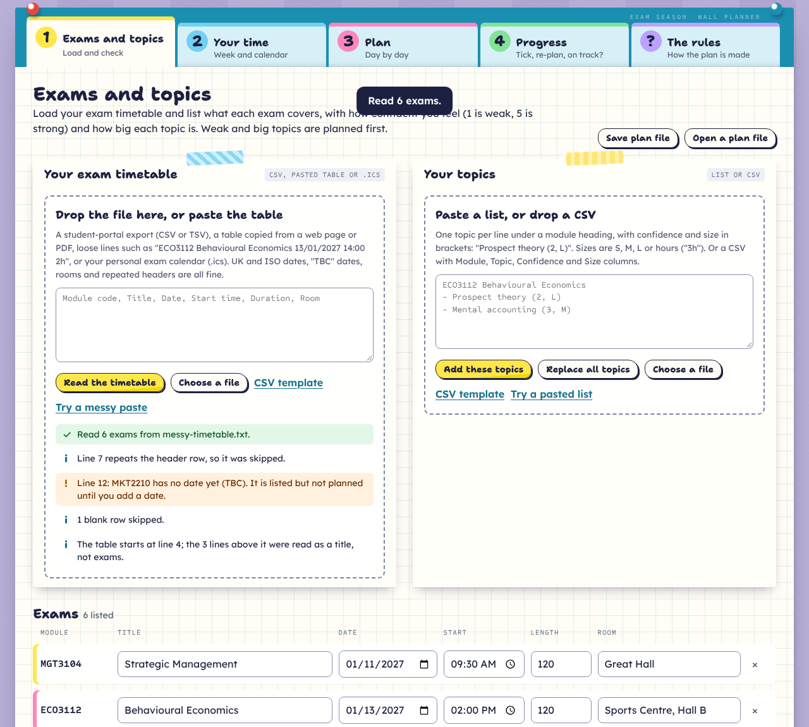
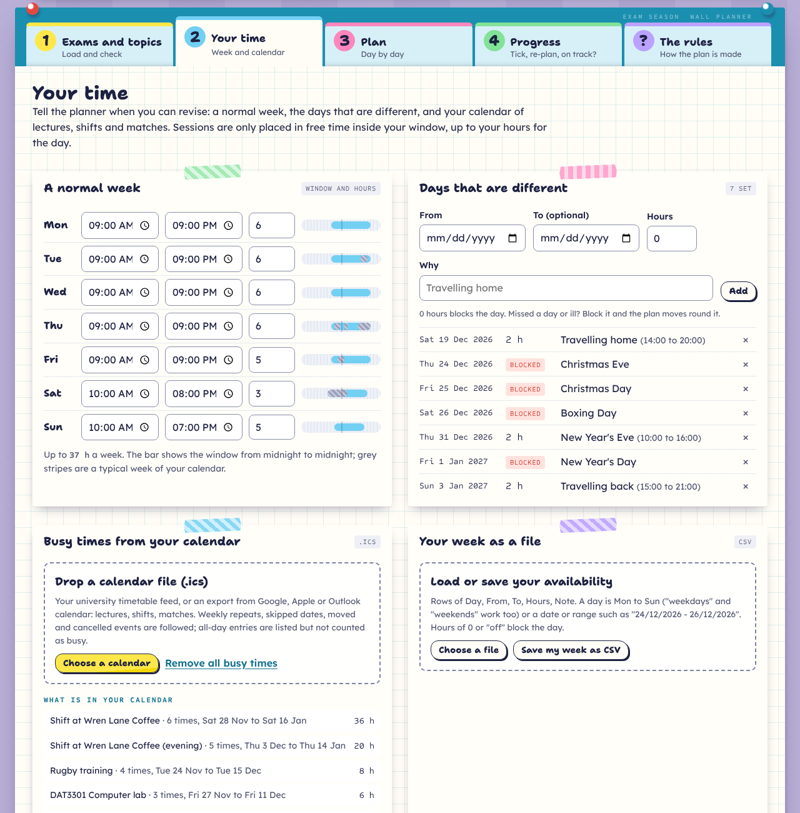
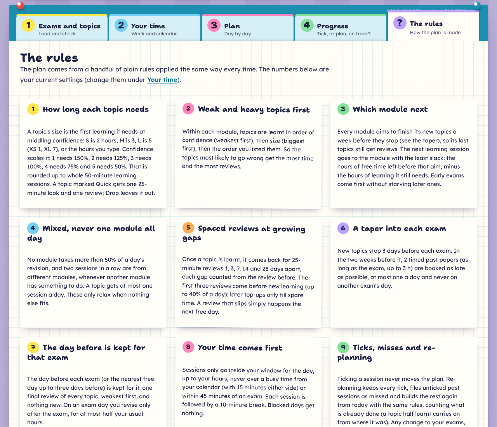
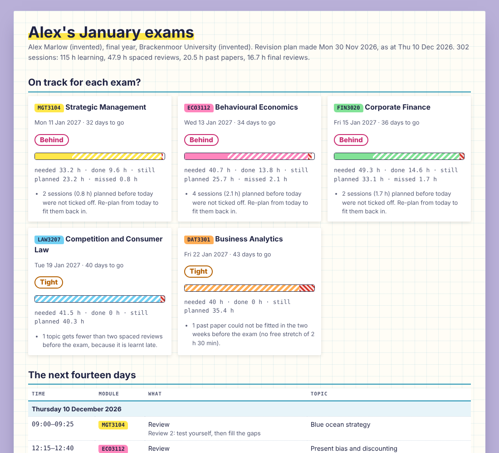

# Exam season

**Turns your exam timetable, your topics and the time you actually have into a day-by-day revision plan you can follow, tick off and re-plan when life gets in the way.**

Most revision plans are drawn on paper in a burst of good intentions and abandoned the first time a day goes wrong. They also tend to be wrong from the start: the easy topics get done first, one module eats a whole week, the day before an exam is full of new material, and nobody checks whether the hours exist at all.

Exam season does the planning properly from the inputs a student already has: the exam timetable from the student portal (CSV, a pasted table or the .ics calendar many universities provide), a list of topics per module with how confident you feel about each, and your real availability (a normal week, the days that are different, and the lectures, shifts and matches in your own calendar). It hands back a timetable of sessions with times, a calendar file for your phone, a printable wall planner, and an honest answer to "am I on track for each exam?", with what to drop or shorten when the time simply is not there. Tick sessions off as you go; when you miss a day, re-plan from today and everything you have done stays done.

Everything runs in your browser or on your own computer. Nothing you load is sent anywhere.

## Who it is for

- **University students and sixth-formers** with January or summer exams who want a plan they can trust and keep up with.
- **Study groups** who want regular sessions on the modules they share, at times when everyone taking that module is free (the Python companion does this).
- **Anyone who revises around other commitments**: part-time shifts, sport, travel home for the holidays, other exams.

## Use it on your own data

1. **Open the app** (`app/index.html`; see below) and press **Use your own timetable**.
2. **Load your exam timetable** under *Exams and topics*: drop the file your student portal gives you (or the timetable page saved from your browser), choose it, or paste the table straight from the web page. Check the list it read, fix anything by hand (dates, times, rooms) and fill in any date still to be confirmed.
3. **List your topics**: paste one topic per line under a module heading, with confidence (1 weak to 5 strong) and size (S, M, L or hours) in brackets, or load a CSV. Change any rating with one click.
4. **Tell it about your time** under *Your time*: your usual window and hours for each weekday, days off and short days, and your calendar file (lectures, shifts, matches) or work rota if you have one.
5. **Follow the plan** under *Plan*, put the calendar file on your phone or print the wall planner, and **tick sessions off** under *Progress*, saying how each review went (shaky, OK or solid). If a day goes wrong, press **Re-plan from today**. The *Topic tracker* shows where every topic stands.
6. **Save the plan file** now and then. The app also keeps your plan in this browser between visits.

### What it reads

- **Exam timetables**: CSV or TSV exports with columns named the way portals name them (Module code, Module title, Exam date, Start time, Duration (mins), Venue, Seat Number, Assessment type and many variants); the timetable page saved from your browser (.html, read from its table); tables pasted from a web page or a PDF (tabs or runs of spaces), with title lines above the header, repeated headers and blank rows; loose lines with no header at all ("ECO3112 Behavioural Economics 13/01/2027 14:00 2h"); and exam calendars (.ics), where lectures in the same file are left out.
- **Dates and times**: `13/01/2027`, `13/1/27`, `2027-01-13`, `13 Jan 2027`, `Wednesday 13th January 2027`, `13-Jan-27`, `January 13, 2027`, a date and a time (or a time range such as `09:30-12:30`) in one cell, and "TBC", "TBA" or "to be confirmed" (listed but not planned until you add the date). Numeric dates are read day first unless the column shows otherwise (a date such as `01/13/2027` means the file puts the month first, as American exports do); when every date could be read either way, the app says it assumed UK order. Times as `14:00`, `2pm`, `9.30am` or `1400`; lengths as `2 hours`, `2h`, `1h 30m`, `2:30`, `90 mins`, or a number in a column whose header says minutes or hours.
- **Topics**: a CSV with Module, Topic, Confidence and Size columns (in any order, with extra columns ignored), or a pasted list under headings (a module code, a module title that matches an exam, or any line ending with a colon). Confidence can be `1` to `5`, `2/5`, `conf 2`, stars, `40%`, or red, amber and green; size can be XS, S, M, L, XL (1, 2, 3, 5 and 7 hours), `3h` or `90 min`. A trailing number on its own stays part of the title ("Chapter 3").
- **Calendars (.ics)**: weekly, daily, monthly and yearly repeats with an end date or a count, skipped dates, moved and cancelled events, events marked free, overnight events, UTC times (converted to UK time, British Summer Time included) and time zones. All-day entries (birthdays, "Home for Christmas") are listed but not counted as busy, with a button to block those days.
- **Work rotas (CSV)**: a date, a start and a finish (or hours) on each row, with the role or place if given; shifts past midnight carry on into the next day.
- **Availability (CSV)**: rows of Day, From, To, Hours and Note, where a day is a weekday, "weekdays", "weekends", a date or a range ("24/12/2026 - 26/12/2026"); 0 or "off" blocks the day.
- Every row it could not use is listed with the line number and the reason. A PDF or an Excel workbook gets a plain message saying what to do instead.

Templates: [`data/template-exams.csv`](data/template-exams.csv) and [`data/template-topics.csv`](data/template-topics.csv) (also downloadable from the app).

```
Module code,Module title,Date,Start time,Duration,Venue,Seat,Type
ABC1234,Example module,11/01/2027,09:30,2 hours,Main Hall,101,Unseen exam
```

### What you get back

| From the app | What it is |
|---|---|
| The plan | Every session with its time, module, topic and what to do (learn part 2 of 4, review 3, timed past paper, final review), on a wall-planner calendar and as a list. |
| Calendar file (`.ics`) | All sessions and the exams (with a reminder the evening before), for Google, Apple or Outlook calendar. Also for one day, or from today on. |
| Sessions (`.csv`) | One row per session with a Done column, for a spreadsheet. |
| Wall planner | A printable A4 landscape planner, one month per page. |
| On track? | For each exam: hours needed, done, still planned and missed, a verdict (on track, tight, behind or not enough time) with the reasons, and what to drop or shorten. Also as CSV. |
| Topic tracker | Every topic's learning (done, planned, missed), each review and how it went, the next session and a one-word state, filterable by module and state. |
| Today as text | The day's sessions ready to paste into a note or a message. |
| Plan file (`.json`) | Everything, including your ticks and missed sessions. Open it again in the app (or in the companion) to carry on. |

## A worked example

The app opens with the plan of an invented final-year student, Alex, at an invented university (every person, module and place in the sample data is made up). Alex has five exams between Mon 11 and Fri 22 January 2027, 40 topics with confidence ratings, a portal export of the exam timetable, a calendar of lectures (until the end of term on 11 December), Saturday and evening cafe shifts, rugby training and fixtures, a dentist appointment written in UTC and a "Home for Christmas" all-day entry, and a week of 6 hours a day on Monday to Thursday, 5 on Friday and Sunday and 3 on Saturday, with Christmas and New Year blocked.

Planned from Mon 30 November, the plan has **302 sessions on 48 days**: 115 hours of first learning, 47.9 hours of spaced reviews, 20.5 hours of timed past papers and 16.7 hours of final reviews, out of 243.5 hours available. The rules ask for 204.7 hours in all.

- The weakest topics come first: Heuristics and biases (confidence 1) is learnt by 3 December, Cost of capital and Dividend policy (both 1) by 5 and 7 December, while Strategic Management, where Alex rates every topic 4 or 5, is fitted round them by 16 December.
- Each module finishes its new topics well before its exam: Strategic Management by 16 December, Behavioural Economics by 19 December, Corporate Finance by 23 December, Competition and Consumer Law by 11 January and Business Analytics by 16 January.
- Every exam has its day before kept for a final review of every topic, and new topics stop three days before each exam.
- Three exams are **on track**. Competition and Consumer Law is **tight** (one topic is learnt too late for two spaced reviews) and Business Analytics is **tight** (one of its two past papers cannot be fitted: no free stretch of 2 h 30 min in its last fortnight).

The sample then pretends it is Thu 10 December. Alex has ticked off 50 sessions (37.9 hours) but missed Saturday 5 December (an away fixture ran long), the Tuesday evening sessions on 1 December and one review: 8 sessions, 4.6 hours. Strategic Management, Behavioural Economics and Corporate Finance show **behind**. Alex also rated three first reviews **shaky**, all on topics missed in lectures (Heuristics and biases, Cost of capital and Dividend policy), and the confident topics' reviews **solid**.

Pressing **Re-plan from today** files the 8 sessions as missed, keeps every tick (a topic half learnt carries on from the part it reached), and rebuilds the rest. The shaky topics start their ladder of review gaps again: Heuristics and biases and Dividend policy are reviewed again that same day, and Cost of capital first gets the learning part it missed on Saturday. The three are back **on track**, but Business Analytics becomes **not enough time**: 0.8 hours of first learning (Data visualisation) no longer fits before new topics stop on Mon 18 January. The app suggests switching Data visualisation (confidence 5) to a quick look, which frees about 1.3 hours, or finding room for one more 50-minute session on any of the 29 free days before then. Taking the first suggestion puts it right.

## Why it matters

This sits in the **Study and careers** theme of the brief: a revision planner for a job students do every exam season, usually badly. It is also a small study in the brief's wider question of why tools stall after the first try. A planner is only useful if people still use it on day ten, so this one is built for the day things go wrong (ticks never move the plan; one button re-plans without losing progress), and it is deliberately rule-based and explained rather than a black box: every session can be traced to a rule in plain English, and the same inputs always give the same plan.

## Open the app and run the companion

- **The app**: open `app/index.html` in any modern browser (double-click it). It needs no internet connection and no installation, and it works inside a frame.
- **The companion** (Python 3.9 or later, standard library only):

```
python companion/exam_season.py plan --folder data/alex --start 2026-11-30 --out alex.json --ics alex.ics --report alex.html
python companion/exam_season.py today data/sample-project.json --date 2026-12-10 --out-dir today --dry-run
python companion/exam_season.py tick alex.json --day 2026-11-30
python companion/exam_season.py status alex.json --date 2026-12-10
python companion/exam_season.py group data/group/alex.json data/group/sam.json data/group/priya.json --date 2026-11-30 --out study-group
```

It does what a browser is not good at:

- **`plan --folder`** reads a whole folder of a student's files and works out which is the timetable, the topics, the availability, the calendars and the rotas from their contents (several calendars and rotas, and an exam timetable in two formats, are merged without counting anything twice).
- **`today`** is the morning job: run it from cron or a scheduled task and it re-plans from today when sessions were missed or a review went badly, saves the plan file, and writes the day's sessions as text and as an .ics file. **`tick`** ticks sessions off from the command line (`--rate shaky` says how a review went) and **`status --topics`** lists where every topic stands.
- **`group`** is the study-group mode: from each member's plan file it finds, for every module two or more of them are sitting, a weekly 90-minute session when every member taking it is free (inside their window, not busy, not sitting an exam that day, not on a day kept for another exam), spread across the week, ending with a past-paper debrief. Each session focuses on the topics the group as a whole is least sure about. It writes a CSV, one calendar for everyone, an HTML report and, with `--update-members`, each member's plan re-planned around the group sessions. For the sample group (Alex, Sam and Priya), it finds 27 sessions for the four shared modules.
- **`report`** writes a printable HTML report of a plan: on track per exam, the next fortnight, hours each week and the whole timetable; **`check`** shows how each input file is read without planning anything.

## Tests

```
node --test tests/*.test.js                   # the browser model: 26 tests
cd tests && python -m unittest discover        # companion, agreement, browser and repository tests
```

- `tests/model.test.js` checks the model in Node: every input format above, the calendar rules, and the plan's promises (sessions only in free time inside your window and hours, weak topics first, review gaps never shorter than the rules, no new topics in the taper, the day before kept, one past paper a day, modules mixed every ordinary day, the same plan every time, ticks that never move it and re-plans that keep them).
- `tests/test_agreement.py` runs the browser model (taken from the MODEL block inside `app/index.html`) in Node and the Python companion on the same inputs and compares everything: parsed files, every session of every plan, the verdicts and the exact bytes of every exported file. It covers the sample at several points in time, the study group, 40 randomly generated projects with odd clashes and every setting, a 12-exam, 480-topic project, messy strings and damaged project files.
- `tests/test_companion.py` covers the command line, the morning job, the study group (no member is booked when busy, double-booked or on an exam day), the HTML reports and the calendar files read back with the `icalendar` library where it is installed.
- `tests/test_app.py` drives the app in headless Chromium with Playwright: the sample, keyboard tabs, labels on every control, the messy paste, a bad file, topic, calendar and availability uploads, ticking, re-planning, every download opened and checked, reopening a saved plan, the app inside a frame, no console errors, no network requests and no sideways scroll at 390 pixels.
- `tests/test_repo.py` checks the built app is current and the text is clean.

Tests that need Node, Playwright or `icalendar` skip cleanly when they are missing.

## Screenshots


















## Which language does what

| Part | Language | Lines (roughly) | What it does |
|---|---|---|---|
| `src/model.js` | JavaScript | 2,680 | Reading timetables, topics, availability and calendars; the planner; progress and on-track checks; every exported file. Runs in the browser and in Node for the tests. |
| `src/ui.js`, `src/style.css`, `src/shell.html` | JavaScript, CSS, HTML | 1,800 | The five views, imports, ticking and re-planning, downloads and the wall-planner design. |
| `app/index.html` | (built) | | The single self-contained app, assembled by `tools/build_app.py` with the fonts and the sample plan inside it. |
| `companion/` | Python | 3,740 | The same model, function for function, plus the folder reader, the morning job, ticking from the command line, the study-group planner and HTML reports. |
| `tests/` | JavaScript, Python | 1,390 | Model tests, agreement tests, companion tests, browser tests and repository checks. |
| `tools/` | Python | 480 | Builds the app, makes the seeded sample data and takes the screenshots. |

## How it works

1. **Reading.** The model finds the header row (anywhere in the first 30 lines), maps each column to a role by the names portals use, and reads dates into day numbers and times into minutes after midnight, so the plan is whole numbers throughout. Without a header it reads each line by looking for a module code, a date and times. Calendars are expanded to busy pieces for each day, with moved, skipped and cancelled events applied.
2. **How long each topic needs.** Size times a confidence factor (150% for confidence 1 down to 50% for 5), rounded up to whole learning sessions (50 minutes by default).
3. **Your free time.** Each day's window from your week or a dated change, minus busy times with a gap either side and the exam itself, capped at your hours. On an exam day you revise only after the exam, for half your hours (adjustable).
4. **Kept days and past papers first.** The day before each exam is kept for a final review of every topic, weakest first. Then two timed past papers per exam are booked as late as possible in its last fortnight, at most one a day.
5. **Filling each day in time order.** Each free slot gets the best session that fits: first, the unfinished topics of an exam whose new topics stop within three days; then the first three spaced reviews that are due (1, 3 and 7 days apart, then 14 and 28); then new learning for the module with the least slack (hours free before its aim, a week before new topics stop, minus the learning it still needs), weakest and biggest topics first; then later top-up reviews. No module takes more than half a day, two sessions in a row are from different modules, and a topic gets one session a day, unless nothing else fits.
6. **Progress.** The plan depends only on the inputs, the day it was planned from and the sessions done before then, so ticking never moves it. Re-planning files unticked past sessions as missed, settles every tick and plans again from today. A review rated shaky sends its topic back to the start of the ladder of gaps (the next review is a day later), OK moves it one step and solid two.
7. **On track?** Hours needed are first learning, three spaced reviews and a final review per topic, plus the past papers. Learning that does not fit before new topics stop means not enough time; a missing past paper, final review or second review means tight; unticked past sessions mean behind.

The same logic lives in `src/model.js` and `companion/examseason/model.py`; the agreement tests prove they give identical plans and files.

## Limitations

- It knows only what you tell it: confidence ratings are your own guess, and it cannot see past papers, mark schemes or how a module is weighted.
- Sessions have fixed lengths, so short gaps between commitments (under 25 minutes) go unused.
- All times are UK time. Calendar times in other time zones are read as UK clock times, with a note.
- A module with two exams learns its topics for the first one; later papers get past papers and a final review.
- The study-group mode needs each member's plan file; it suggests times, it does not send invitations.

## What could come next

- Let a quick self-test at each review update the topic's confidence, so weak topics come back sooner on their own.
- Read the timetable feeds universities publish by URL, for students happy to let the app fetch them.
