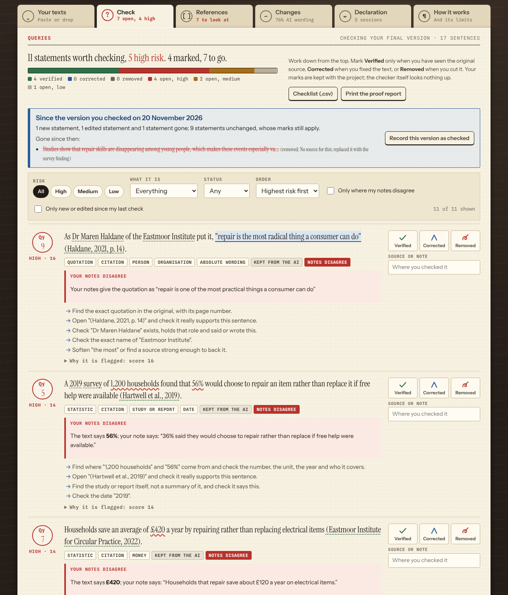
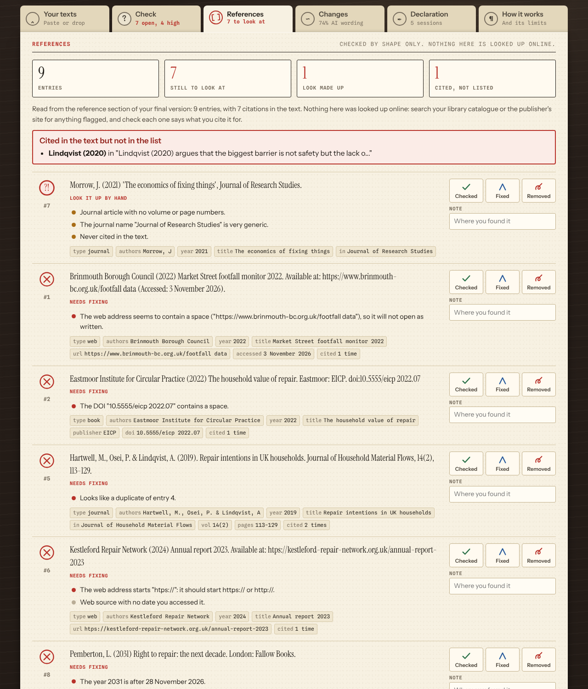
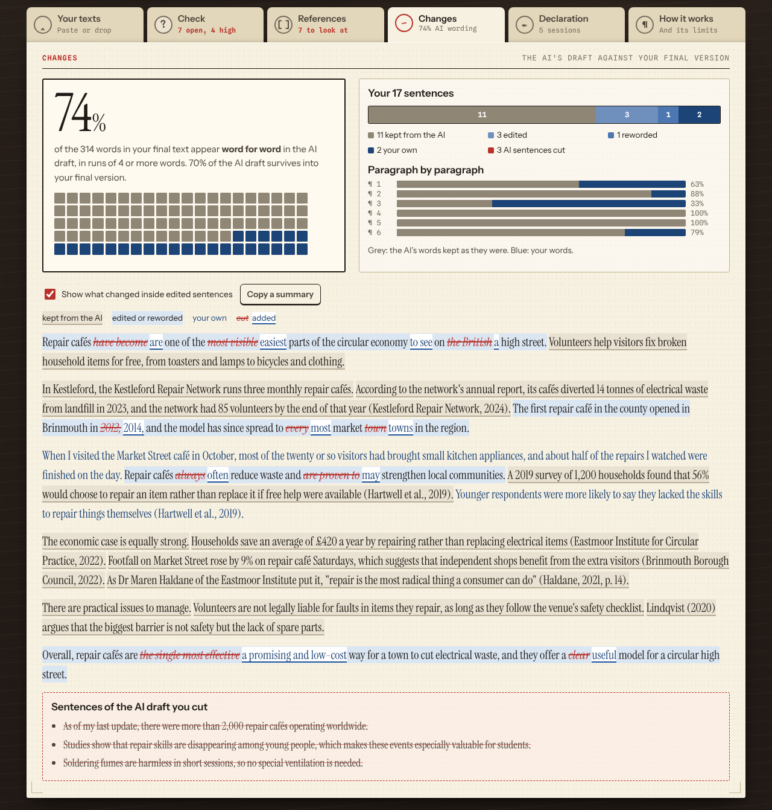
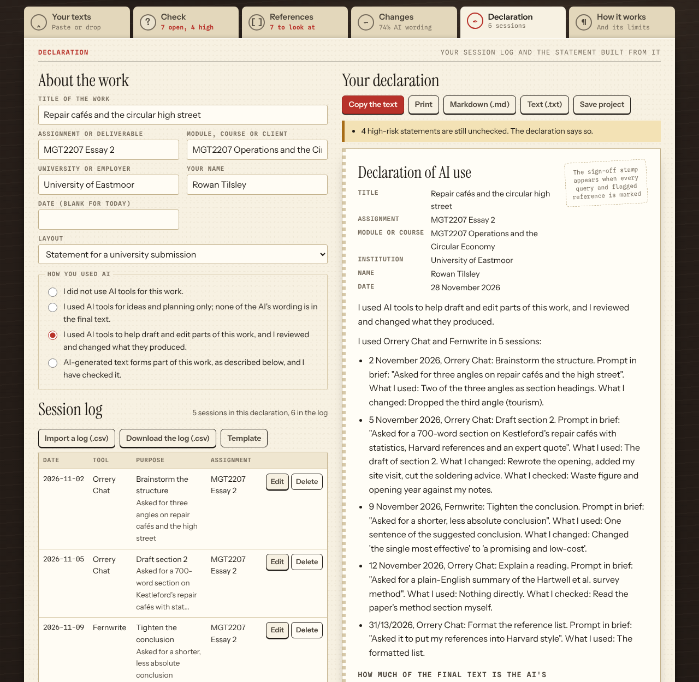
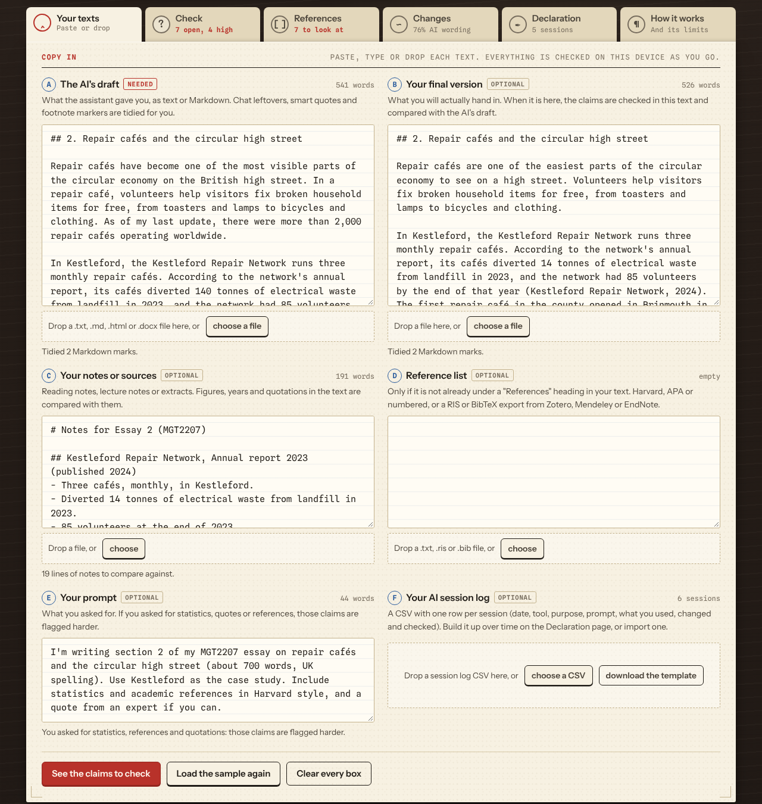
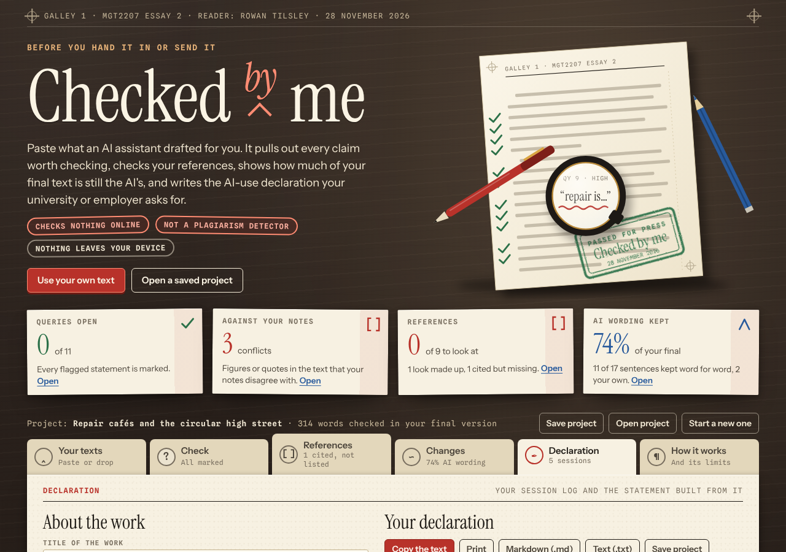
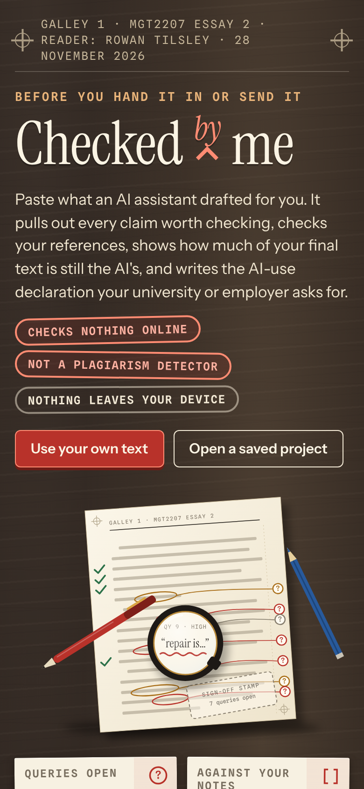
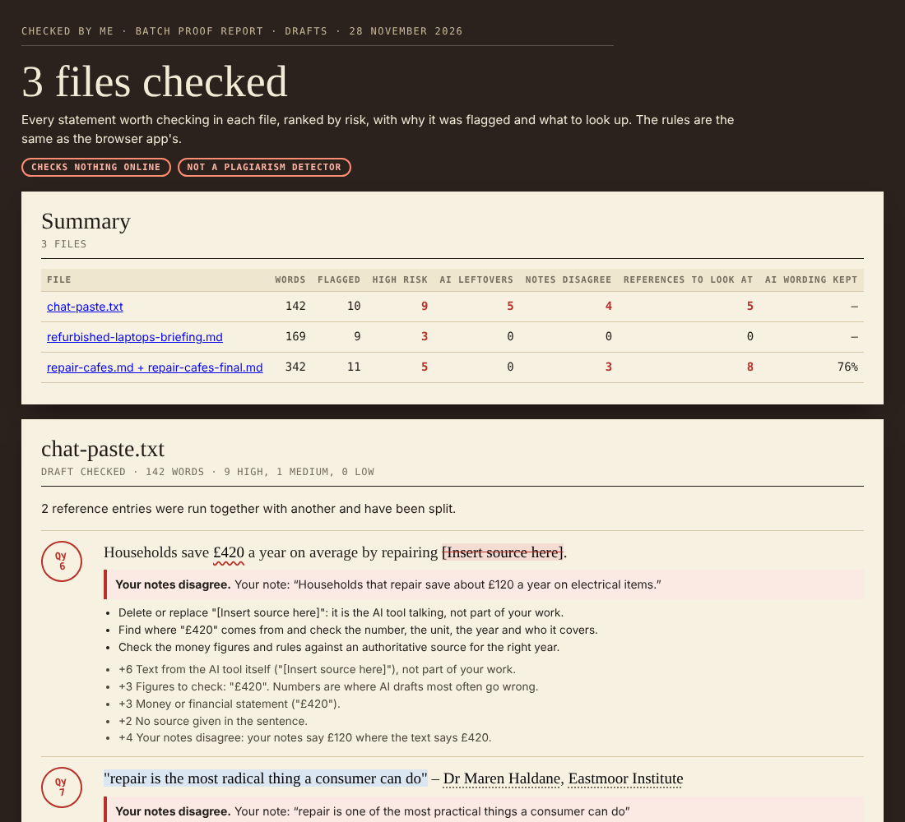

# Checked by me

**Before you hand in or send something drafted with an AI assistant: every claim worth checking, your references checked, how much of your final text is still the AI's, and the AI-use declaration your university or employer asks for.**


## Who it is for, and the job

- **Students** using an AI assistant for coursework. More and more UK universities ask for a statement of how AI was used with each assignment, and every marker expects the facts, quotations and references to be real.
- **Anyone at work** using one for reports, briefs and emails, where a made-up figure or a confident legal aside goes out under your name.
- **People who teach AI fluency** (prompting classes, study-skills sessions): it shows, on a learner's own text, where AI drafts go wrong and what checking looks like.

The job is the check people should do anyway before submitting, plus the declaration they now have to write. You paste the AI's draft (and, if you have them, your final version, your prompt, your notes and your reference list). You get back:

1. **Claims to check**: every sentence with something checkable in it (figures, dates, named studies, people and organisations, quotations, citations, links, absolute wording such as "always", "proven" or "the first", legal, health and money points, and leftovers from the chat window), ranked by risk, each with the reasons, what to look up, and what your own notes say. You mark each one verified (with where you checked it), corrected or removed.
2. **Reference checks**: citations against the list in both directions, impossible years, malformed DOIs and web addresses, duplicates, and entries that look made up (a vague journal, no volume or pages, "et al." or placeholders in the list), flagged for you to look up by hand.
3. **Changes**: your final version against the AI draft, with the share of your text that is the AI's word for word, which sentences you kept, edited, reworded or wrote, and what you cut.
4. **The declaration**: built from your session log, your marks and the comparison, as text to copy, a printable proof report, Markdown and CSV, in four layouts. It always says how many claims are still unchecked. A project file saves everything to reopen next time.
5. **Re-checking after you revise**: record the version you have worked through, and next time the checklist shows what is new, what you edited (with the mark the old wording had, so you check it again) and what has gone; marks on unchanged sentences carry over.

It checks nothing online and it is not a plagiarism or AI detector: it never looks anything up and it compares your text only with the AI draft you give it. Everything stays in your browser.

## Use it on your own work

Open `app/index.html` (double-click it; no installation, no internet). It opens on an invented student's essay section, partly checked. Press **Use your own text** and paste into the boxes on the **Your texts** page, or drop files on them:

| Box | What to put there | Formats |
|---|---|---|
| A. The AI's draft (needed) | What the assistant gave you | Paste, or .txt, .md, .html, .docx |
| B. Your final version | What you will hand in. Claims are then checked in this text, and each is labelled kept from the AI, edited, reworded or your own | As above |
| C. Your notes or sources | Reading or lecture notes, extracts. Figures, years and quotations are compared with them | As above |
| D. Reference list | Only if it is not under a "References" or "Bibliography" heading in your text. Harvard, APA or numbered, or the export from your reference manager | As above, or RIS (.ris) and BibTeX (.bib) exports from Zotero, Mendeley, EndNote or a library database; `data/references.ris` and `data/references.bib` are examples |
| E. Your prompt | What you asked for. Asking for statistics, quotes or references makes those claims count for more | Paste |
| F. Session log | One row per AI session: date, assignment, tool, purpose, prompt in brief, what you used, changed and checked, minutes, person | CSV with commas, semicolons or tabs, any column order, UK or ISO dates; `data/session-log-template.csv` is the template (also a download in the app) |

Messy pastes are fine: smart quotes, non-breaking and zero-width spaces, Markdown marks, superscript or `[^1]` footnote markers, entries split over two lines or run together in the reference list are all tidied, and the page says what it tidied. A file it cannot read (a PDF, an image, a CSV that is not a session log, a row with a date like 31/13/2026) gets a plain message saying why.

Then work down the **Check** list, look up what the **References** page flags, read the **Changes**, fill in **Declaration** (your name, the assignment, how you used AI and the layout your university or employer wants) and log each AI session as you go. When every claim and flagged reference is marked, the declaration gets its sign-off stamp. **Save project** downloads a `.checked-by-me.json` file that **Open project** reopens later; the page also keeps your last project in the browser and offers it back.

What you can take away: the declaration (copy, `.md`, `.txt` or print), the checklist (`.csv`), the reference report (`.csv`), the session log (`.csv`, which builds up across assignments) and a printable proof report with the declaration, the checklist and the references to look at.

## A worked example on the sample

The sample (made by `tools/make_samples.py` with seed 2611) is section 2 of an invented business essay, "Repair cafés and the circular high street", for an invented module at the invented University of Eastmoor, drafted by an invented assistant. The generator plants four wrong figures and a misquotation in the AI draft; the student's notes hold the true values.

- **The AI draft alone** (356 words): 15 statements worth checking, 7 of them high risk. Five clash with the notes: 140 tonnes of waste (notes: 14), a first café in 2012 (notes: 2014), 56% of households (notes: 36%), £420 a year (notes: £120) and a quotation sharpened from "one of the most practical things" to "the most radical thing". It also flags "As of my last update" (chat leftover), "Studies show" (vague source), "Soldering fumes are harmless" (health), "Volunteers are not legally liable" (legal) and the absolute "always ... proven".
- **The references** (9 entries): 7 flagged. A space inside a web address, a space inside a DOI, a second copy of the Hartwell entry, a misspelt `htps://`, a book dated 2031, a malformed DOI prefix (10.555), and one entry that looks made up: "Journal of Research Studies" with no volume or pages, never cited. Lindqvist (2020) is cited in the text but missing from the list.
- **The student's final version** (342 words) fixed the tonnes and the year and cut the soldering advice, but kept the 56%, the £420 and the misquotation: 11 statements, 5 high risk, 3 still clashing with the notes. 76% of its words appear word for word in the AI draft; of its 17 sentences 11 are kept, 3 edited, 1 reworded and 2 the student's own, and 3 AI sentences were cut.
- **Since the last check.** The student recorded an earlier version on 20 November, corrected the tonnes and cut "Studies show that repair skills are disappearing", then revised. Against that version the checklist shows 1 new statement (the Hartwell finding that replaced the vague claim), 1 edited one (140 tonnes became 14 tonnes, marked corrected before the edit, so to be checked again), 1 gone (marked removed) and 9 unchanged whose marks still apply.
- **The session log** has six readable rows (a blank row is skipped; the date 31/13/2026 is kept as typed and "ten" minutes left blank, each with a message). Five belong to this essay, so the declaration lists five sessions with Orrery Chat and Fernwrite, gives the 76%, and says "7 statements are not yet marked as checked, including 4 high risk" because only four have been verified so far.

## Why it matters

This sits in the **human-AI interaction and over-reliance** theme. The risk with AI drafting is not only that the tool is wrong but that people stop checking: a fluent paragraph with a precise percentage and a citation looks finished. This tool turns "check your AI output" from advice into a list with an end, makes it visible which claims came straight from the machine, and records what was actually checked, so a declaration says something true rather than something reassuring. It also touches **AI governance**: university AI-use statements and workplace AI policies only work if people can produce an honest record without much effort, and a log built up session by session is that record. And it is a small answer to **why AI stalls at the pilot stage** in everyday life: people either trust the tool too much or stop using it after it embarrasses them, and a routine, repeatable check is what lets them keep using it safely.

## Open the app and run the companion

- **App:** open `app/index.html` in any recent browser. It is one self-contained file (fonts, code and the sample are inside it), works offline and inside an iframe, and makes no network requests.
- **Companion** (Python 3.8 or later, standard library only):

```
python companion/checked_by_me.py check data/ai-draft.md --final data/final-version.md --notes data/notes.md --csv checklist.csv
python companion/checked_by_me.py batch data/drafts --notes data/notes.md --out report.html --csv summary.csv
python companion/checked_by_me.py gate data/sample-project.json            # exits 1 while high-risk claims are unchecked
python companion/checked_by_me.py gate my-essay.md --checklist checklist.csv --level medium
python companion/checked_by_me.py merge data/team/*.csv --assignment "MGT2210 Group report" --out-csv team-log.csv --out-md team-declaration.md
python companion/checked_by_me.py declare data/sample-project.json --template appendix --md declaration.md
python companion/checked_by_me.py recheck data/sample-project.json my-new-version.md --out essay.json --record
python companion/checked_by_me.py diff data/ai-draft.md data/final-version.md
python companion/checked_by_me.py project --draft draft.md --final final.md --sessions log.csv --out essay.checked-by-me.json
```

What the companion adds to the app:

- **`batch`** checks every draft in a folder (.txt, .md, .html, .docx; a file named `something-final.md` is read as the final version of `something.md`) and writes one self-contained HTML proof report plus a one-line-per-file CSV. Useful for a whole term's assignments, or for a teacher looking at a class's drafts with their permission.
- **`gate`** is a pre-submission check for a team's document workflow (a Git hook, a CI step or a shared-drive script): it exits 1 while any high-risk claim (or, with `--level`, medium or low) is still unmarked, 2 when a file cannot be read, and 0 when everything has been looked at. It reads the marks from saved projects, folders of them, or a draft plus the checklist CSV the app downloads. `--refs` also holds on unmarked references that need fixing or look made up.
- **`merge`** joins several people's session logs (different column orders, delimiters and date styles) into one log, merges a session two people both logged, and writes a team declaration in Markdown with each session, who ran it and a per-person summary.
- **`recheck`** takes a saved project and a new version of the text, lists what is new, edited (with a word diff and the old mark) and gone since the version recorded as checked, and with `--out` writes the updated project (`--record` records the new version as checked).
- **`check`**, **`declare`**, **`diff`** and **`project`** give the app's results from the command line; `project` builds a file the app can open.

## Tests

```
node --test tests/*.test.js                       # the model, run from the built page (19 tests)
cd tests && python -m unittest discover -s .      # companion, agreement and browser tests
```

- `tests/model.test.js`: dates, CSV, cleaning, sentence splitting, citations, every planted problem in the sample, the reference checks, the changes, statuses and sign-off, session logs, the declaration's honesty about unchecked claims, project round trips, Word files, and speed on a long draft.
- `tests/test_agreement.py`: runs the browser model (taken from the built `app/index.html`) under Node and the Python package on the same inputs, including 70 seeded random documents full of emoji, odd spaces, broken Markdown and references, and checks the analyses are identical and every exported file (checklist, reference report, session log, all four declarations as text and Markdown, the project file) is byte for byte the same. Skipped if Node is missing.
- `tests/test_companion.py`: reading text, cp1252 and Word files, every command and its exit codes, the batch report, the merge, reproducing the sample data from the seed, that the built page is current, and that no file contains an em dash.
- `tests/test_app.py` (Playwright, headless Chromium): the sample opens worked through, marking a claim updates everything, signing off shows the stamp, uploading a PDF, a Word file and a messy session log, opening every download and comparing it with the companion's, saving and reopening a project, the browser-kept project offered back, the print report, inside an iframe, no sideways scroll at 390 px, keyboard tabs, every control labelled, no console errors and no network requests. Skipped if Playwright is missing.

## Screenshots

















## Which language does what

| Part | Language | Lines (roughly) |
|---|---|---|
| The model: cleaning, sentences, claim rules and scores, notes comparison, references, changes, session logs, declarations, files (`src/model.js`) | JavaScript | 2,050 |
| The interface: views, hero drawing, uploads, Word files, downloads, printing, saving (`src/ui.js`, `src/shell.html`, `src/style.css`) | JavaScript, HTML, CSS | 1,850 |
| The companion: the same model line for line (`companion/checkedbyme/model.py`), the commands, batch report, gate and merge | Python | 3,150 |
| Tests | JavaScript, Python | 1,180 |
| Sample generator, build and screenshot scripts (`tools/`) | Python | 480 |

`tools/build_app.py` writes `app/index.html` from `src/`, with the fonts as base64 (Instrument Serif, Instrument Sans and Spline Sans Mono, SIL Open Font License, see `src/fonts/OFL.txt`). The model block sits between `/* MODEL START */` and `/* MODEL END */` and exports itself to Node, which is how the tests run it.

## How it works

- **Tidying.** Text is normalised first (line ends, odd spaces, smart quotes, invisible characters, emoji), Markdown and HTML marks are removed, footnote markers become `[1]`, and the reference section and footnote definitions are set aside. Only plain spaces and newlines are left, which is also what lets the JavaScript and Python versions agree exactly.
- **Claims.** Each sentence is scanned with fixed patterns for fourteen kinds of checkable content. Each kind adds points (a figure 3, a quotation 3, a person 2, a date 1, a chat leftover 6 and so on), and so do the circumstances: no source in the sentence (+2), a citation missing from the list (+3), a prompt asking for statistics or references (+1), a clash with your notes (+4), wording kept from the AI (+1). Matches with your notes (-2), your own wording (-1) and hedged figures (-1) take points off. Six or more is high risk, three to five medium. The How it works page lists every rule.
- **Notes.** A figure is compared with figures of the same kind in your notes (percentages with percentages, amounts with amounts, "14 tonnes" with other tonnes) where the note shares at least two content words with the sentence. The same value is a match; a different one in a note sharing three or more words is a conflict. Quotations are compared word by word.
- **References.** Entries are split (mending broken lines and run-together entries) and parsed into author, year, title, journal, volume, pages, DOI and address, or read field by field from a RIS or BibTeX export. They are checked one by one and against each other, and matched to citations by first author's surname and year, by number, or by citation key (`[@hartwell2019]` in Pandoc Markdown, `\cite{hartwell2019}` in LaTeX).
- **Changes.** A word in your final text counts as the AI's when it sits in a run of four or more words that appears, in order, in the AI draft. Each sentence's share decides kept (85% or more), edited (30% or more), reworded (shares half its words with an AI sentence) or yours, and the closest AI sentence gives a word-level diff.
- **Re-checking.** A mark belongs to the exact wording of a sentence (its key is a hash of the sentence's words), so it carries over while the sentence is unchanged. When you revise, each statement without a match in the recorded version is paired with the old statement it shares most words with (at least half), shown as edited with a word diff and the old mark; the rest are new, and old statements left over are gone.
- **Declaration.** Built from the sessions logged for this assignment, your marks and the comparison, in four layouts (a university statement, a full log for an appendix, a short statement for a submission box, a note for a manager or client), always stating what is still unchecked.

## Limitations

- It never checks anything online, so it cannot tell whether a source exists or a figure is right: it tells you what to check and records what you say you checked. "Verified" means you looked, not that the tool did.
- It is not a plagiarism or AI-writing detector, and its "word for word" share only compares your text with the AI draft you paste.
- Pattern rules miss claims made in plain words with no figure, name, quotation or citation, and flag some harmless ones ("the first chapter").
- Notes are compared by shared words, so a note phrased very differently from the sentence will not be found, and two different figures in one note can confuse it.
- Citation matching uses the first author's surname and the year, a number, or a citation key; unusual styles (some law and humanities footnote styles) are read less well. RIS and BibTeX records are read field by field, so a record with a field in an unusual tag may lose it.
- The declaration wording is a sensible default, not any particular university's form; choose the layout that fits and edit the text if your institution asks for something specific.

## What could come next

- A shared class view for a teacher, built from students' saved project files, showing how AI is being used across an assignment without anyone's text.
