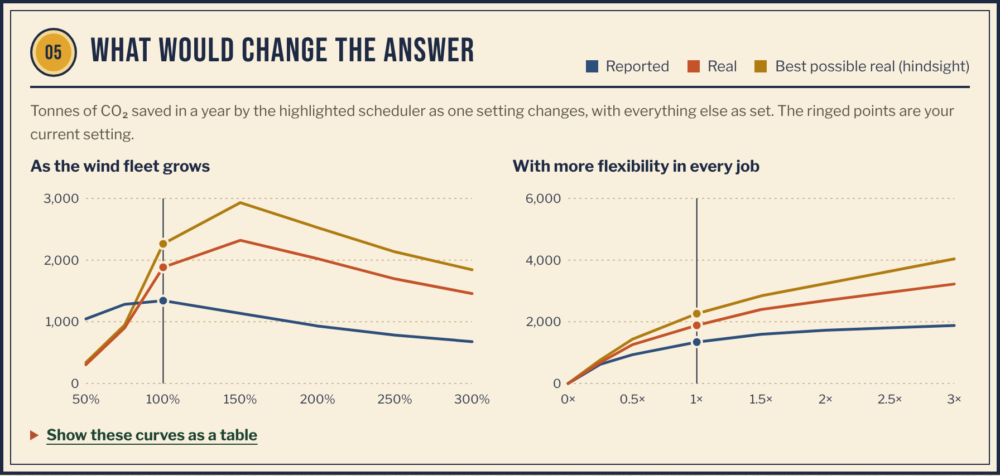
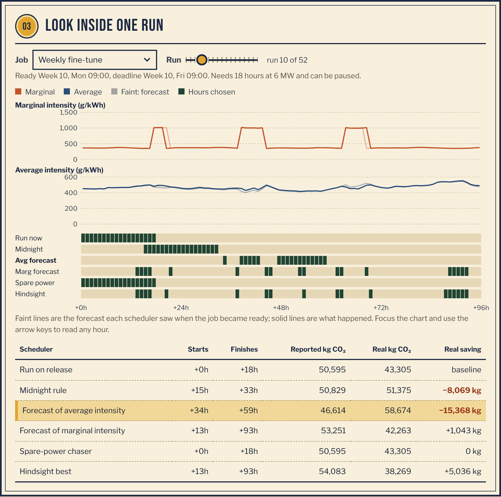

# Clean hours

**When should the AI run? Carbon-aware scheduling for AI compute, and the gap between the saving a carbon report would show and the saving the grid actually sees.**


Clean hours takes a fleet of AI compute jobs (fine-tunes, retrains, nightly embedding refreshes, evaluation suites) and an invented electricity grid with a year of hourly weather, demand and power stations. It moves the flexible jobs into "cleaner" hours with six schedulers, then scores every choice twice:

- **Reported saving:** what a carbon report would show, using the grid's *average* intensity in each hour (the location-based method most company reports use).
- **Real saving:** what changes in the atmosphere, using the *marginal* intensity: the emissions of the power station that actually ramps up to serve the extra load.

The two can differ in size and even in sign. The three example grids are built to show each case.

There are two parts, built on the same model and tested to give identical numbers:

- **The browser app** (`app/index.html`): one self-contained file. Double-click it and it runs offline, with no installs and nothing sent anywhere.
- **The Python companion** (`cleanhours/`): a command-line tool for your own jobs file, full-year CSV exports, and batch sweeps across grids, weather years and settings. Standard library only.

## What it shows

With the example fleet, default settings and weather year 1, scheduling on a forecast of *average* intensity (the signal most carbon-aware tools publish) gives three different stories:

| Grid | Reported saving | Real saving | What is going on |
|---|---:|---:|---|
| Windy island | +1,343 t | +1,884 t | The report **understates** the benefit. Energy moved into hours of spare wind avoids a whole gas plant's output, which an average figure dilutes. |
| Sunny grid | +1,913 t | +664 t | The report **overstates** it nearly threefold. Midday looks clean on average, but gas still answers extra demand in 90% of midday hours. |
| Coal before gas | +859 t | **−2,072 t** | The report shows a saving while real emissions **rise**. Windy nights have a low average, but coal is the plant that responds at night. |

Other findings worth a look in the app:

- A simple **spare-power chaser** (run now unless curtailed wind or solar is forecast before the deadline) gets 70% of the best possible real saving on the windy grid (+1,590 t against +2,264 t with hindsight) with an average wait of 3.0 hours instead of 8.0. On paper it looks like the weakest option (+439 t reported).
- As the wind fleet grows, the real saving from flexibility **rises and then falls**: on the windy grid it peaks at about 150% of today's wind fleet (+2,321 t), when spare clean power appears in 40% of hours, and shrinks again as surplus becomes so common that jobs land in it anyway.
- Across ten weather years on the windy grid, the average-forecast scheduler's real saving ranges from +1,090 t to +1,907 t, and the report overstates it in 3 of the 10 years.



On the coal grid, the average-forecast scheduler moves no more energy into the night than running on release does (a quarter of the flexible energy either way), but it picks the windiest nights, and in those hours coal is on the margin 94% of the time rather than 49%:



## Why it matters

AI's electricity use is growing fast, and "carbon-aware computing" (running flexible jobs when the grid is cleanest) is a popular pilot. It is also a clear example of why AI initiatives stall between pilot and scale: **the benefit is hard to measure, and the obvious measure can be wrong in either direction.** A team that schedules on an average-intensity signal can report a healthy cut while the real effect is small or negative, or undersell a rule that does real good. A sceptical finance or sustainability lead who asks "what did it actually change?" will not get a straight answer from the reported number, and a pilot that cannot show its value rarely gets funded to scale.

It connects to the brief's themes on sustainability and carbon (green forecasting, as covered at the Mannheim summer school) and on AI adoption beyond the pilot (unclear ROI and hard-to-measure benefits block scaling).

## How to open the app

1. Download the branch: on GitHub, choose **Code**, then **Download ZIP**, and unzip it.
2. Double-click `app/index.html`. It opens in any modern browser and works offline.

Pick a grid on the left, move the sliders, and choose which scheduler to highlight. Everything recalculates in the browser. You can edit the jobs, save and load your settings as a JSON file, and download or load the jobs as CSV (the same format the Python companion reads).


## How to run the Python companion

Needs Python 3.9 or later and nothing else. From the folder that contains `cleanhours/`:

```sh
python -m cleanhours run                         # windy grid, example fleet, weather year 1
python -m cleanhours run --preset coal --out results
python -m cleanhours template --out my_jobs.csv  # write the example fleet, then edit it
python -m cleanhours run --jobs my_jobs.csv --slack 2 --out results
python -m cleanhours curves --scheduler spare    # savings as wind fleet and flexibility change
python -m cleanhours years --preset sunny        # the same settings in ten weather years
python -m cleanhours sweep --seeds 1-10 --wind 0.5,1,2 --out sweep-output
```

- `run --out` writes `summary.md`, `schedulers.csv`, `job_results.csv` (each job under each scheduler) and `grid_hours.csv` (all 8,736 hours: demand, wind, solar, curtailment, average and marginal intensity, and the plant on the margin).
- `curves` and `years` print the same analyses as the app's "What would change the answer" and "Does it hold in other weather years?" sections.
- `sweep` runs every combination of grids, weather years, wind and solar fleet sizes, forecast error and flexibility, and writes `sweep.csv` plus a Markdown summary of medians. The default sweep (three grids, five weather years) takes a few seconds.

Use `--help` on any command for every option.

## Which language does what

| Part | Language | Roughly | What it does |
|---|---|---:|---|
| `app/index.html` | HTML, CSS and SVG | 750 lines | Layout, the screenprinted travel-poster look and its header illustration, embedded fonts, phone layout |
| | JavaScript, model block | 630 lines | The grid, forecasts, schedulers, accounting, curves, weather-year checks, run explainer, jobs CSV |
| | JavaScript, interface | 900 lines | Controls, hand-drawn SVG charts, tooltips, keyboard reading of charts, tables, saving and loading |
| `cleanhours/` | Python | 1,090 lines | A line-by-line port of the model (570), the command-line tool (280), reports (150) and jobs CSV (70) |
| `tests/` | JavaScript and Python | 800 lines | Node tests of the app's model, Python tests, a parity test across the two languages, and browser tests |

The browser app is the version anyone can open and explore. The Python companion does what a browser page does badly: reading your own jobs file, writing full-year CSVs for other tools, and running hundreds of combinations in one go.

## How it works

**The grid.** For each of the 8,736 hours in a 52-week year, the model draws demand (a daily and weekly shape with seasons), wind (a persistent weather process with seasonal means, so calm and windy spells last for days) and solar (day length and strength by season, times a daily cloudiness). It then dispatches power stations in merit order: nuclear and renewables first, a minimum amount of thermal plant kept running for stability, then each thermal fleet from its most to its least efficient unit. Each hour gives two numbers:

- **Average intensity:** total emissions divided by demand.
- **Marginal intensity:** the emissions rate of the unit that would serve one more megawatt. If renewables are being curtailed, that is zero.

**Three invented grids.** *Windy island* (lots of wind, gas on the margin most hours), *Coal before gas* (cheap coal below gas in the merit order, so coal often responds at night) and *Sunny grid* (a big solar fleet and an afternoon cooling peak). Sliders scale the wind and solar fleets.

**Forecasts.** When a job becomes ready, the scheduler sees a forecast of the next hours: the true weather and demand plus errors that grow with lead time (wind and demand drift as slowly reverting random walks; cloudiness is wrong by more for each day further ahead). The forecast is run through the same dispatch to give forecast average and marginal intensities. The forecast error slider scales all of this, from perfect to three times typical.

**Jobs.** Each job has a power draw, a run time, how often it repeats, when it becomes ready, a window to its deadline, and whether it can pause. The flexibility slider scales every job's slack.

**Schedulers.** Run on release (the baseline); a midnight rule of thumb; the lowest forecast average intensity; the lowest forecast marginal intensity; the spare-power chaser; and hindsight (the best possible real outcome, as a ceiling). Pausable jobs take their cheapest separate hours; others take their cheapest block of consecutive hours.

**Accounting.** Each scheduler's hours are scored with the *actual* average intensity (reported) and *actual* marginal intensity (real), against running on release. A verdict compares the two in tonnes: backfires, overstates, understates, roughly matches, or changes little.

**One model, two languages.** The app keeps all of this in one block between `/* MODEL START */` and `/* MODEL END */`. The Python package is a line-by-line port. Both use the same seeded random number generator, and only addition, subtraction, multiplication, division, square roots and rounding down on decimals, which every language rounds the same way, so the two give bit-for-bit identical results. `tests/test_parity.py` runs the app's model in Node.js and checks that they do.

## Documents and definitions relied on (simplified and illustrative)

- **GHG Protocol Scope 2 Guidance (2015):** its location-based method, which multiplies electricity use by average grid emission factors. The "reported" figures here follow that idea at an hourly resolution. The market-based method (contracts and certificates) is not modelled.
- **GHG Protocol public consultations on Scope 2 and on electricity-sector consequential accounting (opened October 2025):** background on the debate about hourly accounting and about measuring the consequences of a change in demand. The "real" figures use a short-run marginal emissions rate, one common way of estimating consequences. Nothing here implements or anticipates the outcome of those consultations.

This is a teaching model, not a carbon accounting tool, and it gives no advice on how any organisation should report its emissions.

## Tests

```sh
node --test                              # the app's model in Node.js
python -m unittest discover -s tests     # Python model and CLI, parity with the app, and the app in headless Chromium
```

The browser tests need Playwright for Python with Chromium and are skipped without it; the parity tests are skipped without Node.js. The browser tests check that the app loads with no console errors and no network requests, that every control has a label, that switching grids changes the story, that invalid jobs show an error and recover, that saving and loading work, that bad settings files are refused, that the page fits a phone screen, and that the heaviest legal job at the most extreme settings still finishes promptly.

## Limitations

- The grids, weather and jobs are invented and loosely shaped, not calibrated to any real country, company or data centre.
- Short-run marginal emissions only. Longer-run effects, such as flexible demand making it easier to build more renewables, are left out; some practitioners argue those effects favour average signals.
- The jobs are treated as small next to the grid, so they never change which plant runs, and many users chasing the same clean hours would not use them up.
- No interconnectors, storage, network constraints, or switching between coal and gas as carbon prices change.
- The forecast errors are a simple statistical stand-in for real weather forecasts.

## What could come next

- **Crowding:** let a large flexible fleet shift into the same hours, so spare clean power runs out and the marginal plant changes.
- **Re-planning:** let pausable jobs re-check an updated forecast every hour rather than committing when they are released.
- **Cost of waiting:** add a price for delay and a carbon price, and show the trade-off curve between tonnes saved and hours waited.
