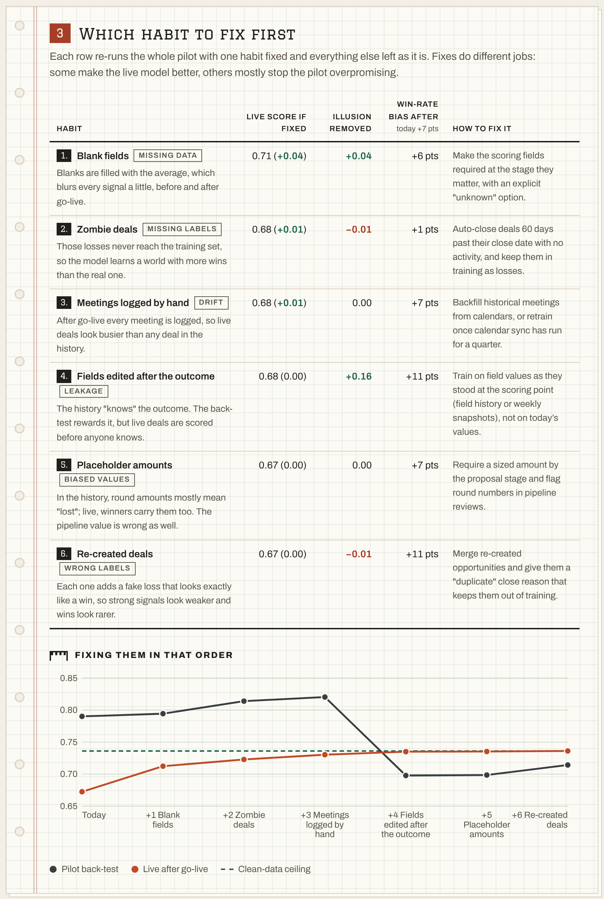
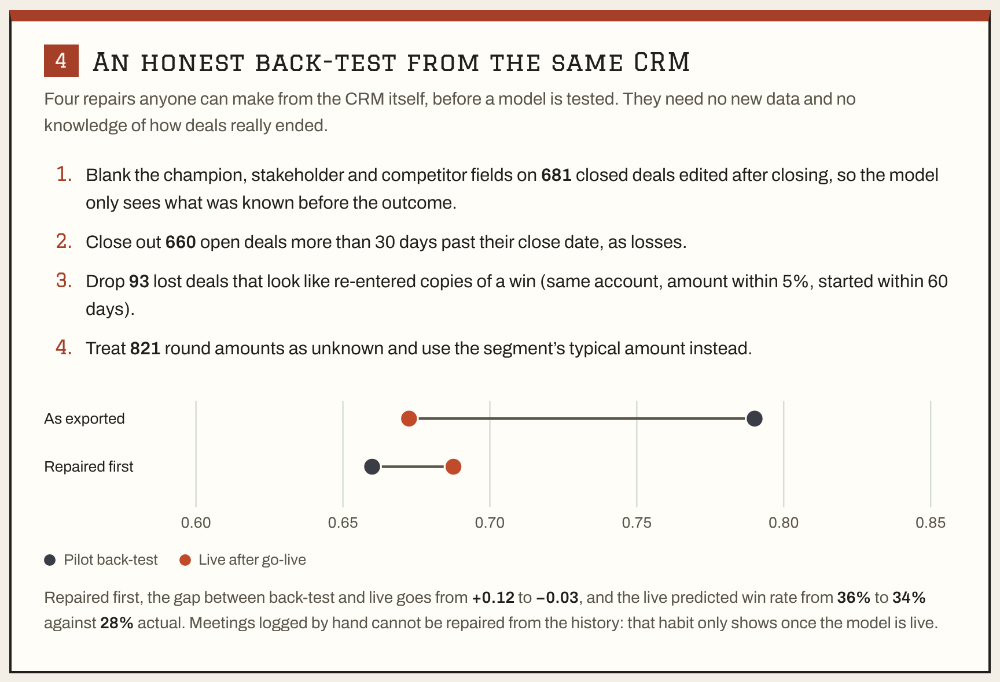
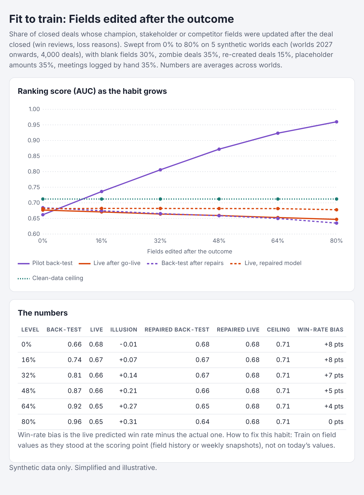

# Fit to train

**Is your CRM ready to train an AI win-probability model?**

A sales team wants an AI model that scores every new opportunity with its chance of winning. The pilot trains on the CRM's closed deals, tests on a random quarter of them, and reports a strong result. Then the model goes live and disappoints.

Fit to train shows why, and what to do about it. It builds a synthetic sales team with two years of deals where the true outcome of every deal is known, lets you turn up six everyday CRM habits, and compares three numbers:

- **the pilot's back-test**, measured the way most pilots measure it;
- **live performance**, the same model scoring new deals three weeks after they are created, judged against how they really ended;
- **the clean-data ceiling**, the same method on a perfectly kept CRM.

It then ranks which habit to fix first, shows an **honest back-test** that anyone could produce from the same messy CRM, and checks which conclusions survive on other synthetic worlds.

There are two ways to use it, built on the same model:

- **The browser app** (`app/index.html`) is the lab. Double-click it: no installs, no internet connection, nothing sent anywhere.
- **The Python package** (`fittotrain/`) gives identical numbers from the command line, runs batches the browser would be slow at, writes CSV and HTML reports, and audits your own anonymised opportunity export for the same six problems. Standard library only.


## Why it matters

The question behind this project is why AI so often stalls at the pilot stage. Executive interviews keep naming unclear ROI, benefits that are hard to measure and technical complexity. In sales, one concrete mechanism sits underneath all three: the CRM data a pilot trains and tests on is not the data the model meets after go-live. Fields are filled in after the outcome is known, lost deals are never closed, stalled deals are re-entered, amounts are placeholders, and logging changes when new tools arrive. A back-test on that data can promise far more than the model will deliver, and the shortfall only shows months later, after the decision to scale has been made.

That makes it a sales operations and CRM analytics problem as much as a data science one. The people who own the CRM's processes decide whether a pilot's result can be trusted, and the fixes they can make are cheap compared with a failed roll-out.

What the default settings show (world 2026, 4,000 deals, the "Typical CRM" preset):

- The pilot's back-test reports a ranking score (AUC) of **0.79**. Live, the same model scores **0.67**, below the **0.74** a clean CRM would have given. It also predicts a 36% average chance of winning when 28% of live deals win.
- Repairing the history before testing would have reported **0.66**, and the repaired model then scores **0.69** live: an honest forecast, and a better model, from the same data.
- On 12 other worlds with the same settings, the pilot overpromised by more than 0.05 in all 12 (by 0.16 on average, between 0.08 and 0.22). After the repairs, 9 of 12 back-tests landed within 0.05 of live and the repaired model beat the unrepaired one in all 12.
- The habits do different damage. Blank fields cost the most live accuracy (the top fix in 11 of 12 worlds), while fields edited after the outcome cause most of the overpromise (the top fix for honesty in 12 of 12). A data-quality dashboard that only tracks completeness would catch the first and miss the second.

## The six habits

| Habit | Kind of damage | What it does in the data |
|-------|----------------|--------------------------|
| Blank fields | Missing data | Scoring fields left empty at entry; the model fills them with the average |
| Fields edited after the outcome | Leakage | Win reviews set "champion identified" and stakeholder counts after a win; loss reasons set "competitor present" after a loss |
| Zombie deals | Missing labels | Lost deals never closed out, so they never reach the training set |
| Re-created deals | Wrong labels | A stalled deal is re-entered as a new opportunity and the old record is closed as lost: a fake loss that looks like a win |
| Placeholder amounts | Biased values | Round amounts entered early and corrected only when a deal is won |
| Meetings logged by hand | Drift | Hand logging missed meetings before go-live; calendar sync logs them all afterwards |

## How to open the app

Download this branch from GitHub (the green **Code** button, then **Download ZIP**), unzip it and double-click `app/index.html`. Or from a terminal:

```bash
git clone --branch build/2026-11-25-fit-to-train https://github.com/bb414/daily-builds.git fit-to-train
cd fit-to-train
open app/index.html        # macOS
xdg-open app/index.html    # Linux
start app\index.html       # Windows
```

What you can do in it:

- **Set how the CRM is kept.** Four presets (Spotless, Tidy team, Typical CRM, Quarter-end chaos) and a slider for each habit, plus the number of deals and the world number.
- **Read the verdict.** How much the back-test flatters the model, the live score, the clean ceiling, the honest back-test and which habit to fix first, in two sentences at the top.
- **See what a CRM owner can check today.** Six audit checks with traffic lights, each next to what really happened in the synthetic world.
- **Rank the fixes.** Every habit fixed on its own (live score, overpromise removed, win-rate bias after), the mechanism behind each one and how to fix it, then a chart of fixing them in order until the CRM is spotless.
- **Run the honest back-test.** Four repairs made from the CRM alone, with the before-and-after gap between back-test and live.
- **Look under the bonnet.** Whether the probabilities are honest (calibration by decile), what the model learned from this CRM against a clean one (odds multipliers), and ten records as entered next to the truth.
- **Check how sure it is.** Run the same settings on 12 more worlds.
- **Compare two set-ups.** Pin one as A, change anything, and compare.
- **Save and share.** Settings live in the page's address, so "Copy link" shares an exact set-up; "Save settings" writes a JSON file that the Python version also reads.

On a phone the tables turn into cards, charts redraw at the screen's width, and a bar at the bottom keeps the three headline numbers in view while you move the sliders. The look borrows from an athletics track and a coach's training log: the habits are lanes and hurdles, the headline numbers are race bibs and the results sit on grid-paper log pages.


| Which habit to fix first | The honest back-test |
|---|---|
|  |  |

## How to run the Python companion

Python 3.9 or later, nothing to install. From the project folder:

```bash
python -m fittotrain lab --preset typical                   # the lab once, same numbers as the app
python -m fittotrain lab --set retrofill=0.6 --seed 7 --json
python -m fittotrain lab --worlds 12 --preset typical       # what holds across 12 other worlds
python -m fittotrain sweep retrofill --out reports          # one habit from 0 to its maximum: CSV and HTML
python -m fittotrain lab --settings fit-to-train-settings.json   # a settings file saved from the app
python -m fittotrain generate --preset chaos -o crm.csv --truth truth.csv
python -m fittotrain audit crm.csv                          # audit an export, yours or a synthetic one
```

`lab --worlds` also reports how often each habit comes out as the one to fix first, which takes about 2.5 seconds per world. `sweep` writes `sweep_<habit>.csv` and a self-contained `sweep_<habit>.html` with a chart:



At 0% of closed deals edited after the outcome, the back-test and live scores agree (0.66 and 0.68 on average over five worlds). At 80%, the back-test reaches 0.96 while live slips to 0.65; the back-test after repairs stays at 0.64, close to the truth.

### Auditing your own export

`audit` reads a CSV of opportunities. Only the first six columns are required; any scoring field can be missing or blank. Anonymise before use.

| Column | Meaning |
|--------|---------|
| `opportunity_id`, `account_name` | Any identifiers; the account name is only used to spot duplicates |
| `created_date`, `close_date` | YYYY-MM-DD (a time after the date is ignored); for open deals, the expected close date |
| `status` | won, lost or open (also "closed won" and "closed lost") |
| `amount` | Deal value; currency symbols and commas are fine |
| `owner`, `segment`, `source` | Optional; segment is SMB, Mid-market or Enterprise; source is Inbound, Outbound, Partner or Event |
| `stakeholders`, `meetings_first_3_weeks`, `champion`, `competitor`, `discount_pct`, `days_to_first_meeting` | Optional scoring fields; champion and competitor are yes or no |
| `edited_after_close` | Optional yes or no from field history; enables the leak check and the first repair |

It reports the six checks (the drift check needs data from after go-live, so it is marked as not yet possible), then fits the same win-probability model three ways: a random 25% hold-out, the newest 25% of closed deals, and a random hold-out after the four repairs. If the edit flag is present, it also compares how well each field alone predicts the outcome on records edited after closing and on untouched ones; a field that only predicts well once a deal has closed is marked "suspect". The hold-out is chosen by a hash of `opportunity_id`, so it does not depend on row order, and a synthetic export reproduces the lab's back-tests exactly.

### Tests

```bash
python -m unittest discover -s tests -v    # Python, parity with the app, the CLI, and the UI if Playwright is installed
node tests/test_model.js                   # the app's model in Node.js
```

The parity tests run the app's model block in Node.js and check that every number (back-test, live, ceiling, repairs, fix ranking, robustness, sample records and the random numbers themselves) matches the Python package to within 1e-9, including for nonsense inputs. The UI tests (Playwright for Python with Chromium) check for console errors, network requests, unlabelled controls, sideways scrolling at phone width, links, saved files and the comparison.

## Which language does what

| Part | Language | Roughly | What it does |
|------|----------|---------|--------------|
| `app/index.html` | HTML and CSS | 740 lines | Layout, the track and training-log styling, embedded fonts, the phone layout |
| `app/index.html`, model block | JavaScript | 750 lines | The world, the six habits, the model, the audit, the repairs, the fix ranking, robustness |
| `app/index.html`, interface | JavaScript | 690 lines | Controls, charts drawn as SVG, tables, links, saving and loading, comparison |
| `fittotrain/model.py` | Python | 800 lines | A line-for-line port of the model block |
| `fittotrain/` (other modules) | Python | 900 lines | Command line, CSV import and export, audit of real exports, batches, sweeps, text and HTML reports |
| `tests/` | Python and JavaScript | 950 lines | Unit, parity, command-line, browser and repository checks |

The browser app does everything the lab needs on its own. Python adds what a browser is poor at: reading your own CRM export from disk, many worlds at once with the fix ranking for each, sweeps, and files you can keep.

## How it works

1. **A true world.** Seeded random numbers (the same generator in both languages) create 12 reps and between 1,000 and 8,000 deals over two years. Each deal has a segment, source, amount and six scoring fields, and wins or loses with a known probability that depends on them and on its rep. The model goes live after 18 months.
2. **The CRM as recorded.** Each habit draws from its own random stream, so changing one leaves the others exactly as they were. Fields edited after the outcome change only closed deals; zombies are lost deals left open; re-created deals add a closed-lost copy of a win; placeholders are corrected only on wins; hand logging thins historical meeting counts.
3. **The pilot.** A logistic regression (13 coefficients, a light ridge penalty, Newton steps) is trained on closed deals in the history and tested on a random 25% of them, chosen by a hash of the record's id. Blanks are filled with the training average.
4. **Go-live.** The same model scores every deal created in the last six months, using the fields as they stood three weeks in; the true outcomes judge it. The ranking score is AUC (the chance a random winning deal scores above a random losing one), alongside the share of wins found in the top 20% of scores, calibration by decile and the bookings forecast.
5. **The audit.** Six checks a CRM owner can run without knowing the truth: blank fields, closed deals edited after closing, open deals past their close date, likely duplicates (same normalised account, amount within 5%, started within 60 days), round amounts and the change in meetings per deal after go-live.
6. **Which habit to fix first.** The pilot is re-run with each habit fixed on its own, then with the habits fixed one after another in order of live gain. With every habit fixed, the live score lands exactly on the clean ceiling, which the tests check.
7. **The honest back-test.** Blank the champion, stakeholder and competitor fields on records edited after closing (rather than dropping those records, which would bias the win rate), close out open deals more than 30 days past their close date as losses, drop lost deals that look like copies of a win, and treat round amounts as unknown. Then train and test again.
8. **Robustness.** The same settings on the next 12 world numbers, summarised as averages and ranges.

## Limitations

- The world is synthetic and the habits are stylised. Real CRMs mix them in ways this model does not try to capture, and real win-probability models use far more signals than six fields.
- AUC on a few hundred test deals is noisy. On a single world the back-test can sit a few hundredths above or below live even with a spotless CRM, which is why the robustness check exists; with 1,000 deals, fixing everything can even land slightly below a partly fixed CRM.
- The repairs are deliberately simple and use only what is visible in the export. In heavily damaged worlds the repaired back-test errs on the cautious side (on average about 0.03 below live with the "Quarter-end chaos" preset), and it cannot see drift that only appears after go-live.
- The audit of a real export can say where a back-test is likely to overpromise, but not by exactly how much: only live results can.

## What could come next

- Read weekly pipeline snapshots instead of a single export, so the audit can rebuild each field as it stood at the scoring point rather than relying on an edit flag.
- Add a cost model for each fix (hours of sales operations time, rep friction) so the fix ranking becomes a value-for-effort plan.
- Let the browser app import a CSV too, for people who will not run Python.
