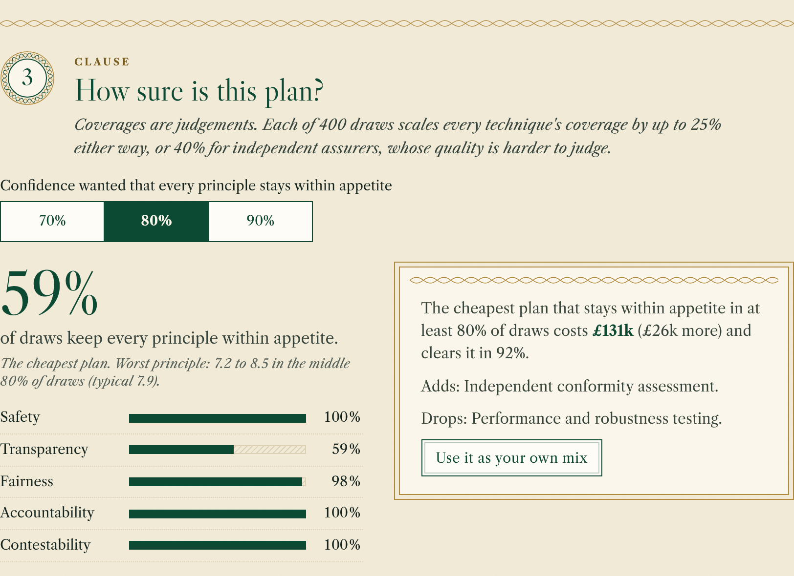
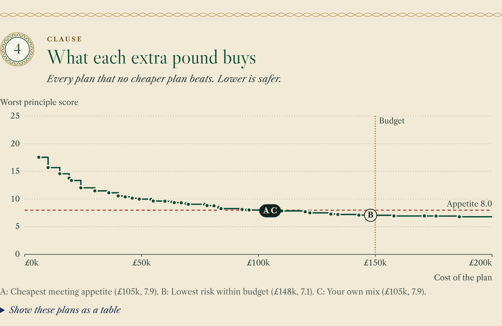

# Assurance mix

**Simplified and illustrative. Not legal advice.** The costs, durations and coverages in this project are illustrative judgements, not market data, and the example systems are invented.

**How much AI assurance is enough, and what is the cheapest way to get there?**

The UK has no cross-sector AI law. Instead, existing regulators apply five principles within their own remits, and organisations are expected to show that their AI is trustworthy through *assurance*: risk and impact assessments, bias audits, testing, compliance audits, conformity assessment, certification. Government guidance says assurance should be proportionate, with low-risk uses relying on a few techniques and high-risk uses on "a more robust combination". It does not say which combination, what it costs, or how long it takes.

Assurance mix works that out for one AI system. Describe the system (eight questions) and your limits (risk appetite, budget, weeks to go-live), and it scores every combination of 16 assurance techniques against the five principles to find:

- the **cheapest plan that brings every principle within your appetite**, with the reason each technique is in it;
- the **lowest-risk plan within your budget**, and **your own mix** to compare against both;
- **what each extra pound buys**: every plan that no cheaper plan beats;
- **from pilot to scale**: what assurance each roll-out stage adds, and whether planning stage by stage costs more than planning for scale from the start;
- **how sure the plan is**: how often it stays within appetite when every technique works better or worse than assumed, and the cheapest plan that clears a confidence bar;
- **when it happens**: a timeline from design to go-live against your deadline.

A Python companion runs the same model from the command line, writes reports, and shares **one assurance budget across a whole inventory of AI systems**.


## Why it matters

- **AI governance and regulation, the UK way.** The UK's approach is principles-based and regulator-led, and it leans on a market of assurance providers to make the principles real. That only works if organisations can judge how much assurance a system needs. This turns the DSIT guidance (the five principles, the assurance techniques, the qualitative to quantitative spectrum, proportionality) into something you can plan and cost.
- **Why AI stalls at the pilot stage.** Pilots are usually assured lightly, because they touch few people. The "From pilot to scale" view shows the bill that arrives when the system grows: in the billing assistant example, the pilot needs £6k of assurance and full scale needs £107k in all, almost 18 times as much. A business case that only prices the pilot's assurance will meet that jump just as the system tries to scale, which is one concrete reason pilots stall.
- **Innovation and investment decisions.** Assurance is a cost line with diminishing returns. The frontier chart shows where extra spending stops buying much, and the portfolio allocator shows how much better an organisation does by deciding across all its systems at once instead of system by system.

## What it shows

All figures come from the code in this branch, with the default settings (appetite 8, budget £150k, 20 weeks).

**One system.** The CV shortlister (a bought-in model, outputs only, ranking job applicants at a limited roll-out) starts at 20.3 (very high) on transparency and fairness. The cheapest plan that brings all five principles within appetite costs **£105k**: 11 techniques, live in 9 weeks. Transparency is the binding principle: dropping almost any technique pushes it back over 8.

**The cheapest plan is fragile.** That plan sits just inside the line, so when coverages vary it stays within appetite in only **59%** of 400 draws. The cheapest plan that clears 80% costs **£131k** (£26k more): it adds an independent conformity assessment and drops performance testing. Across the six examples, the cheapest plan clears 80% for only two (predictive maintenance and the policy search pilot); for payment fraud flags it clears just 46%.

**Pilot to scale.**

| Example | Pilot | Limited roll-out | Full scale | Total |
|---|---:|---:|---:|---:|
| CV shortlister | £46k | +£59k | +£38k | £143k |
| Billing assistant | £6k | +£24k | +£77k | £107k |
| Hardship grant checker | £40k | +£14k | +£0k | £54k |

For the grant checker, planning each stage on its own costs **£5k more** than working out the full-scale plan first: the stage-by-stage route buys model documentation and a compliance audit that the cheapest full-scale plan does without.

**One budget, many systems.** With £250k across the eight systems in `examples/inventory.csv`:

| Approach | Systems within appetite |
|---|---:|
| Optimised (exact) | 6 of 8 |
| Riskiest first | 4 of 8 |
| Equal shares | 4 of 8 |
| Shares by inherent risk | 3 of 8 |

The optimiser gets there by leaving the two costliest systems (the CV shortlister and the billing assistant) above appetite for now and bringing the other six within it.

## Open the app

1. On GitHub, open this branch, choose **Code**, then **Download ZIP**, and unzip it (or `git clone` the repository and check out this branch).
2. Double-click `app/index.html`. It opens in any modern browser, works offline, makes no network requests and needs nothing installed.

In the app you can:

- **Describe the system** with eight questions, or start from one of six invented examples.
- **Set your limits**: risk appetite (Cautious 4, Balanced 8, Tolerant 12 or any value), budget and weeks to go-live.
- **Compare plans**: the cheapest that meets appetite, the lowest risk within budget, and your own mix built by ticking techniques.
- **Steer the search**: set any technique to Must, Done (you already have it, so it costs nothing and takes no time) or Rule out.
- **See the trade-offs**: risk by principle, why each technique is there, the cost frontier, the pilot-to-scale ladder, the robustness check and the timeline.
- **Save, open or share** your settings. A saved file can be opened again in the app or read by the Python companion, and "Copy link" puts every setting in the address.

It works on a phone as well as a desktop, and every control can be used with a keyboard and has a label for screen readers. The page is set out like an engraved policy document: ivory paper, a guilloche seal whose five petals stand for the five principles, numbered clauses and schedule-style tables, in Libre Caslon (embedded, under the SIL Open Font License; see `app/FONT-LICENCE.txt`).

| Phone | Pilot to scale (billing assistant) |
|---|---|
|  |  |





The page stays on its ivory paper whatever colour scheme your system uses: 

## Run the Python companion

Python 3.9 or later, standard library only. Run these from the folder that contains `assurance_mix/`:

```bash
# Plan one system: a built-in example, or a file saved by the app
python3 -m assurance_mix plan --example shortlister
python3 -m assurance_mix plan examples/shortlister.json --markdown report.md

# Change the limits, the robustness check, or get everything as JSON
python3 -m assurance_mix plan --example billing --appetite 6 --budget 200 --weeks 16
python3 -m assurance_mix plan --example fraud --draws 2000 --confidence 0.9
python3 -m assurance_mix plan --example grant --json

# Share one budget (in £ thousands) across an inventory of systems
python3 -m assurance_mix portfolio examples/inventory.csv --budget 250 --markdown portfolio.md --csv allocation.csv

# List the techniques and their coverage
python3 -m assurance_mix techniques
```

The inventory CSV has one system per row: a `name`, the eight answers (`stakes`, `autonomy`, `model`, `data`, `affected`, `source`, `change`, `stage`, using the option ids in `assurance_mix/catalogue.json`), and optional `weeks`, `must` and `exclude` columns (technique ids separated by semicolons). Unknown columns and answers are reported, not silently dropped. Example outputs are in [`examples/shortlister-report.md`](examples/shortlister-report.md), [`examples/portfolio-report.md`](examples/portfolio-report.md) and [`examples/portfolio-allocation.csv`](examples/portfolio-allocation.csv).

## Tests

```bash
node --test tests/*.test.js                  # the app's model, run in Node.js (Node 18 or later)
python3 -m unittest discover -s tests        # Python model, parity with the app, reports, command line, browser
```

The parity tests need Node.js and the browser tests need Playwright for Python with Chromium; each group skips itself if its tool is missing. `python3 tools/screenshots.py` retakes the pictures in `docs/`, and `python3 tools/sync_catalogue.py` copies an edited `catalogue.json` into the app.

## Which language does what

| Part | Language | Lines | What it does |
|---|---|---:|---|
| `app/index.html`: model (between `MODEL START` and `MODEL END`) | JavaScript | 665 | Inherent risk, technique availability, the exhaustive search, frontier, schedule, pilot-to-scale ladder and robustness draws, with the catalogue embedded as one line of JSON |
| `app/index.html`: interface | JavaScript, HTML, CSS | 1,527 | Controls, summary, plan views, inline SVG charts, the seal illustration and embedded fonts, catalogue, save, open and share |
| `assurance_mix/catalogue.json` | JSON | 261 | The data both versions share: principles, likelihood bands, questions, 16 techniques, examples |
| `assurance_mix/model.py` | Python | 790 | A line-for-line port of the app's model |
| `assurance_mix/portfolio.py`, `report.py`, `__main__.py` | Python | 646 | Budget allocation across systems, text and Markdown reports, CSV output and the command line |
| `tests/` | JavaScript, Python | 930 | 24 Node tests, 41 Python tests (model, parity, portfolio, command line, browser) |
| `tools/` | Python | 82 | Catalogue sync and screenshots |

The app has to work as one file opened from disk, so it carries its own copy of the model and the catalogue. Python adds what a browser tab does less well: running a whole inventory, exact budget allocation across systems, longer robustness runs, and files to keep. The parity tests run the app's own model in Node.js and check that both versions give identical answers, number for number: 156 analyses (the six examples and 150 random systems with odd inputs mixed in), 36 pilot-to-scale ladders, 26 robustness runs, 200 hand-built plans and the robustness of 40 more, the random number generator for seven seeds, and the two copies of the catalogue.

## How it works

**Risk.** For each principle, likelihood (the chance a material problem exists) and impact (how bad it would be) both start at 1 and each answer adds to them, capped at 5. A pilot takes 1 off impact and full scale adds 1. The score is likelihood times impact, from 1 to 25, the same product the DSIT AI risk management toolkit uses. Likelihood scores stand for probability bands (under 5%, 5 to 20%, 20 to 50%, 50 to 80%, over 80%); a score maps to the middle of its band.

**Assurance.** Each technique has a coverage for each principle: the chance it catches a material problem of that kind, if there is one. Caught problems are assumed to be fixed. Coverage is reduced, or the technique ruled out, by how much access you have to a bought-in system (the trusted third-party assurance roadmap names access to information as a barrier) and by the kind of model (formal verification is not practical for generative models). The chance a problem slips through every chosen technique is the product of their misses; that probability is turned back into a likelihood score, so assurance changes how likely a problem is to reach people, not how much is at stake.

**Search.** With at most 16 usable techniques there are at most 65,536 combinations, so the model scores them all, building each combination from a smaller one plus one technique. Combinations that leave out a must or a prerequisite are skipped. The cheapest plan is the lowest-cost combination that brings every principle within appetite and goes live in time; the lowest-risk plan within budget minimises the worst principle. The frontier keeps every plan that is safer than all cheaper plans.

**Time.** Design work comes first, then testing before go-live. Techniques in a stage run side by side, a technique waits for its prerequisites (a certified AI management system needs risk and impact assessments; a conformity assessment needs documentation), and monitoring starts at go-live.

**Pilot to scale.** The system is planned at each stage in turn, keeping what earlier stages bought at no further cost or time. That route is compared with finding the cheapest full-scale plan first and buying at each stage only the part of it that stage needs.

**Robustness.** Each of 400 draws scales every technique's coverage by a random factor, up to 25% either way for in-house work and 40% for independent assurers, whose quality the roadmap calls "currently unclear". The same draws are used for every plan. The robust plan is the cheapest plan that meets appetite on the assumed coverages and stays within it in at least the chosen share of draws (70%, 80% or 90%).

**Portfolio.** Each system's frontier lists its sensible plans. Choosing one per system within a shared budget is a multiple-choice knapsack, solved exactly by dynamic programming over whole thousands of pounds: first as few systems above appetite as possible, then the lowest total of their worst scores.

## Sources

The model is built on these documents. Wording and dates were checked in November 2026; the app quotes none of them as law.

- DSIT, *Introduction to AI assurance* (published 12 February 2024): the five cross-sectoral principles (safety, security and robustness; appropriate transparency and explainability; fairness; accountability and governance; contestability and redress), the six techniques marked DSIT in the app (risk assessment, algorithmic impact assessment, bias audit, compliance audit, conformity assessment, formal verification), the spectrum from qualitative to quantitative assessment, and proportionality ("low-risk use-cases able to rely on a smaller range of assurance techniques, and high-risk use-cases utilising a more robust combination"). Where each technique sits on the spectrum is this project's own judgement; the guidance does not place them.
- DSIT, *AI risk management toolkit* (published 8 September 2026): scoring likelihood and impact on 1 to 5 scales, with the risk score as their product, and comparing risk with appetite. It is written for government departments; this project borrows only the scoring.
- DSIT, *Trusted third-party AI assurance roadmap* (published 3 September 2025): the four market barriers (quality, skills, information access, innovation), which motivate the access settings and the wider uncertainty for independent assurers.
- ICO, *Guidance on AI and data protection*: "In the vast majority of cases, the use of AI will involve a type of processing likely to result in a high risk" to individuals and so needs a data protection impact assessment under UK GDPR Article 35. The app therefore treats a DPIA as required whenever the system uses personal data (this can be switched off). The ICO notes that this guidance is under review after the Data (Use and Access) Act 2025, so it may change.

**What may have changed.** UK AI policy is moving. As of November 2026 there is no cross-sector AI statute in force, and the five principles remain non-statutory, applied by existing regulators. Proposals for frontier AI legislation, new guidance following the Data (Use and Access) Act 2025, and the assurance market measures in the roadmap (a professional consortium and an £11 million AI Assurance Innovation Fund) could all change what assurance is expected. Check the current versions before relying on any of this.

## Limitations

- **Illustrative numbers.** Costs, durations and coverages are judgements chosen to be plausible, not data. The structure of the answer (which principle binds, where returns diminish, how fragile a just-good-enough plan is) is more trustworthy than any single figure. Edit `assurance_mix/catalogue.json` to use your own.
- **Independence.** Techniques are assumed to catch problems independently. Similar techniques (an internal and an independent bias audit) probably overlap more than that, so combinations of them look better than they are.
- **Fixed scoring.** Each answer adds a fixed amount to likelihood or impact. A real assessment judges each system on its facts.
- **Costs counted.** One-off costs and a first year of monitoring are counted; fixing what assurance finds is not, and nor is the value of the evidence to customers or regulators.
- **Not a compliance check.** It does not say what any regulator requires of a particular organisation, and passing appetite here is not the same as complying with the law.

## What could come next

- Let coverage depend on who performs a technique and how good they are, so the value of an accredited assurer can be priced.
- Model overlap between similar techniques, instead of assuming they catch problems independently.
- Add the value of evidence: which plans give regulators, customers or a board the independent evidence they ask for, and what that is worth.
