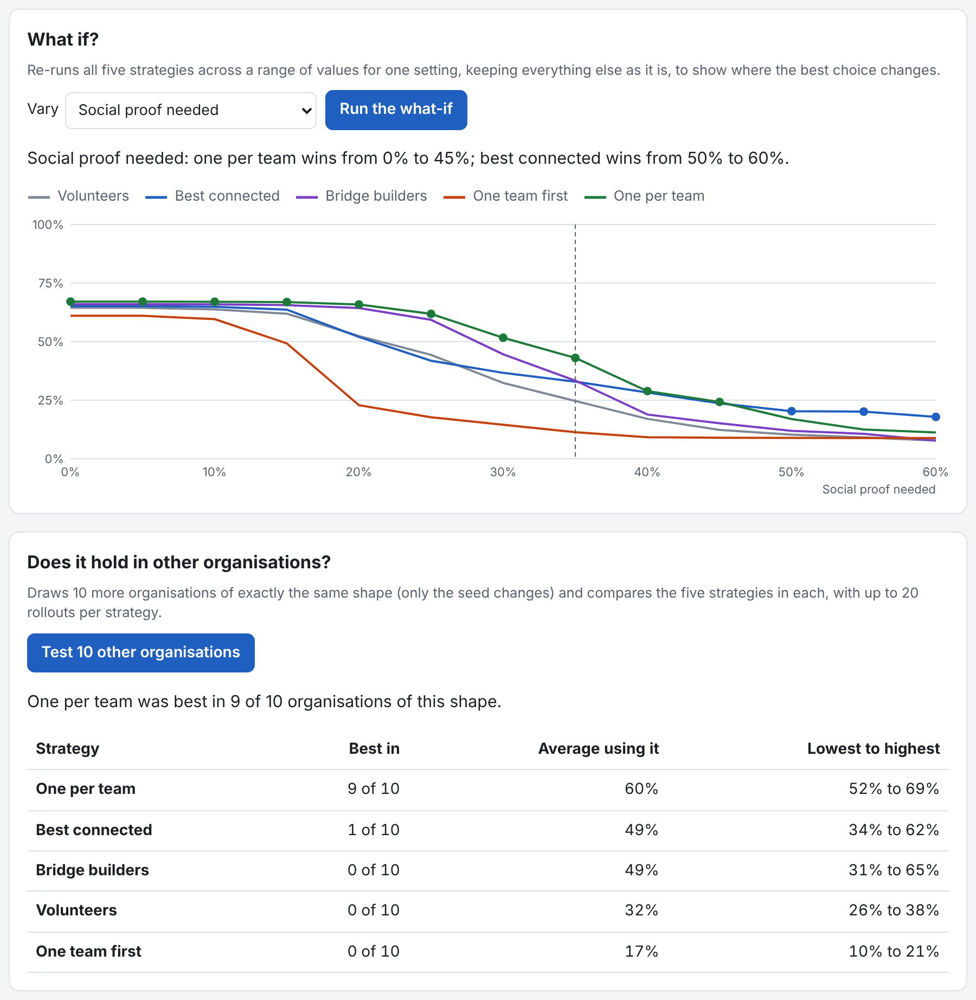

# Champion Seeding

**You have a handful of champions for a new AI tool. Where should they sit?**

Champion Seeding simulates how use of a new tool spreads, and fades, through an organisation's network of working relationships. You set up the organisation (teams, departments, who works with whom), describe the tool (how much social proof people need before they try it, how easily they drop it), and compare five ways of choosing the same number of champions. You can also pick champions yourself and see how your choice does.

It comes in two parts built on the same model:

- **The browser app** (`app/index.html`). Double-click it and it works: no installs, no internet connection, nothing sent anywhere.
- **The Python companion** (`champion_seeding/`). The same model from the command line, plus the part the browser cannot do: run it on your own anonymised network from CSV files and get named champions back. Standard library only.


## Why it matters

A common way to roll out a new AI tool is to find a few enthusiasts, give them early access and hope it spreads. Whether it does depends less on how many champions there are than on where they sit. Many workplace tools, AI assistants especially, change how a team works together. People are reluctant to adopt them until enough of the colleagues they work with closely have done so, and they quietly drop them if they are left using them alone. Network research calls this *complex contagion*: unlike news or a rumour, it needs reinforcement from several contacts, not just one.

That links to two themes in the brief:

- **Innovation management.** Diffusion of innovations inside organisations: how champions, network structure and social proof decide whether a new practice spreads.
- **Why AI stalls after the pilot.** A pilot is usually one team. The model shows why use that takes hold inside a pilot team so often fails to cross into the next one, and what a seeding plan that does cross over looks like.

## Open the app

If you do not have the files yet: on GitHub, switch to this branch, choose **Code**, then **Download ZIP**, and unzip it.

Double-click `app/index.html`, or from a terminal:

```bash
open app/index.html        # macOS
xdg-open app/index.html    # Linux
start app\index.html       # Windows
```

What you can do in it:

- **Pick a scenario**: an AI assistant that changes how a team works, a handy add-on that spreads by word of mouth, or a siloed organisation. Every setting can then be changed.
- **Compare five ways of choosing champions**:
  - *Volunteers*: in effect, people at random.
  - *Best connected*: the people with the most contacts.
  - *Bridge builders*: the people who link otherwise separate groups.
  - *One team first*: like a pilot team.
  - *One per team*: the best-connected member of each team.
- **Watch one rollout week by week** in the network, with play and pause, and see who tried it and then dropped it.
- **Pick your own champions** by clicking people in the network, or by typing their numbers, and see how your choice compares.
- **Ask "what if?"**: re-run every strategy across a range of values for social proof, number of champions, peer pull, cross-department contacts or dropping off, and see where the best choice changes.
- **Test whether it holds** in 10 other organisations of exactly the same shape.
- **Save and share**: copy a link that holds every setting, including your picks, or download the settings as a file that the Python version can read.

It works on a phone as well as a desktop, every control can be used with a keyboard, and it supports dark mode. Long checks run in small steps, so the page stays responsive even at the largest settings.




## What it shows

All figures below come from the default scenario: 180 people in 12 teams and 3 departments, 8 champions, 52 weeks, 40 simulated rollouts per strategy, organisation seed 7. Run `python -m champion_seeding compare` to see them; the browser app shows the same numbers.

| Strategy | Using it after a year | Tried it at some point | Teams where at least half use it |
|---|---|---|---|
| One per team | 43% | 49% | 5.3 of 12 |
| Bridge builders | 33% | 40% | 3.3 |
| Best connected | 33% | 38% | 4.3 |
| Volunteers | 25% | 30% | 2.6 |
| One team first | 11% | 16% | 1.0 |

Four things stand out:

1. **Where the champions sit matters more than how many there are.** With the same eight champions, the best plan ends at 43% and the worst at 11%. To do as well as *one per team* does with 8 champions, *best connected* needs 12 (`sweep --param champions`).
2. **Starting with one pilot team is the weakest plan.** Use takes hold in that team but rarely crosses into the next, because only 23% of working ties cross team lines.
3. **The best-connected people are not automatically the best champions.** When people need several colleagues on board before they try something, one well-connected champion is not enough. Here, *best connected* does no better than *bridge builders*.
4. **The answer depends on the tool.**
   - For the word-of-mouth add-on, where one colleague is enough, every plan ends between 62% and 66%. What differs is speed: about 16 weeks to reach half the organisation with *one per team*, against 33 with *one team first*.
   - The "what if?" sweep shows *one per team* winning while people need up to 45% of their contacts on board. Above that, almost nothing spreads, and *best connected* does least badly.
   - With four or fewer champions, nothing takes off.

The default organisation happens to be one of the harder ones. In 10 other organisations of the same shape (`python -m champion_seeding robustness`), *one per team* was best in 9, averaging 60% (range 52% to 69%), and *best connected* was best in 1.

## Run the Python version

Requires Python 3.9 or later. No packages to install. Run these from the project folder.

```bash
python -m champion_seeding compare                    # the five strategies on the default organisation
python -m champion_seeding compare --champions-list   # ...and who each strategy would pick
python -m champion_seeding compare --preset silos --set champions=12
python -m champion_seeding compare --picks P007,P019,P037   # add your own champions
python -m champion_seeding compare --config champion-seeding-settings.json   # settings saved from the app
python -m champion_seeding sweep --param champions    # what if there were more or fewer champions?
python -m champion_seeding robustness                 # does the ranking hold in 10 other organisations?
python -m champion_seeding compare --json             # machine-readable summary
python -m champion_seeding compare --csv curves.csv   # weekly adoption curves for every strategy
```

**Run it on your own network.** Export a list of working ties from a collaboration tool (who meets or messages whom), anonymise it, and save two CSV files: `source,target` for the ties and `id,team` for teams. Then:

```bash
python -m champion_seeding load --edges examples/edges.csv --teams examples/teams.csv --champions-list
```

The `examples/` folder holds the default synthetic organisation in that format (made with `python -m champion_seeding export-network --edges examples/edges.csv --teams examples/teams.csv`), and loading it gives exactly the same results as `compare`. Duplicate ties, self-ties and extra columns are ignored, and people with no team are grouped as "Unassigned". Without a teams file, the two team-based strategies have nothing to work with.

`sweep` re-runs everything about 50 times and takes around 20 seconds; add `--set runs=20` to halve that.

## Which language does what

| Part | Language | Lines (approx.) | What it does |
|---|---|---|---|
| `app/index.html` | HTML and CSS | 220 | Layout, styling, light and dark themes, phone layout |
| `app/index.html` (model block) | JavaScript | 630 | The organisation, the five strategies, the rollouts, the what-if sweep, the robustness test, explanations, settings links and files |
| `app/index.html` (interface) | JavaScript | 690 | Controls, the network view, charts, tables, picking champions, running heavy work in small chunks |
| `champion_seeding/model.py` | Python | 680 | A line-for-line port of the model block |
| `champion_seeding/network_io.py`, `cli.py` | Python | 350 | Loading and exporting CSV networks, the command-line tool, text, JSON and CSV output |
| `tests/` | JavaScript and Python | 880 | Model tests in Node.js, Python tests, a parity test and browser tests |

**Both versions agree exactly.** They use the same random number generator (Mulberry32) and draw random numbers in the same order. The random decisions use only basic arithmetic, not library maths functions that can differ between platforms. `tests/test_parity.py` runs the browser app's own model code in Node.js and checks that it matches Python for:

- every network
- every rollout summary
- every sweep
- every robustness test
- every explanation
- the way odd inputs are read

## How it works

1. **The organisation.** People are split evenly into teams of at least three, and teams into departments. Every pair of people is linked at random with a probability set so that, on average, each person has the number of close teammates, contacts in other teams and contacts in other departments you chose. Nobody is left without a contact.
2. **People differ.** Each person gets a personal bar for social proof (between half and one and a half times the average) and a draw that decides whether the tool suits their job. These come from their own random stream, by person number, which is why an exported network loads back identically.
3. **Champions** use the tool from week one, never drop it, and count as several users in the eyes of their contacts (*champion influence*).
4. **Each week**, a person whose job suits the tool becomes open to it once the share of their contacts using it reaches their bar. Once open, each contact using it gives them a chance to try it (*peer pull*). Anyone can also try it unprompted. Users drop it at the weekly *dropping it* rate, scaled by the share of their contacts who are not using it.
5. **Fair comparisons.** Every strategy faces the same organisation and the same weekly luck in each rollout (common random numbers), so the differences come only from where the champions sit.
6. **The strategies.**
   - *Best connected*: the most contacts.
   - *Bridge builders*: the highest betweenness centrality, worked out with Brandes' algorithm.
   - *One team first*: fills the most tightly knit team, then the next.
   - *One per team*: takes the best-connected person in each team, most tightly knit teams first, and goes round again if there are more champions than teams.
   - *Volunteers*: a fresh random pick for every rollout.

## Tests

```bash
node --test "tests/*.test.js"          # the browser app's model, run in Node.js
python -m unittest discover -s tests   # Python, parity and browser tests
```

The browser tests need Playwright for Python (`pip install -r requirements-dev.txt`, then `python -m playwright install chromium`) and are skipped if it is missing. The parity test needs Node.js and is skipped without it.

The browser tests load the app in headless Chromium and check that:

- it makes no network requests and logs no errors
- every control is labelled
- it fits a phone screen
- the network drawing never overlaps itself
- picking champions by clicking and by typing works
- links and files restore settings
- the long-running checks clear themselves when the settings change
- the page keeps responding at the largest settings

`python tools/screenshots.py` regenerates the pictures in `docs/`.

## Limitations

- **Illustrative, not calibrated.** The mechanisms come from research on the diffusion of innovations and complex contagion, but the numbers are assumptions. Use it to see how network structure and social proof interact, not to forecast a real rollout.
- **A simple organisation.** Ties are random within the averages you set. Real networks have managers, hubs and long-standing friendships, so loading a real network is the more realistic route.
- **Simple people.** Everyone follows the same rules: no training sessions, mandates, incentives or tool improvements over time.
- **Champions are perfect.** They never give up and they count the same in every relationship.
- **One organisation can mislead.** Results vary between organisations of the same shape (see the robustness test), so the ranking is more reliable than any single percentage.

## What could come next

- **Search for the best champions.** A greedy search that adds, one at a time, whichever person most improves adoption, as a benchmark for the simple rules.
- **Interventions over time.** Training waves, a manager mandate or a second round of champions part-way through, to compare against getting the first seeding right.
- **Community detection for loaded networks,** so the team-based strategies work even when no teams file is available.
