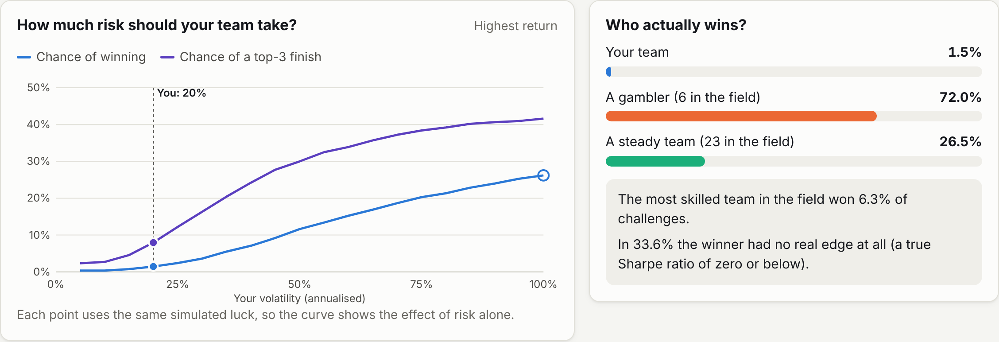
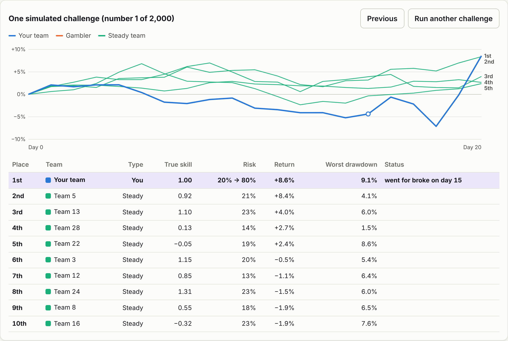
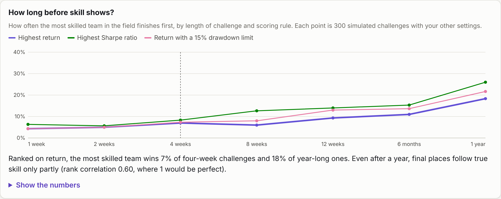

# Leaderboard luck

**Run a trading challenge thousands of times. How much of the leaderboard is skill, who usually wins, and how much risk should your team take?**

University trading challenges usually last a few weeks and rank teams on return. Over a few weeks, luck is far larger than skill, and the cheapest way up the table is to take more risk. This project puts numbers on that. It simulates the same challenge thousands of times with teams whose true skill is known, then shows your team's real chances, the level of risk that maximises them, who actually tends to win, and how long a challenge has to run, under which scoring rule, before the best team reliably comes out on top.

It is written for people who captain or coach trading-challenge teams and run society seminars: captains deciding how hard to push, coaches explaining why last term's winner may not have been the best team, and organisers choosing a format that rewards skill rather than leverage.


There are two parts:

- **The browser app** (`app/index.html`): set your team's skill and risk, the field and the rules, and see your chances, the risk that maximises them, who usually wins, any single simulated challenge place by place, and how the most skilled team fares at every length from one week to a year. One file, no installation, works offline.
- **The Python companion** (`leaderboard_luck/`): the same simulation from the command line, tested to give exactly the same numbers as the app, plus an organiser's report that compares every scoring rule at every length and writes text, CSV or a self-contained HTML page.

All data is synthetic. Nothing here uses real market prices, real teams or real challenges.

## What it shows with the default settings

The defaults describe a typical four-week (20 trading day) challenge: 30 teams ranked on highest return, rivals whose true Sharpe ratios are spread around zero (standard deviation 0.75), a fifth of rivals running three times the usual risk, and your team with a true Sharpe ratio of 1.0 at 20% volatility. That makes your team better than 91% of the field. Every figure in the next two tables comes from 2,000 simulated challenges with luck number 1, and is the same in the app and in Python.

| | Result |
|---|---|
| Chance your team wins | 1.5% (a fair share would be 3.3%) |
| Chance of a top-3 finish | 8.0% |
| Average finishing place | 13th of 30 |
| Who wins | a gambler 72.0%, a steady team 26.5%, your team 1.5% |
| The most skilled team in the field wins | 6.3% |
| The winner has no real edge at all (true Sharpe ratio of zero or below) | 33.6% |
| Your best chance of winning | 26.2%, at 100% volatility |

So a team that is better than nine in ten of its rivals wins less often than a team picked at random, and the single most useful thing it can do for its chance of winning is to multiply its risk by five. Changing the rules changes that:

| Scenario (everything else at the defaults) | Your chance of winning | What changes |
|---|---|---|
| Ranked on Sharpe ratio | 5.6% | Gamblers win 18.5% instead of 72.0%. Risk no longer matters: 5.6% at every volatility. |
| Knocked out at a 10% drawdown | 2.6% | Your team is knocked out of 4.7% of challenges. The best risk falls to 55% volatility (12.9%), even though at that risk your team is knocked out of 63% of them. |
| Your team goes for broke when behind | 8.6% | Switches to 80% volatility if outside the top 3 at day 15, which happens in 92.3% of challenges. Top-3 chance rises to 27.1%. |
| Every steady rival chases the lead | 0.7% | Every steady rival outside the top 3 at day 15 triples its risk. |
| Sixty per cent of rivals are gamblers | 0.4% | Gamblers win 94.3% of challenges. |
| Twelve weeks (60 days) | 2.4% | The most skilled team wins 9.8%. |
| A full year (250 days) | 3.4% | The most skilled team wins 19.3%, and the winner has no real edge in 8.0%. |

The organiser's view, from `python -m leaderboard_luck design` with 400 challenges for each rule and length (the app's chart uses 300 per point, so its figures differ slightly):

| Length | Ranked on return | Ranked on Sharpe ratio | Return with a 15% drawdown limit |
|---|---|---|---|
| 4 weeks | 7.0% (0.22) | 8.3% (0.23) | 7.2% (0.21) |
| 1 year | 18.5% (0.60) | 26.8% (0.64) | 21.0% (0.33) |

Each cell is how often the most skilled team wins, with the rank correlation between true skill and final place in brackets (0 is pure luck, 1 is a perfect match). Ranking on Sharpe ratio picked out the most skilled team most often at all seven lengths tested. Over four weeks, gamblers won 69% of return-ranked challenges against 17% of those ranked on Sharpe ratio. Even after a year, the best team wins only about a quarter of the time under the best rule tested.

These are results from a deliberately simple model, not forecasts for any real challenge. They are most useful as a way to start an argument: change a setting you think is unrealistic and see whether the conclusion survives.

## Open the app

Download or clone the branch and double-click `app/index.html`. It opens in any modern browser and needs no internet connection, server or installation.



- **Your team, the field and the rules** are three cards of sliders. Secondary settings sit behind "More about the field" (how much rivals' skill varies, typical rival risk, how much riskier gamblers are, market correlation, and how many rivals go for broke when behind) and "More about the markets" (fat tails).
- **Start from a scenario** loads one of nine presets, from a society league of eight to a full year of trading.
- **New luck** reruns everything with a different random seed. The same settings and luck number always give the same results.
- **Copy link to these settings** puts the settings in the page address, so you can send a scenario to your team or put it on a seminar slide.
- **How much risk should your team take?** plots your chances of winning and of a top-3 finish at 20 levels of volatility, all on the same simulated luck, so the curve shows the effect of risk alone. Click the chart to set your risk.
- **Who actually wins?** splits the wins between your team, the gamblers and the steady teams, and says how often the most skilled team wins and how often the winner had no real edge.
- **One simulated challenge** shows a single challenge place by place: the top five teams' paths, your team's path, and the top ten of the final table (plus your team, wherever it finished) with each team's true skill, risk, return and worst drawdown. Step through challenges one at a time.
- **How long before skill shows?** runs every scoring rule at seven lengths, from one week to a year, with your other settings.
- **How it works** explains the model, its limits and its sources.





It works on a phone too: the tiles stack in pairs, and the least important table columns are hidden on narrow screens.


### Ideas for a society session

- Before showing anything, ask members to guess how often a team better than 91% of the field wins a four-week challenge. Then open the app.
- Step through single challenges with "Run another challenge" and ask people to spot the most skilled team from the table without looking at the True skill column.
- Load "Ranked on Sharpe ratio" and "Knocked out at a 10% drawdown" in turn, and watch what happens to the risk curve.
- If you run an internal league, use the design report to choose its length and scoring rule before the term starts.

## Run the Python companion

Python 3.9 or later, standard library only. From the top folder of the branch:

```bash
python -m leaderboard_luck simulate                       # your chances with the default settings
python -m leaderboard_luck simulate --rule sharpe         # the same, ranked on Sharpe ratio
python -m leaderboard_luck simulate --catch-up --json     # going for broke, as JSON
python -m leaderboard_luck sample --index 0 --top 0       # one simulated challenge, every team
python -m leaderboard_luck design                         # every rule at every length, as text
python -m leaderboard_luck design --html report.html --csv report.csv
```

Every setting in the app is a flag: `--teams`, `--days`, `--skill-spread`, `--field-vol`, `--gamblers`, `--gambler-multiple`, `--correlation`, `--fat-tails`, `--rule {return,sharpe,drawdown}`, `--drawdown-limit`, `--your-sharpe`, `--your-vol`, `--catch-up`, `--catch-up-vol`, `--checkpoint`, `--rivals-catch-up`, `--sims` and `--seed`. Fractions are written as fractions, so `--your-vol 0.4` means 40% volatility. A value outside a slider's range is pulled back to the nearest allowed value, with a note saying so. `python -m leaderboard_luck <command> --help` lists every flag with its range and default.

`sample` shows the top ten and your team (`--top` to change; `--top 0` shows every team). `design` runs every scoring rule at every length, so it takes no `--rule`, `--days` or `--sims`: that is 21 rule-and-length combinations (400 challenges each by default, `--sims-each` to change) across all your processor cores (`--workers` to change). The results are identical whatever the number of workers. An example report, made with the default settings, is in [`examples/design-report.html`](examples/design-report.html).

## Tests

```bash
python -m unittest discover -s tests -t .
node --test tests/app_model.test.js
```

The Python suite needs nothing beyond the standard library. Some tests are skipped if their tools are missing: the agreement tests and the JavaScript test runner need Node.js 18 or later, and the browser tests need Python Playwright with Chromium (`pip install playwright` then `playwright install chromium`).

| Test file | What it checks |
|---|---|
| `tests/test_model.py` | The Python model: the random number generator, scoring rules, busts, drawdown knockouts, going for broke, tied skill, rank correlation, skill by length (and that the number of workers does not change it), sample challenges, and the design report's wording |
| `tests/test_cli.py` | The commands, their text and JSON output, the design report's CSV and HTML, which settings each command takes, notes on out-of-range values, error handling and rounding |
| `tests/test_agreement.py` | The app's model and the Python model give exactly the same numbers on 8 settings, including extreme ones, for simulations, sample challenges, skill by length and seeds |
| `tests/app_model.test.js` | The app's model on its own in Node: determinism, chunked runs, scoring rules, busts, going for broke, settings limits, rank correlation, skill by length, and consistency between the summary and single challenges |
| `tests/test_js.py` | Runs the Node tests from the Python suite |
| `tests/test_app.py` | The app in headless Chromium: it opens with the right answer and no errors or network requests, the rule control, keyboard sliders, presets, new luck, stepping through challenges, the risk-chart click, the skill card, shareable links, wording that follows the numbers, the dark theme and phone width |

## Which language does what

| Part | Language | Lines | What it does |
|---|---|---|---|
| `app/index.html`, layout and styles | HTML and CSS | 338 | Page structure, light and dark themes, phone layout |
| `app/index.html`, model | JavaScript | 636 | The simulation, between `/* MODEL START */` and `/* MODEL END */`, also loadable in Node |
| `app/index.html`, interface | JavaScript | 773 | Sliders, presets, charts in SVG, chunked runs that keep the page responsive, shareable links |
| `leaderboard_luck/` | Python | 1,042 | A line-for-line port of the model, the command line, text and JSON reports, and the organiser's design report |
| `tests/*.py` | Python | 547 | Model, command line, cross-language agreement and browser tests |
| `tests/*.js` | JavaScript | 210 | Node tests of the app's model, and the harness the agreement tests use |

The browser app is the main product; Python is the companion for batch runs, scripting and the organiser's report.

## How it works

**A challenge.** There are N teams, including yours, and a fixed number of trading days. Each team has a true skill, measured as the annualised Sharpe ratio its strategy would earn over a very long run, and a level of risk, measured as annualised volatility. On each day a team's return is

> skill × volatility ÷ 252 + (volatility ÷ √252) × z

where z is a standard random shock. Part of z is shared by every team (the market) and the rest is the team's own: z = √ρ × market + √(1 − ρ) × own, with ρ the market correlation. With fat tails switched on, each shock has a 5% chance of being three times its usual size, scaled so that the overall variance is unchanged. Returns compound, so a team's account can fall to zero, and a team that loses everything is out.

**The field.** Rivals' true Sharpe ratios are drawn from a normal distribution centred on zero, because most student strategies have no lasting edge. Their volatility is spread around the typical level. A share of rivals are gamblers: they run several times the typical risk but are no more skilled than anyone else.

**Scoring.** Teams are ranked on total return, on realised Sharpe ratio (the mean of daily returns divided by their standard deviation, annualised), or on return with a drawdown limit, where any team whose worst fall from a peak exceeds the limit is knocked out. Knocked-out teams share the places at the bottom.

**Going for broke.** At a checkpoint (by default three-quarters of the way through), a team outside the top 3 can switch to a much higher level of risk for the rest of the challenge. Your team can do this, and so can a chosen share of steady rivals. This mirrors what Brown, Harlow and Starks (1996) and Chevalier and Ellison (1997) found among mutual fund managers: funds that were behind part-way through the year tended to raise their risk for the rest of it.

**Same luck, different risk.** To draw the risk curve, your team is run at 20 levels of volatility from 5% to 100% inside each simulated challenge, against the same rivals on the same luck. This is known as common random numbers, and it means the curve's shape comes from the risk alone rather than from noise. Rivals decide whether to go for broke by comparing themselves with one another, so their behaviour is the same at every level of your risk.

**Reproducible.** Every challenge has its own seed, worked out from the luck number and the challenge's number, and both languages use the same small random number generator (mulberry32) and the same method for normal draws (Marsaglia's polar method). That is why the app and Python agree to the last decimal place, and why a shared link shows exactly the same results to everyone. Rounding in the Python reports matches the browser's.

**Who is most skilled.** The most skilled team is whichever has the highest true Sharpe ratio, your team included, and ties count as wins for any team sharing the top skill. "No real edge" means a true Sharpe ratio of zero or below. Rank correlation is the correlation between true skill and final place, using average ranks for ties.

## Limitations

- **Skill is a fixed number.** Each team has one true Sharpe ratio for the whole challenge. Real teams learn, change strategy, and do not know their own edge.
- **Markets are simple.** Returns are normal, or normal with occasional jumps, with constant volatility and one shared market factor. There are no trends, volatility regimes, crowded trades or correlations between particular teams.
- **Risk is free.** There are no transaction costs, position limits, margin calls or leverage caps beyond the drawdown rule and going bust. Real challenges often cap leverage, which would shrink the gamblers' advantage.
- **One way to go for broke.** Teams switch once, at one checkpoint, if they are outside the top 3. Real teams adjust gradually and react to what they see on the leaderboard.
- **Daily resolution.** Drawdowns and busts are checked at the close of each day, so intraday moves are ignored.
- **Sampling error.** Figures come from a finite number of simulated challenges. With 2,000 challenges, a 1.5% chance has a standard error of about 0.3 percentage points; the skill-by-length chart uses 300 challenges per point in the app and 400 in the design report, so neighbouring points can wobble by a percentage point or two.
- **Real challenges differ.** Formats, scoring formulas and fields vary widely. The model shows how luck, risk and rules interact in general; it is not calibrated to any particular competition.

## Next steps

- **Real leaderboard data.** Upload a past challenge's final table and estimate how much of the spread in returns is consistent with luck alone.
- **More scoring formats.** Sortino ratio, return over maximum drawdown, and judged components such as a written pitch.
- **Adaptive strategies.** Let teams adjust risk every day based on their place, and search for the best rule for your team given what rivals do.
- **Leverage caps and costs.** Add a maximum gross exposure and a cost per trade, and see how much of the gamblers' edge survives.
- **Team-level skill uncertainty.** Let a team see only a noisy estimate of its own skill from past results, and work out when it should switch strategy.
